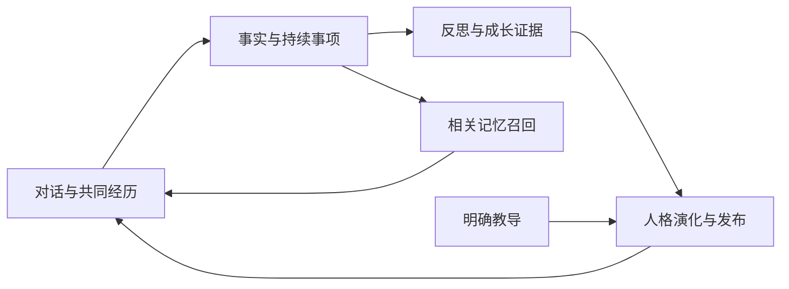

<p align="center">
  
</p>

<h1 align="center">铃芽 RIN</h1>

<p align="center"><strong>可编辑人设、持续养成、长期记忆的人格陪伴系统。</strong></p>
<p align="center"><em>风起时铃响，记忆落土发芽。</em></p>

铃，是唤醒与回应；芽，是人格的萌芽与成长。

RIN 希望让 AI 的陪伴有延续：记得你说过的话，接得住共同经历；你认真教过的相处方式，下一次能用上；相处中形成的认识，也能在真实互动的支持下慢慢成长。

| RIN | 含义 | 在系统里做什么 |
|---|---|---|
| **R · Recall** | 记忆召回 | 把与当前话题有关的事实、经历与未完事项带回对话 |
| **I · Identity** | 人格身份 | 编辑、冻结、发布和回滚人设，让角色保持自己的身份与表达 |
| **N · Nurture** | 养成培育 | 从明确教导与共同经历中学习，让变化有依据、可追溯、可撤销 |

核心仓库：**rin-memory** · 配套接入：[dsh-rin-memory](https://github.com/lxl8182/dsh-rin-memory) · Python 3.11+ · Apache-2.0

## 让陪伴留下什么

### 教过的，下次能改

“以后别每次都总结，像平时聊天那样说就好。”

明确的长期教导可以在单轮对话后形成持久表达规则，发布后供下一轮采用。规则保留原话来源，支持撤销；临时要求和随口评价与长期教导分别处理。学习另一个角色的表达方式时，记录的是表达机制，角色身份仍由自己的人格卡定义。

### 经历过的，能接着聊

“我明天去面试，有点紧张。”到“拿到 offer 啦”，是一件事的开始、进展与结束。

RIN 保存原始对话，提取有来源的事实，维护持续事项与经历关联。后续再聊起它时，可以召回相关背景；事情结束后也会结案，让过去的关心跟得上现在的进展。

### 相处久了，变化有来处

事实、反思、成长证据与人格修订各有自己的记录。自动演化需要独立经历和真实交互依据；角色反复自述、时间流逝和用户沉默都不会增加支持。稳定的身份段可以冻结，允许成长的部分则逐步修订，并保留版本历史。

### 惦记的事，适时来问

主动交流来自未完事项、明确约定的回访、共同经历产生的认识和已积累的兴趣。宿主领取候选后结合当前人格生成正文，发送前再次检查来源、事项状态和用户是否已经插话。

默认普通主动消息每天最多 2 次，间隔至少 90 分钟，北京时间 00:00–09:00 静默；普通事项通常等待 12 小时再考虑跟进。明确约定的提醒按约定时间处理。只有平台接受的输出片段才进入近期对话，未发出的内容保留独立发送状态。

### 记忆，也能由你照料

**铃芽 RIN · 记忆管理台**把事实、经历、状态、人设和成长放在同一处。你可以查看来源、编辑人设、更正或删除记忆、发布与回滚版本，检查消费与发送回执。更正和删除会沿着派生关系及接入方清理通知继续传播。

## 一条完整的成长链路



人格与长期记忆由独立服务持有。N.E.K.O、DSH 和 QQ 等接入方负责各自的对话与表现：文字、语音、表情、Live2D 或消息传输。多个入口可以使用同一份已发布人格与记忆，同时按主体和场景划定使用范围。

## 从哪里开始

| 想做什么 | 入口 |
|---|---|
| 先管理人设与记忆 | 启动本仓库的服务和水彩管理台 |
| 在 DSH / QQ 里相处 | 安装 [dsh-rin-memory](https://github.com/lxl8182/dsh-rin-memory)，QQ 通道配合 [dsh-qq-bridge](https://github.com/lxl8182/dsh-qq-bridge) |
| 接入自己的宿主 | 使用 HTTP 接口提交真实轮次、读取上下文和报告回执 |
| 理解养成设计 | 阅读 [记忆与人格养成设计](docs/companion-growth-design.md) |

### 构建与启动

需要 Python 3.11+ 和 uv 构建工具。当前发行包为 `rin-memory 0.1.0.dev10`，核心运行依赖为零。

```bash
git clone https://github.com/lxl8182/rin-memory.git
cd rin-memory
uv build
python -m venv .venv
```

激活虚拟环境：Windows PowerShell 使用 `.\.venv\Scripts\Activate.ps1`；Linux / macOS 使用 `source .venv/bin/activate`。随后安装并初始化：

```bash
pip install dist/rin_memory-0.1.0.dev8-py3-none-any.whl
rin-stack init --config ./runtime/config/stack.toml
```

按生成的 `stack.toml` 填写模型接口、模型名及密钥环境变量，再启动：

```bash
rin-stack start --config ./runtime/config/stack.toml
rin-stack status --config ./runtime/config/stack.toml
rin-stack stop --config ./runtime/config/stack.toml
```

默认管理台为 <http://127.0.0.1:48931>。空库可在页面创建角色、填写初始人设并首次发布；“铃芽”是系统品牌，角色的名字与性格由你的人格卡决定。服务支持本机运行，也可以常驻服务器并通过受控连接接入。

### 接入合同

常用接口包括 `/v1/context`（人格与记忆上下文）、`/v1/turns`（完整轮次提交）、`/v1/persona/teach`（明确教导）、`/v1/outputs`（助手输出与投递回执）和 `/v1/proactive/*`（主动候选消费）。接口按身份、主体和能力授权，详细约定见 [管理台与客户端合同](docs/webui-console.md)。

### 命名与升级

仓库目录为 `rin-memory`，Python 发行包为 `rin-memory`，导入路径为 `rin_memory`；DSH 接入目录为 `dsh-rin-memory`。命令统一为 `rin-memory`、`rin-memory-run`、`rin-stack`。

升级时安装新的 wheel，并同步更新启动脚本、Python 导入及配置中的解释器路径和 `runtime.package_version`。已有数据与 HTTP 合同继续使用。

当前部署采用固定 Git 提交与手动发布；推送到 GitHub 后，服务器不会自动拉取或重启。部署时需要同步提交、安装对应版本并检查服务状态。

## 项目与文档

| 内容 | 位置 |
|---|---|
| 领域核心与存储 | `src/rin_memory/domain/`、`persistence/` |
| 独立服务与接口 | `src/rin_memory/service/` |
| 水彩管理台 | `webui/designs/tidebell/` |
| DSH 接入端 | [dsh-rin-memory](https://github.com/lxl8182/dsh-rin-memory) |
| 设计与养成链路 | [companion-growth-design.md](docs/companion-growth-design.md) |
| 开发与部署状态 | [roadmap.md](docs/roadmap.md) |
| 服务与管理台使用 | [webui-console.md](docs/webui-console.md) |
| 开发接手 | [AGENTS.md](AGENTS.md) |

## 许可

[Apache-2.0](LICENSE)。项目保留迁入实现的版权头、适用 NOTICE 和修改说明。
