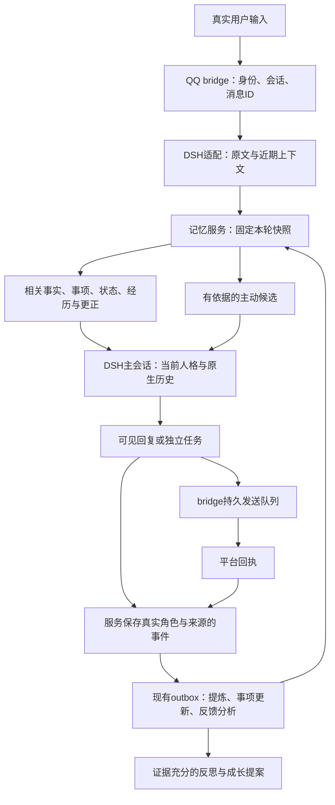

# 记忆与陪伴连续性改造方案

日期：2026-10-27。适用范围：独立 companion-memory 核心、DSH 记忆插件、QQ bridge，以及消费同一核心的 N.E.K.O 文字端。

本文定义待开发方案。批次状态统一维护在 [roadmap.md](roadmap.md) 的 MC 专项，不在本文维护第二份完成台账。现有实现以本机工作树为开发起点，所有编码、修复、测试和构建都在本机完成；服务器承担安装、运行和真实渠道验收。

## 1. 目标与推荐路线

目标是让同一个角色在长期相处中做到：

1. 用户换一种说法、只提半句话，也能联系到相关记忆。
2. 隔天、换会话或切换聊天端后，接得上仍在进行的事情。
3. 记得共同经历的过程、结果，以及自己确实做过的帮助和约定。
4. 根据用户当下明确表达的感受调整回应方式，并在事情结束后更新状态。
5. 在合适的时候跟进有依据的话题，收到反馈后改变相处方式。
6. 保持身份与长期性格稳定，依据多次真实经历缓慢形成新的相处习惯。

推荐顺序：**准确召回与时间 → 完整经历与跨会话续接 → 状态、反馈和表达 → 主动交流 → 受控成长**。发布准备在开始前补齐，之后每批均走本机验收、版本构建、服务器安装。

当前不引入第二套记忆后端、独立常驻调度服务、通用知识图谱或向量数据库。现有文件存储、SQLite 原文索引、journal/outbox、状态存储、人格发布和 DSH 原生会话继续复用。语义检索通过已有 EmbeddingProvider 端口接入，具体运行后端作为 MC02 的显式配置条件。

## 2. 已核对的现状

### 2.1 代码与运行位置

| 部分 | 本机开发位置 | 服务器当前运行位置 | 交付形式 |
|---|---|---|---|
| 记忆核心、HTTP、管理台 | `F:\game\projectNEKO\companion-memory` | `/opt/companion-memory/venv` 下的安装包 | wheel |
| DSH 记忆与咒语接入 | `F:\game\projectNEKO\dsh-companion-memory` | DSH web profile 的 `@local/dsh-companion-memory` | npm tgz，经 DSH 插件流程安装 |
| QQ 收发与发送队列 | `E:\dsh\plugins\dsh-qq-bridge` | DSH web profile 的 `@yachangchang/dsh-qq-bridge` | 构建后的 npm tgz，经 DSH 插件流程安装 |
| N.E.K.O 消费适配 | `F:\game\projectNEKO\N.E.K.O` | 本机新 stack 的宿主 | 按宿主现有部署流程 |
| 服务器运行数据 | 本机测试使用自己的运行根 | `/srv/companion-runtime`、`/root/.dsh`、`/srv/snowluma` | 留在各自机器，独立于源码发布 |

### 2.2 2026-10-27 审查结果

- 核心有来源、主体与场景隔离、删除/更正屏障、整轮提交、持久补交、回执及人格版本。
- 线上审查快照为 10 轮已保存对话、2 条事实，无向量，无已生成的反思或 companion_state；人格演化模式为 `off`。
- 自动召回采用 `build_turn_context`。临时数据复现：记忆为“用户喝咖啡会胃疼”时，输入“咖啡”自动召回为空，显式查询命中；输入“想点杯拿铁”两条召回路径均为空。
- QQ 调用 `/v1/context` 时未提供前两轮对话；服务只使用请求里的 `recent_turns` 做查询扩展。
- `ServiceProtocol.recent` 按当前 `session_id` 筛选。临时数据复现：原会话返回 1 条，换会话返回 0 条。
- 核心召回的 `companion_state` 当前返回空状态；DSH `renderIncrement` 只处理更正、召回正文和近期对话，未处理成长、状态及 episode 背景。
- 自发轮次 QQ 发送已修复，具备分段持久化、去重和失败分段重试；该路径未发布用户整轮报告，也未把后续助手正文提交给记忆服务。
- 相对时间按抽取时钟解析。临时数据复现：27 日发“明天面试”，28 日处理队列，事件时间得到 29 日。
- 反思默认收集至少 5 条未吸收事实，按重要度截取一批后生成一条认识；提示要求没有稳定认识时也给保守结论。
- S06 已有召回样本、检查工具和基线。MC02 复用它们推进 S07，不重建另一套基线。

### 2.3 必须保留的行为

- 核心是唯一写入方，各端通过服务访问；既有根锁、版本、幂等和清理流程继续生效。
- 人格卡及其发布/审核历史只能走服务编辑、发布、回滚和演化流程，禁止清空或重建。
- QQ 主会话保留当前的人格与咒语组织方式，工作任务仍进入独立执行会话。
- 系统提示与已提交历史保持稳定；动态背景追加在当前轮，不反复改写旧历史。
- 显式 game/run 范围继续隔离；共同经历按当前 shared 约定处理，同时保留游戏、局次与来源。
- 不把助手台词、工具结果、主动发言或发送成功作为用户偏好证据。
- 明确遗忘继续清理派生记录、客户端副本、队列和恢复路径。

## 3. 源码管理与服务器同步

### 3.1 结论

**使用 Git 管理源码与验收版本；从指定提交构建 wheel/tgz，再经 SSH 传输、校验并安装。**

Git 负责说明代码来自哪个版本、包含哪些修改、如何回到上一个版本；构建包负责安装。SSH/SFTP 继续作为传输方式。正常发布不覆盖服务器 `site-packages` 或 profile 中的单个源码文件。

| 方式 | 适用情况 | 本项目决定 |
|---|---|---|
| 手工传若干源码文件覆盖安装目录 | 一次性定位或紧急恢复，需登记文件与哈希并回到本机修复 | 保留为应急路径 |
| 服务器直接更新分支并原地运行 | 版本易追踪，但构建环境和运行目录混在一起 | 不作为日常启动方式 |
| Git 固定提交、本机构建版本包、服务器安装 | 能核对来源、重现构建、整体发布与回退 | 日常采用 |

### 3.2 Git 基线与发布准备

2026-10-27 更新：三个开发目录均已有自己的 Git 仓库与远端。后续先核对现有基线和包白名单，再完善版本发布闭环。

- `companion-memory` 首次提交为 `9725445`，`origin` 为 `lxl8182/companion-memory`。
- `dsh-companion-memory` 已有独立仓库，`origin` 为 `lxl8182/dsh-companion-memory`。
- QQ bridge 的 `origin` 为 `lxl8182/dsh-qq-bridge`，原作者 `TomoyoNatsume/dsh-qq-bridge` 保留为 `upstream`。
- 核心源码及水彩资源目录存在 `.bak-uiopt` 文件。发布白名单需要排除备份，现有文件保留供本机核对。

MC00 需要完成：

1. 审核核心和适配插件的提交白名单，基于现有源码提交形成可发布基线；bridge 将已有有效修改与本批后续修改分清。
2. 代码、测试、项目文档、构建配置和必要锁文件进入版本管理。
3. 运行根、人格与对话数据、凭据、真实会话抓包、日志、`.venv`、`node_modules`、构建缓存和临时备份排除。已跟踪文件另外核对，不能只依赖 `.gitignore`。
4. 保持三个现有开发目录，各自独立仓库，不为了统一发布搬动目录。
5. 远端优先使用用户自己的私有仓库或私有 fork；bridge 原作者仓库仅作上游来源，不向其推送本地定制。
6. 没有私有托管时，先使用本地 Git 与 `git bundle` 经现有 SSH 通道传输历史。创建私有托管不作为修复功能的前置。

MC00 继续核对包白名单、明确版本与发布清单、构建和安装路线；仓库地址使用现有远端。源码提交与包发布分别验收。

### 3.3 发布清单

每次发布生成一个清单，至少包含：

```json
{
  "release_id": "20261027-continuity-01",
  "sources": {
    "companion-memory": "<完整提交SHA>",
    "dsh-companion-memory": "<完整提交SHA>",
    "dsh-qq-bridge": "<完整提交SHA>"
  },
  "dirty": false,
  "artifacts": [
    {"file": "<核心wheel>", "version": "<实际版本>", "sha256": "<文件哈希>"},
    {"file": "<适配插件tgz>", "version": "<实际版本>", "sha256": "<文件哈希>"},
    {"file": "<bridge插件tgz>", "version": "<实际版本>", "sha256": "<文件哈希>"}
  ],
  "contracts": {"context": 2, "outputs": 1},
  "checks": ["<实际通过的检查与结果>"]
}
```

这是目标格式示例；接口版本在 MC01/MC04 定稿。仅变更某个包时只构建、安装该包，清单仍记录其它运行组件的实际版本。发生代码变化的包使用新版本号，不反复用同一版本覆盖不同内容。

### 3.4 本机构建与安装路线

1. 从审核通过的提交导出干净源码，执行相关测试，再构建。构建必须包含已提交的 WebUI 资源。
2. 核心使用 `uv build --wheel`；bridge 使用其 `npm run build` 与 `npm pack`；DSH 适配插件使用语法检查、相关测试与 `npm pack`。
3. 包内核对源码、资源和元数据，排除备份文件；在本机独立安装环境验证导入、启动和新接口。
4. 上传包和发布清单，服务器校验 SHA-256，再进行安装。
5. Python 安装精确 wheel，依赖无变化时沿用当前环境。插件使用 DSH 提供的安装命令/插件管理流程，不直接改 profile 清单或复制工作树。
6. 当前核心是纯 Python，仍需检查 Windows Python 3.11 与服务器 Python 3.12 的兼容性。将来引入本地向量运行库时，Linux 原生依赖使用对应平台包，不复制 Windows 环境目录。

### 3.5 服务切换与回退

发布前检查活动轮次和待发送分段。准备阶段保持线上运行；真正安装时按受影响组件排空、停止、安装和启动。核心与适配合同一起变化时，先停止 DSH 消费，再停止记忆服务，更新后先恢复记忆服务，再恢复 DSH。

只改插件时不重启记忆服务；普通记忆/插件发布不重启 SnowLuma 容器。QQ 登录态与这些包的发布分开处理，避免无关的扫码中断。

安装后检查实际包版本、关键文件哈希、新接口、记忆健康状态、插件订阅和 OneBot 连接；真实 QQ 收发按本次验收场景核对。健康检查与包哈希分别记录，真实发送结果用平台回执记录。

保留上一份通过验收的包及清单。回退时重装上一组兼容包，保持运行数据与人格历史；新增字段须可被前一兼容版本忽略或由明确版本检查拒绝。不通过恢复旧数据目录回退代码。涉及不兼容数据变更时，在该批中提供格式检测和转换步骤，不把旧数据迁移扩大为本项目的前置工程。

## 4. 目标数据流与职责



| 层 | 负责 | 数据权威 |
|---|---|---|
| QQ bridge | 验证来源、按真实轮次发送、分段回执、去重与恢复 | QQ 发送事实 |
| DSH 适配 | 原生消息与轮次关联、上下文注入、独立执行、提交与补交 | DSH 已提交日志及客户端队列 |
| 记忆服务 | 原文、事实、事项、状态、经历、反馈、召回与删除规则 | 唯一记忆写入方 |
| 模型 | 基于固定快照生成回应、提出有来源的候选认识 | 生成结果，等待程序校验与真实反馈 |
| 管理台 | 查看来源、纠错、关闭事项、遗忘及审核人格提案 | 调用同一服务 |

## 5. 保存完整经历与稳定时间

### 5.1 时间合同

区分四个时间：`occurred_at` 为原始行为发生时间，`received_at` 为服务收到时间，`processed_at` 为后台处理时间，`event_start_at/event_end_at` 为内容里所描述的事件时间。

- 相对时间依据原始 `occurred_at` 和用户时区解析。跨日、重试和重启不改变这个锚点。
- 抽取提示为各条原话提供各自的发生时间和时区，并说明相对时间的基准。模型只输出相对结构或明确日期，服务负责解析与格式检查；一个窗口中不同日期的原话分别计算。
- 用户没说时间时省略 `event_when`。创建时间不自动充当事件发生时间。
- 相对时间缺少有效锚点时保留原文与未解析标记，不使用处理时钟补造日期。
- 独立事件时间继续保留时区，展示按使用端时区转换。

### 5.2 自发回复的保存合同

当前 `/v1/events` 把事件文本交给 `human` 消息形状保存，不能直接拿它提交助手后续正文。普通 `/v1/turns` 已提交结果保持不可变，不通过重写原请求来塞入第二次回复。

**拟新增 `POST /v1/outputs`，接口目前尚不存在。** 它保存助手后续输出，复用 journal、原文索引、outbox 和回执机制。普通用户整轮继续使用已有入口。

请求的最小内容：

| 字段 | 含义 |
|---|---|
| `output_id` | DSH 会话 ID 与轮次形成的稳定标识；重试不变 |
| `parent_request_id` | 已登记的原用户轮次；独立主动轮次改用已签发的候选 ID |
| `subject/scene/session_id` | 与已验证身份绑定的范围 |
| `origin` | `spell_feedback`、`task_result` 或 `proactive`，严格枚举 |
| `occurred_at` | 原始助手轮次完成时间 |
| `context_receipt_id/persona_version` | 该次生成实际使用的依据；从对应生成记录读取 |
| `visible_text` | 剥离咒语和控制标签后的最终可见正文 |
| `source_refs` | 原任务、真实结果和父轮次的来源引用 |

服务校验父轮次或主动候选归属，服务器根据鉴权身份确定 `client_id`。客户端传入其它主体、其它客户的父 ID 或已删除来源时拒绝提交。写入为助手角色、`content_class=companion_output`，只记录真实可见正文。

输出使用独立记录，最小字段为输出 ID、范围、父引用、正文、来源、生成依据、发生时间及 `committed/interrupted/deleted` 状态。可新增 `persistence/outputs.py` 与对应领域服务，登记 `core.output_committed` 回放处理器；这些是本核心拥有的事件，不向 DSH 会话追加未知事件类型。原文索引与 recent 采用 `ai` 形状并保留 output/source 元数据。

现有 `/v1/receipts` 的查询只支持用户轮次，MC01 需要补齐输出目标的解析。拟增加 `record_kind=turn|output`，缺省 `turn` 保持旧接口；输出回执按稳定 output ID 解析范围与记录，查询、删除和重放均使用同一目标类型。不得伪造一个空用户轮次来通过回执校验。

生成完成先持久登记输出，再发送并追加平台回执。首次输出保存失败时保留原文与稳定 ID 自动补交；不重新运行模型或工具。平台部分失败只补失败分段，`unknown` 保留待核对。服务有生成记录与发送记录后，默认续聊背景采用已被平台接收的正文；未发送的内容不写成“已经对用户说过”。

任务结果另有明确来源：执行成功是实际结果，助手宣布成功是表达，两者分别保存；失败或取消保留真实状态。工作日志、命令全文、敏感工具输出不自动复制成共享记忆，只保留必要摘要及来源引用。

### 5.3 反馈轮人格与记忆

反馈轮使用当前会话已采用的人格；用户触发的新轮次按既有下一轮换版规则采用新发布人格。每个后续输出独立登记生成依据，保留其父引用；长任务完成时重新取得并预留该输出的上下文，避免依赖原轮次 300 秒后过期的凭据。预留 ID 与 output ID 稳定关联，读取和提交继续复查删除/更正版本。

需要补充背景时使用来源标记，避免重新提交原用户输入。`spell-runner` 从触发助手消息开始传递父轮次、任务 ID 和反馈消息 ID，使多个并发任务的反馈各自归属。扩展 `latestUserInput` 的来源区分，使主动、任务、记忆材料均不回退成旧用户发言。

## 6. 召回与上下文组装

### 6.1 近期上下文与跨会话背景分开提供

`/v1/context` 在服务侧读取当前会话的最近有效轮次，供查询展开使用。DSH 可补充服务尚未收到的最新一至两轮已提交原文，必须保留来源 ID 和真实角色；去重后按时间合并，最多使用两轮展开查询，不接受外部文本指定其它主体或绕过删除屏障。

服务返回的历史分为：

- `recent_turns`：当前会话已有的有效历史，延续现有语义。
- `continuity_turns`：与当前问题相关、当前会话尚未拥有的共享片段，初始最多两轮。
- `threads`：相关未结束事项，初始最多两条。
- `episode`：本次指代或命中事项需要的经历背景。

跨会话选择按 character、subject、适用范围与来源权限过滤。`session_id` 是来源定位，不用于把 shared 信息永久锁在原会话；显式 session/run 范围仍限原场景。网页端与 QQ 端共享同一主体时，按上述规则使用可共享内容。

### 6.2 MC02-A：先修无向量路径

- 复用 `build_recall_query`，让“后来”“上次那个”使用近期话题或唯一可辨识的未结束事项。
- 调整短词和短句的无向量门槛，使用命中词、实体辨识度、候选竞争关系与原文支持判断，不单凭查询长度拒绝。
- 有多个可能指代对象时，不强选第一个；返回候选歧义信息，由模型结合当前原生历史自然询问。
- 查询“咖啡”能找到对应事实，同时让“咖啡色外套”等无关语境被排除。
- 不把全部旧记忆默认注入。普通事实初始保留最多两条，按新增失败样本再调整预算。
- 检查注入后的实际行为；显式查询命中而聊天自动召回为空的差异需要有原因和样例。

### 6.3 MC02-B：语义检索接入

正式方案使用现有 EmbeddingProvider、余弦与 RRF 路径，补齐模型配置、批量生成、缓存和服务装配。无需向量数据库，初期在当前数据规模上用现有候选集计算。

1. 先确认本机与服务器都能使用同一向量模型，记录模型 ID、维度、正文指纹和生成版本。
2. 优先复用用户已有可用端点；若需要付费服务、新账号或本地模型运行依赖，明确列出费用/内存/安装影响，再确定后端。
3. 事实、反思、经历摘要在后台生成向量；向量缓存按正文指纹失效。更正或删除立即使旧向量不可用。
4. 查询向量受已有召回期限约束，失败时返回词法结果并标明实际 `retrieval_mode`，不阻断聊天。
5. 模型 ID 或维度变化时不混用向量，按当前来源重新生成。
6. 语义候选仍需经过主体、场景、有效期、更正/删除和话题相关性过滤。

MC02-A 可独立发布。MC02-B 以可用向量配置为执行条件；该条件未具备时，同义表达样例继续作为待解决项展示，不改成跳过或降低期望。不为“拿铁”等单个样例维护硬编码同义词表，也不默认给每轮聊天增加一次 LLM 查询改写。

### 6.4 注入与缓存

保持当前稳定人格与咒语系统段、原生历史顺序和空工具主会话约定。动态材料以带来源的增量背景追加，不每轮改写 system 或过去的消息。

新增状态、事项、经历、更正和成长各有稳定 ID 与内容版本。注入去重按“有效历史中已存在该版本”判断；压缩、裁剪和会话换代后可重新注入。相同记忆在当前问题中仍重要但距离很远时，可在预算内给短引用；不把“曾经注入过”当成永久不再提醒。

一个统一背景预算覆盖所有部分，更正约束优先，其次是当前事项和状态、直接相关事实、必要经历、可用成长。初始沿用核心 2204 token 召回量级，普通轮次以更短为目标；按样本和延迟测量调整，不将各块预算分别用满再相加。

## 7. 事项、经历与短期状态

### 7.1 事项复用现有状态存储

首版用 `companion_state` 的 concerns/progress 承载事项，避免建立重复的待办系统。扩展其字段白名单与版本处理，保留现有 CAS、租约、幂等和 journal 写入路径。

| 字段 | 用途 |
|---|---|
| `id/episode_id` | 事项及其经历的稳定关联 |
| `text/why/next_step` | 发生什么、为何在意、当前下一步 |
| `status` | `open/waiting/completed/cancelled` |
| `source_event_keys` | 用户原话、真实结果和反馈来源 |
| `last_user_at/updated_at` | 最新有效进展时间 |
| `followup_after` | 有依据的最早跟进时间，可空 |
| `mention_policy` | `allowed/passive_only/blocked` |

一个事项可以跨会话，场景适用性沿用现有 scope。只有明确进展、可验证结果或用户反馈才改变状态；经过时间或用户沉默不自动标记完成。

“不聊这个了”停止当前延伸并转为仅被动使用；“不要再提”阻止主动提及；“忘掉”进入真实删除。用户主动重新谈起时，依据其表达更新事项，不因关键词出现就自动解除明确禁提。

### 7.2 经历保留过程与来源

`episode_id` 关联已有事件、原文与输出。首版按来源聚合必要摘要，不另存多份对话正文。经历包含起因、重要进展、结果、用户表达的感受、角色确实做过的回应，以及仍未解决的问题。

同一次经历提炼出多条事实，也只算一个独立支持来源。镜像、重试、发送重投和模型复述不增加支持。删除某条来源后，依赖它的摘要、状态、成长及客户端缓存按现有删除流程失效或重建。

### 7.3 短期表达状态

- 用户明确说“很累”“先别给建议”等，可形成有来源和期限的回应约束。
- thoughts 记录角色实际表达过的打算和约定；moods 用于角色表现态，来源于真实交互，不生成没有发生的个人生活事件。
- 短期状态和长期事实分开。一次心情不修改人格卡，不作为长期性格结论。
- 状态有过期和关闭机制。过期表示停止默认影响回应，不等同于事情已完成。
- 状态更新由服务侧后台从已接收事件产生，模型给候选操作，程序验证来源、范围、版本和可执行操作后提交。复用提炼批次时，为包含事实、状态候选和反馈的结构定义解析版本；旧事实数组的处理在切换批次中明确适配，格式不符保留任务重试，不静默丢弃原文。

## 8. 事实更新、反馈和相处经验

### 8.1 新认识替换旧认识

继续复用 CorrectionService。对用户明确表达的变更、纠正、否定和范围收窄，产生带来源的更正候选，匹配同主体、同适用范围内的旧认识。

只在新旧内容确实描述同一对象、属性和时间范围时替换。无法唯一定位时保留候选并在自然对话中澄清，不批量覆盖相似条目。旧事实可以作为历史保存，但退出当前事实默认召回；明确删除则清正文与派生内容。

偏好带适用条件：“最近不想聊工作”和“长期不喜欢聊工作”具有不同有效期。临时调整、工作指令、一次性生成要求仍不自动提升为长期偏好。

### 8.2 区分四类反馈

| 事实 | 可以更新什么 |
|---|---|
| 背景被注入 | 上下文使用记录和成本 |
| 回复明确提到了某项记忆 | 实际提及次数与主动提及冷却 |
| 用户明确认可或否定 | 相关事实、相处策略的支持或反证 |
| 有真实任务结果 | 该次经历、事项进展和效果 |

发送成功只更新传输状态。用户未回应不增加喜好、依赖、认可或关系支持。模型上报的使用 ID 需要属于签发快照，且标为生成侧声明；有可见引用或用户反馈后再记录相应证据。

反馈分析复用现有后台提炼批次，不默认每轮再调用一次模型。明显的明确纠正优先处理，普通反馈在相邻若干完成轮次或事项终态后合并处理。补交和反馈应用以来源 ID 幂等。

### 8.3 优先学会如何相处

成长首先表现为有适用条件的行为：何时先听、何时给建议、用户更喜欢怎样的玩笑和跟进方式。这些经验通过 growth/相处约束进入背景，后续真实使用和反馈继续调整。

不增加通用“亲密度分数”。用户偏好、当前情绪、角色表达、实际任务成效分别保留依据，避免一个分值支配所有回复。

## 9. 反思与人格演化

明确教导和授权示例采用独立快速路径：单次即可形成局部规则并在下一次生成采用，自动演化关闭时仍可用，详见 [养成感与活人感设计 §8](companion-growth-design.md#8-明确教导与模仿学习单次对话可以直接采用)。下面的证据阈值与自动模式针对系统自主归纳的成长。

1. 反思先按主体、适用范围、事项/主题和时间关系选取支持材料，避免将一批无关事实硬归成一种性格。
2. 输出允许零条认识；现有“没有稳定认识也要给一条”改为“证据不足则不生成”。
3. 反思可覆盖有意义的共同经历和明确反馈，不只等待稳定生活事实凑够数量。
4. 不机械降低所有晋升阈值。次数按独立经历与用户支持计算，模型复述与时间经过不加证据。
5. 继承现有冻结段、证据校验、提案审核、发布和回滚。核心身份默认保持稳定，可演化的表达、兴趣和相处习惯按段落权限处理。
6. 本机先用 `propose` 检查候选质量；服务模式继续由用户现有配置决定。自动采用只在相应验收通过、明确选择 `auto` 后启用。
7. 发布从下一次生成边界生效，已在进行的轮次使用原快照。新提案不能把暂时心情写成永久人设。

## 10. 主动交流

### 10.1 触发来源

首版候选来自：未结束事项到了适合跟进的时间、角色之前的明确约定、相关任务有真实新结果、某条经过验证的新信息与近期持续话题有关。

候选保留 `candidate_id/episode_id/source_refs/reason/not_before/expires_at`。程序先做范围、禁提、终态、去重和时间筛选，再由当前人格决定是否发送及如何表达，允许选择不发。

### 10.2 调度与回应

- 在现有 DSH 记忆插件生命周期内维护最近到期候选的可释放计时器；任务持久登记，重启后恢复，不启动新的常驻服务。
- 对已验证主人、当前可用渠道发起带来源的 `companion-proactive` 原生 followup，唤醒主角色生成。
- 用户正在说话、生成或刚切换话题时推迟或取消。发送前复查候选状态、来源屏障和当前会话绑定。
- 普通主动交流初始每天最多 2 次、间隔至少 90 分钟、用户时区 00:00—09:00 静默，作为可调试用值；明确约定的定时提醒保留其自身时间语义。
- 上一次同主题主动消息未获回应时，不连续追问；过期候选丢弃。多个理由指向同一事项时合并。
- 每次通常一两句，带具体细节，尊重角色自己的语气。内容根据真实对话和结果，不编造现实活动来制造生活感。

### 10.3 保存与发送

候选生成只登记状态；实际生成的助手正文走 `/v1/outputs` 的 proactive 来源，平台回执决定哪些正文可作为“已经说过”参与后续续聊。放弃、被抢占、未发送和发送状态未知分别保留原有语义，不增加用户事实或成长支持。

本方案只规划上述机制；创建真实定时任务或启用主动发送在 MC06 的本机和渠道验收中按实际配置执行。

## 11. 一致性、失败与恢复

| 场景 | 必须完成的行为 |
|---|---|
| 记忆服务短暂不可达 | 保留现有准入与补交约定，原输入/输出及 ID 留在客户端队列；恢复后继续，不重新执行工具 |
| 可选状态或事项召回失败 | 保留必需人格/更正与可用背景，记录分项错误，沿用可选召回降级语义 |
| 补交跨日 | 使用原 `occurred_at`、时区与相同正文；日期和来源指纹不漂移 |
| 重复事件或反馈 | 相同 ID 同正文返回已有结果；不同正文返回冲突 |
| 删除发生在生成/提炼期间 | 提交前复查屏障，丢弃旧依据；队列和派生记录按来源清理 |
| 用户关闭或禁提事项 | 未发送候选取消；已生成未发正文停止默认发送 |
| 来源不明确 | 不生成长期事实、任务成功结论或关系成长；保留原文供正常对话澄清 |
| QQ 分段失败或状态未知 | 只补已知失败分段；未知状态不盲目重投 |
| 状态并发更新 | 沿用 CAS 与处理事件幂等；冲突后重读并重算适用操作 |
| 向量调用失败 | 词法路径继续，记录实际模式和超时，不关闭聊天能力 |
| 历史压缩/会话换代 | 注入索引随有效历史代际更新，仍相关的背景可重新进入 |
| 包安装或新接口验收失败 | 使用上一份兼容发布包回退，运行数据和人格历史保持当前状态 |

新增输出、状态与事项的来源引用必须进入现有 consumer refs/清理台账。不能只删除主事实而留下后续输出、经历摘要、向量或 DSH 注入正文。单条遗忘与整段经历遗忘分别验证。

## 12. 开发批次与代码落点

状态只在 roadmap MC 专项更新。下面定义各批工作与完成条件。

| 批次 | 前置 | 本机主要修改位置 | 交付内容 |
|---|---|---|---|
| MC00 源码与发布基线 | 当前工作树核对 | 三个源码目录、核心构建配置及本机发布工具 | 首次 Git 基线、自己的远端或 bundle 路径、包白名单、版本与发布清单 |
| MC01 时间与助手后续输出 | MC00 | `domain/extraction.py`、`domain/turns.py`，必要的新 outputs 存储/服务，`service/protocol.py/server.py/management.py`；适配 `index.js/memory-client.js/spell-runner.js`；bridge `handlers/agent.ts/plugin.ts/bridge-events.ts/delivery-store.ts` | 稳定原始时间；拟定的 `/v1/outputs`、输出回执目标、父轮次关联、来源区分、补交、发送与删除闭环 |
| MC02 召回增强，承接 S07 | MC00；可先于 MC01 完成 | `domain/recall.py`、`service/server.py/protocol.py`、`adapters/composition.py`、必要的模型适配与配置；适配 `index.js`；`tools/s06_*` | 当前上下文展开、短句召回、跨会话背景合同；A 无向量路径先发布，B 语义配置具备后接入 |
| MC03 事项与共同经历 | MC01、MC02-A | `domain/state.py`、`persistence/state.py`、已有原文/事件与 episode 逻辑、maintenance 装配 | 服务侧有来源的事项更新，跨日/跨会话进展，经历聚合、关闭和禁提 |
| MC04 状态、事实更新与反馈注入 | MC03 | `service/protocol.py/server.py`、`domain/recall.py/corrections.py/reflection.py`；适配 `index.js/main-session.js/memory-client.js` | 固定上下文包含状态/事项/经历/成长，统一预算与去重，更正替换，实际提及及反馈记录 |
| MC05 反思与相处成长 | MC04 | `domain/reflection.py/evolution.py/evolution_scheduler.py`、composition、既有提案视图 | 有主题和范围的反思、允许无结论、独立证据计数，先影响行为再提案 |
| MC06 主动交流 | MC01、MC03、MC04 | 适配 `index.js`，必要时提取 `proactive.js`；复用状态和 outbox；bridge 现有出站路径 | 持久候选、原生 followup、用户抢占、静默/冷却、发送与保存闭环 |
| MC07 多端与整体发布验收 | 前述目标批次 | 核心管理视图、DSH 接入、N.E.K.O `main_logic/remote_memory.py` 与主动交流适配、发布工具 | 多端使用相同合同，必要管理操作、场景回放与版本发布 |

新增源文件只在现有模块明显无法清晰承载时拆出；不把所有新增逻辑继续堆进适配插件 `index.js`。不改 DSH 宿主内核或无关游戏决策流程。

每批默认只跑对应的 1—2 个测试文件与必要构建；复用当前测试设施。新增测试围绕该批独立行为风险，通常控制在 1—3 项；验收语料可以有多个场景，不用大量源码字符串断言替代行为检查。跨组件版本发布时再运行受影响的组合检查。

## 13. 验收场景与完成标准

### 13.1 功能场景

| 编号 | 场景 | 验收要点 |
|---|---|---|
| A01 | 用户只说已知事实中的短词 | 自动召回命中，回复自然关联；无关同词语境不注入 |
| A02 | 用户换一种语义相近的说法 | 语义配置启用后能命中对应事实，不靠样例专用词典 |
| A03 | “后来呢／上次那个” | 根据近期话题或事项续接；多个候选时澄清 |
| A04 | 用户突然换到无关话题 | 旧事项不强行占据回复，也不触发牵强关心 |
| A05 | 当天关闭聊天，次日新会话继续 | 能找到尚未结束的事项及必要背景 |
| A06 | 网页与 QQ 同主体共享信息 | 只读共享范围；其他主体、显式游戏/局次私域不混入 |
| A07 | 咒语先回复、执行完成再回复 | 原输入、结果、后续助手正文关联到同一经历；角色来源正确 |
| A08 | 输出保存或平台发送期间重启 | 补交幂等，模型/工具不重跑，成功分段不重复发送 |
| A09 | 延迟一天处理“明天面试” | 日期仍以原发言时间计算；含时区与日期边界用例 |
| A10 | 用户明确说偏好已经改变 | 旧认识退出当前默认召回，新认识生效，历史来源可查 |
| A11 | “今天累，先别给建议” | 后续回应方式受状态影响；过期/解除后自然恢复 |
| A12 | 事项完成、取消或要求不再提 | 状态更新、主动候选撤销，不重复追问 |
| A13 | 用户要求忘掉某条或整段经历 | 主文、输出、状态、摘要、向量、客户端副本及重启恢复均遵守删除 |
| A14 | 多条无关事实凑够反思门槛 | 不强行输出人格结论；允许零提案 |
| A15 | 同一次经历被镜像、复述、重投 | 支持次数只算一次；用户沉默不增加认可 |
| A16 | 多次独立反馈支持一种相处习惯 | 下一次适用场景体现行为改变，可查证据并撤回 |
| A17 | 主动候选遇到用户新消息或禁提 | 取消/推迟，发送前重检，不将放弃内容写成已送达 |
| A18 | 历史压缩和会话换代 | 重要背景重新可用，当前有效历史中不重复堆叠 |
| A19 | 向量超时或没有配置 | 词法路径、人格与更正继续可用，检索模式如实显示 |
| A20 | 安装失败、版本不兼容或回退 | 当前包组合可核对；回退代码不回退对话或人格数据 |

### 13.2 检查方法

- 自动检查使用真实核心、HTTP 合同、适配生命周期及替身平台，验证行为与失败恢复。
- 扩展 `tools/s06_samples.py` 的数据与期望；保持原基线和失败类型可见，分别记录显式查询、自动召回和实际注入。
- 真实模型回放使用固定多日对话，包括延迟、否定、话题关闭与换端，不只检查是否提到了关键词。
- 真实 QQ 验收核对生成、发送、保存和反馈四个阶段的稳定 ID 与回执，按测试需要明确发送内容。
- N.E.K.O 验收复用其原有文字/主动交流通路，检查新背景合同与来源；语音、Live2D 和游戏策略不因本专项扩展为必跑全量。

### 13.3 质量与成本记录

至少记录：召回应命中率、无关注入数、主体/删除泄漏数、跨会话续接结果、日期偏移数、重复发送数、错误事实/成长数、背景 token 数、上下文 p50/p95 延迟，以及后台模型调用次数。

主体泄漏、删除复活、日期漂移、重复执行和把助手输出当用户证据为必须修复项。新失败类型不得从语料中删掉以维持分数。语义检索阶段分别报告有无向量结果；模型使用 token 和缓存命中只记录 API 实际返回字段。

本机词法召回的 p95 与 S06 同环境基线比较，增加的状态/事项选择需给出耗时；外部向量调用单独测量，并遵守上下文总期限。以真实可用的背景预算和响应时间决定是否扩大候选量，不通过无上限增加历史长度改善单个样例。

## 14. 管理台与日常观察

复用当前水彩管理台，不重新设计页面。增加完成验收所需的最小内容：

- 事项的来源、当前进展、下次跟进条件、关闭及禁提操作。
- 经历的相关轮次、真实结果、助手后续输出与用户反馈。
- 事实当前有效/已替换状态及时间依据。
- 反思与成长的独立来源、适用范围、待提案和撤回入口。
- 发布清单与实际组件版本的诊断视图，方便核对运行版本。

正文和隐私数据仍走当前鉴权。普通运行日志只记 ID、状态、数量、耗时和错误分类，调试回放使用经授权的最小样本。

## 15. 第一轮执行入口

结合 [养成感与活人感设计](companion-growth-design.md)，先核对 **MC00 → MC01 → MC04-T → MC02-A / MC03**。MC04-T 是明确教导子项，可在必要来源基础后先行，让单次教导直接改变后续表达。各批通过本机验收后形成版本包，再进入对应渠道验收。

可交给开发 agent 的任务文字：

> 按本方案及 `docs/companion-growth-design.md` 执行当前未完成的 MC 工作包，状态只更新 `docs/roadmap.md`。所有编码、修复、测试和构建在本机三个现有源码目录完成，尊重已有未提交修改。先核对现有 Git 基线、源码白名单和打包条件，再实施原始时间锚点、证据语义、助手后续输出保存，优先交付 MC04-T 明确教导后继续 MC02-A / MC03。保持人格卡、来源范围、删除屏障、稳定提示前缀和现有独立工作会话。新增接口先完成真实核心与 HTTP 合同测试，再接 DSH 和 bridge。每批完成对应本机验收后构建明确版本的 wheel/tgz，服务器通过包安装流程更新；普通发布不重启 SnowLuma。遇到新付费服务、账号或部署依赖时列明具体条件，先完成不依赖它的已授权工作。渠道验收核对实际模型输入、发送、保存与反馈。

## 16. 参考与关联

- [当前进度与 S06/S07 基线](roadmap.md)
- [独立服务合同](standalone-service.md)
- [领域设计](design.md)
- [DSH 接入计划](../../dsh-companion-memory/PLAN.md)
- [Git bundle 官方文档](https://git-scm.com/docs/git-bundle)：用于没有托管远端时传输 Git 历史。
- [pip 可重复安装文档](https://pip.pypa.io/en/stable/topics/repeatable-installs/)：固定依赖与包安装的依据。
- [LongMemEval](https://arxiv.org/abs/2410.10813)：长期记忆验收涉及跨会话、时间和认识更新等能力。
