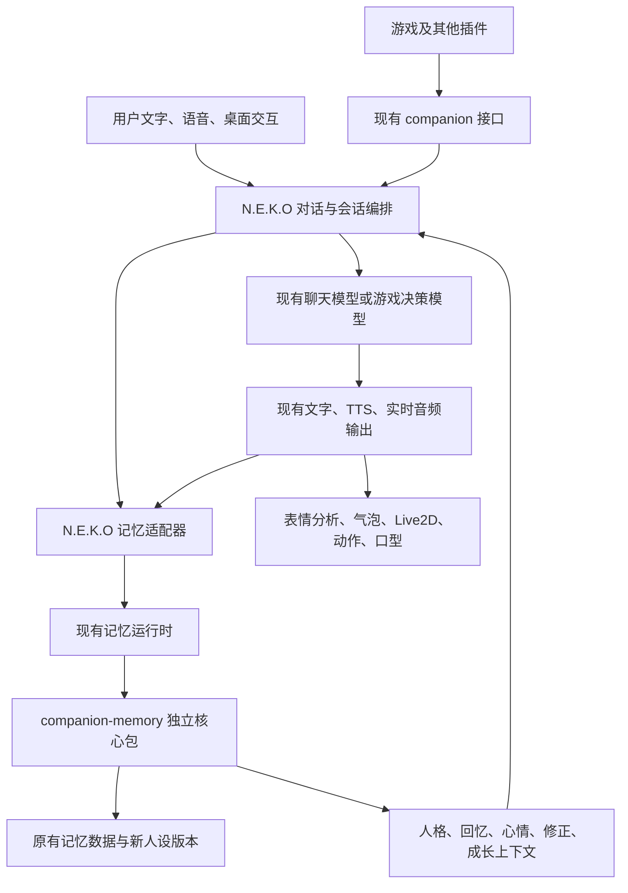

**独立记忆与人格演化引擎：项目抽离、N.E.K.O 无感接入与自演化完整方案**

日期：2026-10-22。

本文是完整实施设计。2026-10-22 已创建本仓库的可运行框架；实际完成范围及接手任务见 AGENTS.md 和 README.md。本文描述的完整记忆抽离、迁移、宿主接入与自演化仍按阶段推进。

具体执行顺序与进度统一见 [分批开发计划与后续扩展路线](F:/game/projectNEKO/companion-memory/docs/roadmap.md)：B00—B15 对应首版完整交付，O01—O05 对应体验优化，X01—X06 对应大型扩展。本文件定义架构与验收合同，roadmap 维护批次状态。

**核心决定：建立独立记忆与人格演化项目；第一版作为 Python 包运行在 N.E.K.O 现有记忆运行时内。N.E.K.O 继续负责对话、实时语音、情绪分析、Live2D、表情、动作、口型、界面与插件调度。先完成行为兼容的抽离，再启用人设卡自演化。**

项目暂用工作名 `companion-memory`，Python 包名 `companion_memory`。正式命名不影响接口及拆分方式。源码位置为 `F:\game\projectNEKO\companion-memory`，独立本地 Git 仓库。

**1. 最终效果与“无感”的具体含义**

用户继续用现有启动方式打开 N.E.K.O，继续使用当前角色、声音、模型、聊天窗口、记忆浏览器和游戏插件。抽离后，记忆由独立项目维护；启用自演化后，经历可以逐步修订当前人设卡，并影响后续表达与选择。

| 方面 | 交付要求 |
|---|---|
| 启动 | 现有源码后端加 Steam 壳的启动方式继续可用，不增加用户手动启动步骤 |
| 角色 | 当前角色、昵称、称呼、手写设定和已有记忆保留，首次切换不生成另一套身份 |
| 对话 | 文字、语音输入、流式回答、历史衔接、打断、主动交流继续使用原入口 |
| 表现 | 情绪分析、思考气泡、表情图、消息反应、Live2D 表情及动作、口型继续工作 |
| 配置 | 已选聊天/agent/summary/correction/emotion 模型、声音、模型资源及动作映射继续生效 |
| 游戏 | NekoSpire 继续使用当前接管、暂停、恢复、退出及语音回传流程 |
| 管理 | 角色编辑和记忆管理仍从 N.E.K.O 现有页面进入；新增演化管理作为相关页面内的小面板 |
| 性能 | 不因抽离增加一层 HTTP 往返，不在每轮回复前增加人格改写模型调用 |
| 人格更新 | 新人格在适当的下一次生成前生效，当前语音与动画完成原有生命周期 |
| 故障 | 可选回忆或后台演化失败时，现有回复、语音、表情链路继续处理；写入失败有明确回执 |

“无感”以入口、配置、数据、输出协议和交互连续性为验收对象。实施部署时安排一次正常的受控重启；运行中的人格更新不要求用户重启、重新选角色或重新开游戏。

抽离阶段先关闭新增的自动人设修订，保持现有成长与召回行为。兼容验收完成后，再独立启用演化，便于判断变化来自哪部分。

**2. 当前可复用的基础与接入证据**

旧方案中的 P1a/P1b/P2a/P2b/P3/P4 已提供本次抽离的主要领域能力。沿用来源、主体、场景、修正、删除与证据规则，不另造一套平行记忆体系。

| 当前入口或模块 | 已有职责 | 本次处理 |
|---|---|---|
| `memory/turn_context.py`、`hybrid_recall.py` | 被动召回、混合检索与预算 | 领域实现迁入核心，保持返回语义 |
| `memory/facts.py`、`reflection/`、`persona/` | 事实、反思、人格、证据、版本和归档 | 复用实现，拆除对宿主全局配置的直接依赖 |
| `memory/growth.py` | 成长候选、独立依据、晋升、采用记录与撤回 | 作为演化依据，新增到人设卡修订的出口 |
| `memory/companion_state.py` | 当前想法、心情、关注、进展、版本与租约校验 | 核心管理状态；宿主仍管理谁拥有前台对话 |
| 来源、更正、删除、episode、fading 模块 | 防重复、范围过滤、关联、更正和防复活 | 整体保留其行为合同 |
| `app/memory_server/` | 组件装配、路由、后台任务及恢复 | 保留宿主外壳，内部调用独立引擎 |
| `main_logic/turn_context.py` | 并发获取上下文，按共享期限注入当前轮 | 保留宿主编排与现有 HTTP 边界 |
| `main_routers/companion_router.py` | 通用上下文、事件和状态接口 | 保留路径、既有字段和错误语义 |
| `main_routers/sts2_companion_router.py` | 游戏接管、轮询、输出和人格传递 | 保留游戏会话路由，接收引擎生成的人格投影 |
| `memory/persona/persistence.py` | 将角色卡配置同步成受保护人格条目 | 改为由适配器提供当前有效卡，消除旧卡反向覆盖 |
| `main_routers/system_router/emotion.py` | 回复外显情绪分析、推送，异步回写心情 | 分析和推送保留，心情持久化改接核心 |
| `main_logic/activity/master_emotion.py` | 用户当前情绪分析、Focus 输入 | 保留宿主；用户情绪与角色情绪保持独立 |
| `static/app/app-websocket.js` | 回复结束后分析情绪、派发表情与气泡事件 | 保留现有前端生命周期 |
| `static/live2d/live2d-emotion.js` | 表情/动作执行与操作归属校验 | 保留在 N.E.K.O |
| `main_logic/core/turn.py` | `send_lanlan_response`、`mirror_assistant_speech` | 继续作为文字与游戏语音的投递入口 |

当前成长晋升写入的是 `persona.json` 中的条目；角色卡同步方向是角色配置到人格存储。新增自演化需要明确当前卡的权威来源，配合版本发布与会话刷新。

已有 `/poll` 会传递人格及 `persona_version`，插件已有更新人格和通知 planner 的入口。本次复用这条链路，重点验证版本与实际请求内容一致。

**3. 总体架构与所有权**



第一版在现有 memory server 的运行时中实例化一个引擎。main server、工具服务和插件通过既有访问边界调用它，不在每个进程中各建一个会写同一数据目录的引擎。现有部署把服务拆进程或合并进程时，都遵循同一份所有权规则。

| 对象 | 权威维护方 |
|---|---|
| 事实、反思、记忆、成长与删除屏障 | 独立引擎 |
| 当前人设卡及修订版本 | 独立引擎 |
| 角色心情、关注、共同进展 | 独立引擎；宿主/插件提交有来源的变化 |
| 当前对话控制者、输入输出队列、音频归属 | N.E.K.O 会话运行时 |
| 角色列表、选中角色、Live2D 路径、声音、模型/API 配置 | N.E.K.O 配置与资源管理 |
| 游戏局面、战术经验、动作执行权限 | 对应插件及 Mod |
| 角色卡编辑入口 | N.E.K.O 页面；提交到引擎，页面展示其最新投影 |

独立项目必须能在不安装 N.E.K.O 的环境中运行一个最小示例：创建角色、提交对话、获取上下文、执行一次整理、查看当前卡及更正/删除结果。

将来多个独立应用需要共享同一个角色时，可在同一核心外增加薄 HTTP 服务。该服务属于后续部署形态，不是第一版 N.E.K.O 接入的必要条件。

**4. 项目结构与抽离方式**

建议结构如下，文件拆分随实际复用模块确定，不预建空扩展层：

```text
companion-memory/
  pyproject.toml
  README.md
  LICENSE
  src/companion_memory/
    api.py                 # 对外引擎入口
    contracts.py           # 输入、输出、版本与回执
    memory/                # 事实、反思、检索、证据、经历与淡出
    state/                 # 当前状态、场景与版本
    persona/               # 当前卡、修订、编译、来源和历史
    persistence/           # 现有存储、事件日志、删除与恢复
    maintenance.py         # 后台整理生命周期
    cli.py                 # 独立示例和管理入口
  examples/
  tests/
```

N.E.K.O 适配器放在 N.E.K.O 仓库内，允许它依赖宿主；核心包不得反向 import N.E.K.O 的 `app`、`main_logic`、`main_routers`、全局 `config`、插件 SDK 或桌宠模块。

抽离分为四类工作：

1. 纯领域逻辑迁入新命名空间，保持规则与数据语义。
2. 文件、时钟、日志、token 计数等基础能力复用必要实现，避免把整个 `utils` 目录搬入。
3. 配置、模型调用、embedding 和宿主写入许可通过少量明确参数或接口注入。
4. 原 `memory` 导入路径在迁移期保留薄兼容入口，统一委托新核心。兼容入口不再保留另一份算法或全局存储实例。

Python 版本首先与当前 N.E.K.O 的 3.11 对齐。依赖只迁入实际使用的部分；向量能力作为可选依赖，沿用无向量时已有检索行为。Live2D、音频、桌面自动化和游戏依赖不进入核心包。

开发时可使用本地 editable 安装；交付时固定核心包版本，保留锁文件及兼容版本范围。核心升级与 N.E.K.O 适配器升级通过明确版本配对，避免运行时临时拉取最新版。

**5. 对外合同与数据身份**

以下是核心接口语义；具体函数签名已在 B01 冻结（见 §17.9）：

| 核心操作 | 输入要点 | 输出要点 |
|---|---|---|
| `observe` | 角色、主体、场景、来源、事件类型、内容、发生时间 | 接收/重复/拒绝回执、关联条目和版本 |
| `build_context` | 当前输入、近期对话、用途、场景、预算、请求标识 | 人格引用、相关回忆、状态、修正、成长和版本 |
| `read_state` / `commit_state` | 角色/主体、版本、来源事件、操作、控制权凭据 | 状态快照或提交回执、冲突说明 |
| `correct` / `forget` | 范围、目标、来源、请求标识 | 立即停止使用的版本、清理进度、插件回执状态 |
| `get_profile` / `revise_profile` | 角色、主体视图、基版本、局部修订、理由和依据 | 新卡片版本或冲突/拒绝结果 |
| `maintain` | 待处理范围、资源预算 | 抽取、反思、成长和修订的处理位置 |

N.E.K.O 继续对外暴露既有 `/api/companion/*`、`/api/sts2-companion/*`、记忆管理和内部记忆路由。新核心接口由适配器转换，不要求插件同时改用一套新 URL。

**5.1 身份、主体与场景**

- 角色身份沿用当前角色映射；第一版不全量重写旧目录名和来源键。重命名通过宿主既有角色生命周期处理，新增稳定身份映射时保留旧别名解析。
- 主体继续区分私人、群组及其他已支持对象。用户 A 的偏好和关系记录不得进入用户 B 的上下文。
- 来源与适用范围分别保存。发生于游戏的生活事实可按内容成为共享记忆；游戏战术继续限于原场景。
- `shared/game/run` 沿用 `applies_to` 表达；游戏经验不会因抽离而自动晋升为全局人格。
- 角色自身的通用兴趣与按对象形成的相处方式分别存储。后一类作为主体范围的人设段落，仅在对应对象的有效卡片视图中出现。

**5.2 事件最小字段**

```text
schema_version
character / subject
source_key / event_type
occurred_at / received_at
scene { producer, plugin_id?, game_id?, session_id? }
content_class / applies_to
payload
request_id
```

继续识别现有 `host:...` 和 `plugin:...` 来源键。同一事件的原消息、镜像、摘要、反思不能分别增加成长支持。新事件优先绑定已有 turn/output/action 标识，迁移时不重新哈希全部旧事件。

接收成功只表示事件被接纳；文字送达、音频送达、播放完成、动作执行完成分别按已有回执记录。核心不根据模型的“我已经做了”直接确认结果。

**5.3 上下文与版本**

上下文继续兼容现有 `block/items/version` 形状，新增信息采用可选字段。至少区分记忆修正版本、删除版本、共享状态版本、成长版本和人设修订版本。

每次生成使用一份完整版本快照，不把新卡的前半段和旧卡的后半段混合。人格修订版本用单调递增的 revision；既有 `persona_version` 保持兼容的不透明版本标识，用于宿主/插件缓存失效。模型切换、语言切换引起的渲染变化与人格实质变化分开记录。

**6. N.E.K.O 各入口怎样保持原有体验**

**6.1 普通文字及语音聊天**

1. 用户输入继续走原输入与会话流程。
2. 原 turn-context provider 在现有总期限内请求相关记忆，适配器返回兼容结构。
3. 宿主把当前人设、相关记忆和状态放入原模型请求；模型选择、工具和语音模式不变。
4. 回复继续流式送入原文字和音频输出，保持 turn/request/speech 标识及取消语义。
5. 已送达结果按现有 post-turn 路径记录，后台整理不阻塞出声。

语音识别、回声抑制、实时音频、TTS 分段和播放结束回执保留在宿主。记忆核心只接收它们已经形成的语义事件。

**6.2 主动交流**

主动交流时机、Focus、用户打断和投递控制继续由宿主决定。核心提供有当前话题关联的候选、提及限制及可用状态；两种 follow-up 接口继续使用一致的相关性规则。

没有合适历史回忆时，可使用真实的新见闻或当前关注；没有合适来由时保持安静。抽离不增加固定搭话频率。候选被读取不算已向用户提及，实际送达后才记账。

**6.3 游戏接管、暂停与退出**

- NekoSpire 继续使用 `/poll` 获取输入、人格和版本，通过通用 context 接口获取本轮记忆。
- 游戏仍由原 planner 结合人格、局面和行动合同决策，保持当前 agent 模型配置及 `hold` 执行权限约定。
- `advise`、`standby`、暂停自动操作与同伴聊天继续遵守现有行为；暂停动作不丢失共享心情和聊天能力。
- 游戏输出继续走 `send_lanlan_response` / `mirror_assistant_speech`，原表情、语音、气泡和播放回执链路保留。
- 释放接管、租约到期或异常重连时，获取最新共享状态与人格；旧计划及旧租约不恢复执行权限。
- 不重新导入全部插件战术库。插件私有经验继续由插件管理，核心只接收已有约定的共享事件和必要来源引用。

**6.4 桌面交互及其他已接入模块**

点击角色、桌面观察、其他插件结果仍经过已有交互与事件入口。现有启用开关、隐私选项和记录条件继续由宿主检查。抽离不把尚未被授权记录的截图、窗口信息或插件输出自动纳入记忆。

角色切换、重命名、导入、删除、数据根切换和配置热加载必须经过适配器生命周期，释放旧实例资源，阻止旧后台任务写入已切换的角色数据。

**6.5 人设与记忆管理页面**

现有角色列表、模型/声音配置和记忆浏览器保持入口位置。编辑语义人设时调用引擎；编辑 Live2D、音色、模型路径时仍调用宿主配置。

在相关页面增加一个紧凑的演化面板，包含：当前卡、最近变化、来源经历、自动演化开关、字段冻结、手动修订和撤回。普通使用不要求打开独立项目管理界面。

**7. 情绪、Live2D、表情和动作的完整保留方案**

**7.1 三种“情绪”分别处理**

| 类型 | 当前来源与职责 | 抽离后的归属 |
|---|---|---|
| 用户情绪 | `master_emotion` 分析用户表达，供 Focus 等模块使用 | 保留宿主，继续沿用节流和使用方式 |
| 角色持续心情 | `companion_state` 中有来由、强度、时间与范围的状态 | 核心持久化，供后续表达与选择使用 |
| 本次外显表情 | 根据已经生成的回复分析 emotion/bubble_emotion | 保留原分析及渲染链路 |

用户难过不直接等同于角色难过；角色的持续心情也不强制每句都使用同一张表情。外显结果可以作为一次状态观察回写，按已有来源与去重规则处理，不新增“表情变化→自动生成一句话→再次分析表情”的循环。

第一版保留现有情绪分析映射与时机；不在抽离同时改情绪算法。当前源码把可记录的分析结果异步提交为心情，适配时只更换提交落点。持续心情的衰减仍按原事件时间计算，重启不重置强度。

**7.2 保持现有输出路线**

```text
模型生成回复
  → 原文字/音频投递
  → 原回复收尾
  → /api/emotion/analysis
  → emotion / bubble_emotion / reaction
  → applyEmotion 与 neko-assistant-emotion-ready
  → Live2D 表情、动作映射及气泡
```

`Live2DManager.setEmotion`、模型动作文件、expression 映射、手动动作、动作取消/归属判断及恢复逻辑继续由宿主管理。新核心不发送模型参数 ID，不重写 `.model3.json`、`.motion3.json`、`.exp3.json` 或资源映射。

需要保留的具体行为包括：思考气泡等待分类时保持可见、分类完成后替换内容、语音开始/结束时的生命周期、角色切换后的旧事件抑制、多窗口显示当前角色名称、手动表情与动作控制。

声音、语速配置、TTS worker、音频队列、嘴型驱动和实时模型音频协议均保持原归属。新的人格文字只影响生成内容；它不得覆盖工具合同、表情控制协议和音频规则。

**7.3 人格提示词与表现能力分开组装**

有效模型上下文由宿主组装为：宿主运行规则及工具合同、当前人格视图、当前用户输入、场景合同、相关记忆与短期状态。保留当前各客户端要求的角色和消息位置。

人设编译器只替换已归属人设的部分。原来支持的表达标签、工具调用方式、Live2D 控制能力描述和语音协议不放入模型可自改的人设字段。

现有手写 system prompt 可能同时包含人设和控制说明：首次导入保留原文与顺序，只映射可以明确识别的语义字段；混合自由文本保持用户控制，不用模型自动猜测并覆盖整段。用户明确开放某段后，才纳入演化范围。

**8. 人设卡模型与权威来源**

**8.1 人设卡的三层结构**

| 层 | 内容 | 写入方式 |
|---|---|---|
| 初始卡 | 创建/导入时的原始设定，作为参照与用户恢复依据 | 创建或显式导入 |
| 当前卡 | 现在的身份、兴趣、表达方式、习惯、认识及相处方式 | 手动修订或通过依据校验的自动修订 |
| 当前状态 | 心情、临时想法、关注、当前进展 | 根据事件与时效更新 |

用户事实另存记忆；与某人的相处方式作为主体范围段落；临时任务与游戏策略保持场景范围。它们可以影响本轮上下文，不都变成全局性格。

建议每个人设段落有以下信息：

```text
section_id / kind / text
scope { subject?, applies_to? }
editable_by { user, evolution }
source_refs / revision / updated_at
origin { imported, user_edit, evolution }
```

卡片整体保存 `schema_version`、角色身份、revision、段落顺序和当前有效版本；修订记录保存基版本、修改段落、理由、来源、操作方及提交结果。

第一版保留现有 JSON/SQLite 存储形态，新增局部的人设卡与修订记录文件即可。不同时引入数据库迁移、图数据库或新的向量系统。

**8.2 哪些内容可以自动演化**

| 内容 | 默认策略 |
|---|---|
| 兴趣、表达细节、相处习惯、经过验证的自我认识 | 在依据满足时允许局部修订 |
| 面向特定用户/群组的相处方式 | 允许修订，保持主体范围 |
| 名字、出身、基础背景与用户固定设定 | 默认由用户编辑，可逐项开放 |
| 用户的明确偏好与边界 | 按对应范围立即生效，不等待成长票数 |
| 临时心情、单次成功/失败、未执行的想法 | 保存为状态或经历，不直接固化人格 |
| 模型/API、工具权限、音色、资源路径、系统协议 | 留在宿主配置，不属于语义人设修订 |

用户可以冻结任意段落。关闭自动演化会停止新的自动修订，保留当前卡与已有记忆；恢复初始卡属于单独的显式操作，不与关闭开关联动。

**8.3 防止原角色配置覆盖演化结果**

引擎维护语义人设的唯一真源；`characters.json` 继续维护宿主角色及资源设置，其中为兼容保留的人设字段是带 revision 的投影。

首次导入完成后，原 character-card 同步逻辑改为读取有效卡的投影，不再每次用初始设定覆盖当前卡。宿主页面保存人设时提交 `base_revision`，引擎成功后刷新投影；投影暂时写入失败可重试，引擎版本保持权威。

用户直接修改配置文件时，沿已有加载/刷新流程检查投影指纹：明确外部改动作为用户修订导入一次；若同时有未处理的人设改动，则进入冲突处理，禁止双向循环覆盖。普通插件不直接写配置文件。

**8.4 真正改写，而非无限追加**

自动修订可以新增、替换、合并或删除已开放段落。编译器只输出当前有效版本，不把所有历史变化塞进提示词。

例如“喜欢立即给建议”可以被改为“喜欢一起解决问题；对方倾诉时会先听完，明确求助时再分析”。这次修订替换原段落，并记录对应经历。

已经被卡片吸收的成长条目保留来源与解释能力，默认不再把同一段话重复注入成长块。相关具体经历仍可在用户回忆时召回。

**9. 自演化的完整处理流程**

1. 接纳真实对话、接触内容、已送达表达、工具结果或共同经历。
2. 复用事实抽取与反思流程形成候选，区分用户陈述、角色主观体验和外部结果。
3. 根据现有独立事件与内容类型规则，判断候选适合维持为临时倾向还是形成稳定变化。
4. 仅把新增、被支持、被质疑或被更正的候选交给人设修订器，定位受影响段落。
5. 模型提出结构化的局部变化，带来源和适用范围；无实质变化时返回不修改。
6. 确定性校验可写字段、来源存在性、删除屏障、主体/场景、长度、基版本和用户冻结设置。
7. 对“新文字是否被给出的经历支持”“是否与有效人设/用户设定冲突”做有预算的语义审核；复杂或不成立的提案保持待处理，不提交模糊整卡重写。
8. 在角色写锁下提交新版本及来源关系，再由宿主发布人格更新。
9. 后续真实使用、结果和反馈继续支持、收窄或撤回相关变化。

角色自身兴趣允许由真实体验与持续选择发展，不把用户表扬作为唯一条件。关于用户想法和双方关系的长期判断依照各自证据门槛；用户沉默、重复自述和模型自评不增加独立支持。

候选的证据门槛首先继承当前 `growth.py`，第一版不同时重新调一套成长数值。用户明确纠正走立即更正路径，不等待自动演化批次。

**9.1 触发与成本**

后台反思有新的可用候选、活动结束有实际结果、用户纠正导致原依据变化时，才考虑修订。空闲时间本身不是成长证据，也不要求每天生成一条变化。

首版建议每角色一次只处理一个修订批次，一次最多修改两个相关段落；自动批次间隔初值为 30 分钟，手动编辑、明确更正和删除联动不受此间隔限制。该值是待验证的运行配置，不是人格规则。

复用现有 `correction` 模型配置执行提案与语义审核。建议提案输入上限 6000 tokens、输出 1200 tokens、timeout 30 秒；必要审核输入上限 4000 tokens、输出 600 tokens、timeout 20 秒。首版每日自动批次上限建议 8 次，预算不足保留候选，后续有预算再处理。上述都是初始运行值，按实际成本与效果调整。

对旧自定义长卡只读取当前受影响的段落与必要约束。导入时不为了满足自动修订预算截断用户原卡；无法在预算内处理的复杂段落保持原样，并在管理面板说明待处理原因。

**9.2 修订提交与异常**

修订携带 `request_id`、`base_revision`、段落 ID、原文指纹、目标内容、来源和理由。同请求重试只产生一次提交；基版本改变时重新读取和评估，不只替换版本号重交。

模型输出无效、调用超时、来源不足或语义审核不通过时，当前卡保持有效；后台记录可区分的处理状态，不对用户反复播报。提交失败不得发布新版本。

卡片、修订记录和提交位置通过现有事件日志及原子写入组成可恢复操作；进程中断后能完成已提交变更或重试未提交提案，不形成两份不同的“当前卡”。

**9.3 更正、遗忘与撤回**

人格段落关联来源。来源被纠正/删除时，先阻止该贡献继续用于生成，再重建依赖段落：没有剩余支持则撤回，有独立支持则重新计算保留范围。

历史修订、初始导入副本、缓存、待发布人格及导出文件中的受影响内容也要纳入删除范围。历史版本回滚必须经过当前删除屏障过滤；删除日志保留必要 ID/哈希，不保留被删正文作为永久审计内容。

用户撤回一次演化时，不删除真实经历；用户删除一段经历时，同时撤回其派生影响。两种操作有不同的回执与范围。

**10. 人格版本怎样在运行中生效**

需要区分“已持久化”“已渲染”“已被当前生成链路采用”。管理面板显示当前生效版本及尚待发布的版本，不把落盘直接当成所有会话已更新。

1. 引擎提交新 revision，通知适配器刷新人格投影。
2. 编译器生成完整的新人格块，保留宿主工具、语音及表现协议。
3. 更新宿主可供下一轮使用的人格缓存和 `persona_version`。
4. 各生成入口在安全边界采用新版本，记录有效版本。

| 生成入口 | 发布方式 |
|---|---|
| 普通文本/非实时语音 | 下一次模型请求组装时采用新卡；已流出的回复继续完成 |
| 支持会话指令更新的实时客户端 | 在当前响应结束后，使用现有会话更新机制；需要确认的客户端等确认后标记生效，保留原工具及音频配置 |
| 需要重建连接的实时客户端 | 复用现有会话准备/交接流程，在空闲边界准备新连接并迁移必要上下文；新连接就绪后再切换 |
| 游戏 planner | `/poll` 人格内容与版本成对更新；下一次规划使用新版本，旧版本未执行结果按现有过期机制处理 |
| 主动生成 | 与普通聊天共用人格版本，禁止独立缓存一份长期旧卡 |

现有客户端已经存在不同协议能力：源码中的 Gemini Live 路径缺少会话中途更新指令机制，其他路径有 session update 与确认能力。适配器按已有能力接口处理，不在记忆核心写模型厂商分支。

自动演化允许在当前用户交互完成后发布，不为了更新卡片打断正在播放的音频。用户在准备新会话期间继续说话时沿用现有输入缓存和交接仲裁，禁止丢输入或播放两遍。明确更正和删除先通过本轮强约束/失效过滤生效，完整卡片随后同步。

**11. 数据兼容、切换与回滚**

**11.1 首版采用原位兼容存储**

N.E.K.O 集成时继续使用配置解析出的 memory_dir，保留原角色目录及现有 JSON/SQLite 文件。代码独立与数据迁目录分开，首版不要求把用户数据搬进新仓库。各数据类的实际写入方、读取方、恢复与删除归属见 §17.3。

独立运行时由使用者指定数据目录（可以是现有运行根或 `nekodata`）。导出/导入可携带角色语义卡、记忆、来源和删除元数据；不打包 API Key、桌宠资源和宿主私有配置。

本轮为测试开发阶段：现有运行根和 `nekodata` 的数据可直接读写、清空、重来，测试数据不需要保留。唯一例外是人格卡不重建（`persona_card.json`、`persona_versions.json`、`persona_admin.json`、`persona_card_archive/` 及宿主侧投影），只经服务编辑/发布/回滚/演化修改。

正式数据根的选择、维护模式和云存档写入许可仍由 N.E.K.O 提供，核心在写入边界执行相应许可检查；独立运行使用自己的本地写入策略。抽离不绕过宿主现有的数据根切换、导入恢复或角色删除保护。

| 数据 | 首版策略 |
|---|---|
| recent、原始会话、facts、reflections、persona、归档 | 兼容读取及写入，保留 ID、时间、主体、来源与证据 |
| companion_state、source ledger、corrections、directives | 保留版本、范围与幂等信息 |
| deletion barriers、forget epochs、插件待处理回执 | 优先恢复，继续阻止旧任务回写 |
| growth_uses、episode、fading 信息 | 保留使用语义及时间，不迁移时重新加分 |
| event log、outbox、cursors | 保留处理位置；全部事件类型有相应重放处理器 |
| 新人设卡及修订记录 | 从当前有效设定一次导入，后续由引擎单独管理 |
| 插件 catgirl_memory 等私有数据 | 保持原位置与插件所有权，沿用删除协调 |
| Live2D、动作映射、声音与模型配置 | 保持原位置与宿主所有权 |

**11.2 从副本验证到正式切换**

1. 记录当前代码状态、有效配置和功能基线；纳入当前未提交的有效实现，不只依据远端 main 抽取。
2. 暂停目标记忆写入与后台任务，等待正在提交的事务收尾，生成一致性副本；SQLite 使用备份机制或受控停写后的复制。
3. 先在副本运行独立引擎，关闭真实对外输出与自动人设修订。
4. 对比读取结果、渲染内容、状态、来源去重、删除屏障和更正行为；模型产生的语义差异与接口差异分开判断。
5. 受控切换时排空旧写入，终止旧后台写任务，清理旧控制权；将唯一写入方切到新引擎。
6. 启动恢复先载入屏障、完成需要的重放和迁移，再开放读取/抽取；不要把现有异步恢复任务的启动顺序当作完成顺序。
7. 新引擎通过原 API 提供服务，保留旧兼容入口；验证普通聊天、语音、Live2D、游戏与重启恢复。
8. 稳定后再启用自动演化，前几次变化可在管理面板逐项查看。

影子对比只在隔离副本执行写入，不允许旧引擎和新引擎同时写正式目录。正式切换后，旧实现不作为异常时自动接管写入的 fallback。

**11.3 回滚要保留切换后的新数据**

首版保持已有文件兼容格式，代码回滚优先让旧版本读取最新兼容数据。新版当前人设需要生成旧宿主可读的投影，保留已经发生的有效变化。

若将来出现旧版不可读的 schema，必须先提供反向兼容导出或转换，再开放升级。切换后发生的对话、修正和删除都要保留；不能简单恢复切换前整目录备份。

确需使用备份恢复时，先合并最新删除屏障与后续已提交记录，再重建可用视图。不同版本期间生成的副本列入备份管理，恢复入口同样过滤已删除内容。

**12. 并发、恢复与性能边界**

| 情况 | 处理方式 |
|---|---|
| 同一事件重复提交 | 返回原回执，不重复加证据或修订版本 |
| 旧实例或租约提交当前状态 | 拒绝覆盖；迟到的真实结果可按历史事件接收 |
| 人设修订与用户手改并发 | 基版本校验，自动提案重新评估；用户冻结立即约束后续提案 |
| 角色切换/删除后旧后台任务完成 | 校验角色代次、删除版本及写入许可，丢弃无效结果 |
| 回忆超时 | 省略可选块，保留当前输入、明确约束和有效人设 |
| 修正/删除版本更新 | 失效旧缓存及在途结果，不能退回旧未过滤快照 |
| 存储不可写 | 保留最后有效人设用于当前对话；写操作返回未提交，后台可恢复事件有界排队 |
| 自动演化失败 | 保留当前卡，后续按预算重试；不阻塞原表情/TTS |
| 插件离线 | 删除回执保持待处理；重连先同步屏障和最新版本 |

角色写入保持单一所有者、原子提交和幂等重放。LLM 调用期间不持有长时间存储锁；提交时重新校验版本。同步文件/SQLite/较重检索运算按当前异步规范移出事件循环。

保持现有普通聊天 turn-context 总等待预算 1 秒；游戏入口沿用现有预算。预算从开始准备时计时，不能每个 provider 分别等待完整的一秒。

自动演化不进入前台必经路径。后台模型复用宿主现有 summary/correction 配置，用户无需填写第二份 Key。独立运行提供显式配置入口；基础库不内置用户凭据或固定模型名。

在同一输入集、缓存状态和环境下，记录抽离前后的本地上下文耗时、首字/首音耗时及超时占比。初始目标为本地上下文额外开销 p95 不超过 50ms，且不增加前台模型调用数；该数值为验收目标，基线采集后确认其测量方法。

日志默认记录版本、耗时、事件数量、重试和发布状态。原始对话与完整人设不写普通日志；审查原文通过用户主动打开对应管理项。

**12.1 既有配置与后台任务兼容**

`powerful_memory_enabled`、被动回忆、近期记忆复核、各模型层级、语言和相关功能开关继续映射到原有语义；关闭强力记忆后的基础抽取、晋升及可用查询行为按现有合同保留。新增的自动人设修订开关独立存在，不改变这些开关的含义。

后台抽取、反思、归档、重放和演化由一个受管理的任务集合运行。宿主负责启动/停止，引擎负责具体任务；旧循环委托或退场后才启动新循环。热加载时共享或移交原有写锁、代次和处理位置，关闭时取消任务并等待正在提交的写入收尾，避免双倍抽取和旧实例回写。

既有记忆浏览、编辑、导入/导出、遗忘及迁移入口列入 D0 的路由清单，不只验证普通对话的读取接口。宿主特有的访问检查保留，核心负责角色、主体、场景和版本合同。

**12.2 事件与修订的信任边界**

生产方身份和可写范围来自适配器确认的调用者及会话，不能仅凭 payload 中自报 `host` 获得权限。现有本机变更接口的 Origin/CSRF 检查继续有效。插件可以提交观察、结果和成长候选；最终人设修订由引擎校验提交。

检索出的旧对话、网页摘录和工具文本作为经历材料处理，其中的指令文字不会直接成为核心配置或修订权限。局部人设修订只接受预定义的段落操作，不能通过模型输出修改任意文件。

**13. 分批实施与每批完成条件**

下面保留 D0—D5 大阶段；实际开发按 [roadmap](F:/game/projectNEKO/companion-memory/docs/roadmap.md) 的 B01—B15 顺序进行。大阶段完成需要对应全部批次及必要验收通过。

| 阶段 | 工作内容 | 完成条件 |
|---|---|---|
| D0：冻结兼容合同 | 核对有效工作树、入口/存储/提示词合同，采集基线与一致性样本 | 明确单一写入方、核心与宿主边界，以及首次导入不改角色的比较方法 |
| D1：独立核心 | 新仓库、依赖注入、核心迁移、独立运行示例、兼容存储 | 无 N.E.K.O 环境能完成记录、召回、成长、更正和删除；无宿主反向依赖 |
| D2：N.E.K.O 兼容接入 | 原路由/导入入口委托、后台调度交接、数据恢复和副本对比 | 自演化关闭时，原有记忆、聊天、语音、表情及游戏合同通过 |
| D3：当前卡与热更新 | 一次性导入、卡片权威来源、手改/冻结/版本、各客户端发布 | 首次渲染保持原设定；手动修订在下一安全生成边界生效，历史和音频连续 |
| D4：自动演化 | 成长到修订、语义审核、来源、预算、撤回和删除联动 | 真实依据可以修订卡片，重复自述不生效，跨主体/跨游戏内容不会串入 |
| D5：上线与交付 | 正式目录受控切换、重启恢复、实机验收、回滚演练、文档同步 | 现有启动和使用方式继续可用，独立项目可安装，N.E.K.O 接入可回退 |

D0 已由 B01 完成，具体迁移清单、冻结接口与 B02 输入见 §17；D1 起按 §17.10 的模块归属与批次推进。

D1—D4 先在代码和隔离数据上推进。D5 才切换正式运行环境。每批单独可检查，不以“项目已拆成文件夹”作为完成标准。

前期主要工作量在解除全局配置/运行时依赖、覆盖现有写入入口和迁移恢复；自演化主要工作量在权威卡片、客户端生效、来源撤回及兼容投影。D0 产出实际依赖清单后再给按批次的工期，避免只按搬文件估算。

**14. 验收矩阵**

优先复用现有测试与运行入口；下表是独立行为场景，不要求每行新增一个测试。每个实现批次选择相关测试，新增用例只覆盖缺失的关键风险。

| 编号 | 场景 | 通过条件 |
|---|---|---|
| A01 | 独立安装 | 在未安装 N.E.K.O 的环境运行最小示例，无宿主模块依赖 |
| A02 | 初次接入 | 当前角色、手写设定、声音、Live2D 资源及记忆保持；同输入的人设与必要上下文无语义改写 |
| A03 | 普通文字/语音 | 流式输出、打断、重新输入、历史续接正常，记忆异步处理不阻塞出声 |
| A04 | 表情与气泡 | 思考→情绪→收尾顺序正常；分类延迟时气泡保持内容；消息反应与角色名正确 |
| A05 | Live2D | 自动情绪映射、手动表情/动作、口型、切换模型、动作结束与取消恢复正常 |
| A06 | 游戏接管 | program/advise/standby、暂停聊天、回传语音、退出续聊与重连保持既有行为 |
| A07 | 主动交流 | 已结束话题不复活，新话题不硬接旧回忆，未送达内容不计提及 |
| A08 | 人格热更新 | 文本、当前启用实时模式、主动生成与游戏下一轮实际使用同一有效版本 |
| A09 | 会话更新竞争 | 更新时继续输入或打断，不丢消息、不重复出声、旧任务不覆盖新版本 |
| A10 | 自演化 | 多次独立经历可改变开放段落；AI 复述、镜像和沉默不增加依据 |
| A11 | 人工控制 | 手改、冻结、关闭演化、撤回均可用；关闭自动修订不重置当前卡 |
| A12 | 范围隔离 | 不同主体隔离；游戏战术不形成全局人格；游戏生活事实按内容保留 |
| A13 | 更正与删除 | 下一相关请求停止使用失效内容，卡片、历史、缓存及插件副本按范围清理 |
| A14 | 崩溃/重启/恢复 | 提交回执丢失可幂等重试；旧备份、在途任务、重放不复活被删内容 |
| A15 | 数据与代码回滚 | 保留切换后的新对话和删除，旧宿主能读取兼容数据与当前人设投影 |
| A16 | 性能 | 共享等待预算不扩大，前台模型调用数不增加，本地额外耗时满足确认后的目标 |

现有可复用测试包括 `test_companion_state_*`、`test_memory_companion_context.py`、`test_growth_*`、`test_persona_version_poll.py`、`test_sts2_companion_route.py`、删除与更正测试，以及 `test_mirror_speech_stream.py`、TTS 相关测试、`chat_avatar_integration.test.cjs` 和 `test_avatar_reaction_bubble.py`。

具体实机验收用当前角色和当前启用的聊天/语音模式，至少完成：一次文字对话、一次语音对话与打断、一次自动/手动 Live2D 表情动作、一次游戏接管及返回桌面、一次手动人设修改、一次可追溯演化、一次删除后重启。副本验证通过后再进入正式数据验收。

**15. 最终交付物与后续边界**

最终交付包含：独立仓库及可安装包、最小独立示例、N.E.K.O 适配层、数据兼容/导入导出工具、当前人设与演化管理入口、版本配对、迁移与回滚说明，以及本方案对应的验收结果。

抽取的原代码保留 Apache-2.0 许可证、相关版权与来源说明，并标注修改；新项目以自己的名称和版本发布。第一版不引入新付费服务、云同步、图数据库、新向量库或独立桌宠界面。

原《N.E.K.O 记忆、成长、变化与遗忘方案》继续作为已有记忆行为的依据；其中“宿主统一管理”在本轮细化为“独立核心提供领域能力，N.E.K.O 作为首个宿主统一接入”。原有不另建服务的取舍与本方案第一版保持一致；本轮新增范围是代码独立和当前人设卡自演化。

实施后按实际变化更新新项目 README、N.E.K.O 记忆架构/API 文档、角色编辑说明与工作区 AGENTS 的路径/部署信息。保留旧阶段记录，不把本方案中的待实施内容写成已经交付。

**首版按 B01—B15 分批推进：先冻结兼容合同，再完成独立记忆闭环、N.E.K.O 兼容接入、人格演化及正式交付。情绪、Live2D、表情、声音和游戏接入贯穿相关批次验收。首版后的体验优化与大型扩展见 roadmap 的 O/X 路线。**

**16. 本次核对的主要源码与文档**

- [原记忆成长与遗忘方案](F:/game/projectNEKO/N.E.K.O-记忆成长与遗忘方案.md)
- [宿主记忆架构说明](F:/game/projectNEKO/N.E.K.O/docs/architecture/memory-system.md)
- [记忆组件装配与恢复](F:/game/projectNEKO/N.E.K.O/app/memory_server/runtime.py:508)
- [现有角色卡同步](F:/game/projectNEKO/N.E.K.O/memory/persona/persistence.py:547)
- [成长到人格条目](F:/game/projectNEKO/N.E.K.O/memory/growth.py:1042)
- [普通聊天上下文入口](F:/game/projectNEKO/N.E.K.O/main_logic/turn_context.py)
- [通用同伴路由](F:/game/projectNEKO/N.E.K.O/main_routers/companion_router.py)
- [游戏接管与人格轮询](F:/game/projectNEKO/N.E.K.O/main_routers/sts2_companion_router.py:424)
- [情绪推送与心情回写](F:/game/projectNEKO/N.E.K.O/main_routers/system_router/emotion.py:603)
- [用户情绪分析](F:/game/projectNEKO/N.E.K.O/main_logic/activity/master_emotion.py)
- [回复收尾与表情事件](F:/game/projectNEKO/N.E.K.O/static/app/app-websocket.js:1821)
- [Live2D 表情和动作入口](F:/game/projectNEKO/N.E.K.O/static/live2d/live2d-emotion.js:1715)
- [气泡延迟分类处理](F:/game/projectNEKO/N.E.K.O/static/avatar/avatar-reaction-bubble.js:2470)
- [统一文字与游戏语音回传](F:/game/projectNEKO/N.E.K.O/main_logic/core/turn.py:3419)
- [实时客户端指令更新能力](F:/game/projectNEKO/N.E.K.O/main_logic/omni_realtime_client/_responses.py:128)
- [现有被动召回预算](F:/game/projectNEKO/N.E.K.O/config/turn_context_settings.py:31)

**17. D0 兼容合同冻结与迁移清单（B01 交付）**

**17.1 基线与核对方法**

- 宿主基线：`F:\game\projectNEKO\N.E.K.O` 工作树 HEAD `4c510926` + 106 项未提交改动（P1b/P2a/P2b/P3/P4 模块与测试；迁移以工作树为准，不按远端 main）。
- 插件基线：`F:\game\projectNEKO\plugin\nekospire`（独立仓库，含未提交改动）；核心基线：本仓库 B00 工作树。
- 核对方法：代码优先于文档；定向读取 + 按装饰器/写入原语/持久路径 grep；宿主 `docs/architecture/memory-system.md`、`docs/design/memory-event-log-rfc.md` 交叉核对，冲突以代码为准。全部结论附 `文件:行号`。
- 本批边界：不迁移业务逻辑、不修改宿主代码。数据根可直接使用现有 `nekodata`/`companion-runtime`，测试产生的数据不必保留。

**17.2 数据所有权与单写者规则**

1. 数据根由宿主解析：`memory_dir = app_docs_dir / "memory"`（`utils/config_manager/storage_roots.py:167`），每角色 `memory/<character>/`（`memory/__init__.py:114-118`）；`project_memory_dir` 是种子/默认根（`storage_roots.py:206`），`anchor_root` 固定保存 cloudsave/state，`local_state_dir` 保存不随云快照的本地状态。核心不自行解析 Documents 或全局配置。
2. 正常路径单写者：只有 memory_server 进程按每角色锁写领域视图；main 进程通过 HTTP 调用 memory server；角色生命周期由 main 串行执行并 `/release_character` + `/reload`。以下为已知多写者/旁路，B02 必须保留其锁与协调语义或收口：
   - `recent.json`：memory_server 与 main 进程记忆浏览器编辑器都写，依赖 `utils/recent_file` 的进程内路径锁 + generation/CAS（无跨进程锁；`main_routers/memory_router.py:1357-1557`、`utils/recent_file.py:94-232`）。
   - `.fact_suppression.json`：memory_server 读、插件 `plugin/nekospire/fact_gate.py:40,128,187` 直接写 memory 根。
   - `facts_sync_*`：main 进程 `main_logic/facts_sync/sync_worker.py` 写自己的 state（`memory/facts.py:866-872` 记录跨进程窗口需 portalocker 才闭合）。
   - `trust_store` 根级 pool：单写者仅 memory_server handler，故意豁免维护模式断言（`memory/trust_store.py:971-998`）。
3. 锁与许可：每角色 `threading.Lock`（EventLog 的 record_and_save/reconcile/sentinel，`memory/event_log.py:219-244`）与每角色 `asyncio.Lock`（FactStore/Persona/Reflection 管线）；`utils/recent_file` 路径锁；`utils/root_state_lock.py` 保护根状态 read-modify-write；`utils/cloudsave_runtime` 包的 `cloudsave_writable_transaction` 是最终写围栏（跨进程锁 + root_state 事务 + 断言，`fence.py:114-145`），`assert_cloudsave_writable` 只是 TOCTOU 断言（`fence.py:94-99`）。
4. 恢复与删除语义：JSON 视图是读模型，事件日志只覆盖部分转换（非完整 event sourcing）；outbox 为 at-least-once，handler 必须幂等；启动顺序 reconcile（完整 await）→ outbox replay → migrations → 后台循环是硬约束（`app/memory_server/runtime.py:1099-1145`）。删除先登记屏障后清理，tombstone 不保留原文，插件副本按待回执处理。

**17.3 持久数据清单**

路径均相对 `memory/<character>/`，另有说明除外。“归属”为本项目批次归属；“许可/屏障缺口”标出 B02/B03 必须接线处。

模块级写入路径（JSON 原子写、JSONL 追加、SQLite）与锁/许可/屏障的归属按 §17.10 的模块分类覆盖；未接许可或未接删除的数据类已在表中标“缺口”。

| 数据类 | 路径/格式 | 权威写入方 | 主要读取方 | 恢复机制 | 删除/更正参与 | 幂等/版本字段 | 归属 |
|---|---|---|---|---|---|---|---|
| 最近对话 | `recent.json`（消息 dict 列表） | `memory/recent.py:875-878`；main 编辑器另写 | turn_context、压缩/复核、记忆浏览器 | 损坏当前重置为 []（B02 改为拒绝并保留备份）；进程内路径锁+generation | 条目过滤 `deletion_engine.py:659-693`；episode 删除 `615-656` | 无版本；retired_keys sidecar | B04 |
| 最近摘要元数据 | `recent_meta.json`、`recent.retired_keys.json`、`theater_runs.json`、`theater_retractions.json` | `memory/recent.py:2214-2225,433-532`；`utils/recent_file.py:520,662-677` | 摘要陈旧检查、theater 撤回 | 缺失/坏读按空 | retired_keys 参与防复活；theater 撤回 | 键集合/TTL | B04 |
| 原始会话与 FTS | `time_indexed.db`：`time_indexed_original`、`time_indexed_compressed`、`facts_fts_v2`、`facts_fts_meta` | `memory/timeindex.py:878-908,1726+` | 召回、时间线、证据环、episode 删除 | 打开时补 timestamp 列+索引（`849-876`）；无 schema_version 行【待核实】 | 事实 FTS 删除（`facts.py:1142`）；episode 删会话行（`deletion_engine.py:648-655`） | FTS 存 token 化文本 | B02/B04 |
| 事实 | `facts.json` | `memory/facts.py:611-613,915` | 召回、反思合成、更正/删除、路由 | 事件 `fact.added` 无生产者；损坏读为 []（R1 确认，B02 改为拒绝） | 条目删除 `facts.py:4014-4051`；更正 `invalidated_at` | `hash=sha256(text/subject+date+text)[:16]`、`schema_version`、subject/applies_to/episode/source_event_keys | B02/B04 |
| 事实归档/去重队列/导入状态 | `facts_archive.json`、`facts_pending_dedup.json`、`external_import_state.json` | `facts.py:1146-1186`；`fact_dedup.py:352-396`；`facts.py:5712-5915` | 归档召回、近重复仲裁、外部导入幂等 | archive-first 两文件提交；坏读按空 | 删除清归档；**导入状态不参与删除（缺口）** | day_fingerprint；队列无版本 | B04 |
| 反思 | `reflections.json`、`surfaced.json`、`synth_backoff.json`、`reflection_archive/` | `memory/reflection/persistence.py:141-187`；事件经 `evidence_flow.py` | 召回、注入、晋升 | 事件回放（`reflection.evidence_updated`/`state_changed`）+ shard 自愈；保存失败会中止 | 删除 `deletion_engine.py:440-488`；更正 withdrawn/needs_rebuild | `id=ref_<sha256(source_fact_ids)[:16]>`、status/source_fact_ids/invalidated_sources | B05 |
| 人格 | `persona.json`、`persona_corrections.json`、`persona_archive/` | `memory/persona/persistence.py:56-130`；事件经 `persona/facts.py` | 人格渲染、召回、更正/删除 | 事件回放（persona.*）+ shard 自愈；损坏读为空并立即 save 覆盖（B02 改为拒绝）；保存失败驱逐缓存 | 更正 `invalidated_at/suppress/version_history`；删除条目/归档 | `id=card_/legacy_/prom_/manual_`；source_id/merged_from_ids/protected/suppress | B05/B10 |
| 共享状态 | `companion_state.json`（按 subject：version/state/processed_events/requests/lease） | `memory/companion_state.py:1341,1502`（经 EventLog.record_and_save） | 普通聊天/主动/游戏 | 事件 `companion.state_committed` 全量快照回放 | 角色删除整目录；**无条目删除接线（缺口）** | 每 subject version、base_version、request_id、processed_event_ids、lease | B07 |
| 来源账本 | `source_events.json`（schema 1，≤2000 条） | `memory/source_event_ledger.py:200-355` | ingest 路由、更正目标定位 | 坏读按“未见过” | **不参与删除（缺口）** | source_key；ingested/pending_since/attempts/host_ids/mirror_ids/scene/content_class | B02 |
| 更正 | `memory_corrections.json`（schema 1, version, corrections[]） | `memory/correction_store.py:907-1007,1273-1396` | turn_context、召回、路由 | 坏读按空；version 单调 | 传播撤回事实/反思/人格；**不参与条目删除（缺口）** | version；correction_id=sha1(source_key+targets+new_text)；derived_invalidations | B03 |
| 提及限制 | `user_directives.json` | `memory/user_directives.py:52,105-114,261+` | prompt 注入、主动聊天门 | 【待核实】 | **不参与删除（缺口）** | schema 1；(kind,term.casefold()) 去重；expire_at | B03 |
| 删除屏障 | `memory_deletions.json`（version, deletions[], tombstones[]） | `memory/deletion_store.py:760-853,1276+` | 删除引擎、路由、插件轮询 | 事件 `memory.deletion_registered` 快照回放 | 本体（屏障/tombstone/回执） | deletion_id=del_<sha256(spec)[:16]>；version 单调；steps/plugin_receipts；tombstone 无原文 | B03 |
| scoped 遗忘 | `scoped_tombstones.json`（forget_epoch/erased_epoch） | `app/memory_server/idempotency.py:28-31,198-199,512-622`；facts 侧 cutoff `facts.py:1218-1284` | scoped_history/scoped_forget | 损坏 fail closed【待核实】 | scoped 遗忘围栏 | forget_epoch/erased_epoch 单调 | B03 |
| 成长使用账本 | `growth_uses.json`（≤2000） | `memory/growth.py:41-44,113-118` | 成长渲染/晋升 | 【待核实】 | 删除/更正后 reconcile（`deletion_engine.py:865-873`） | (item,version,usage,source_key) 幂等 | B05 |
| 送达/问候/防重复 | `delivery_ledger.json`、`startup_greetings.json`、`anti_repeat_corpus.json`、`anti_repeat_effects.json` | `delivery_ledger.py:43`；`startup_greeting_history.py:15-61`；`anti_repeat*.py` | 主动/送达去重、问候去重、防重复注入 | 坏读按空 | **不参与删除（缺口）** | delivery key；ts/text/variant_key/topic_key；模块内签名 | B06/B07 |
| 事件日志 | `events.ndjson` + 哨兵 `events_applied.json` | `memory/event_log.py:620-696` | Reconciler、启动恢复 | 本文件即恢复源；哨兵按事件 id 前进 | 覆盖 evidence/persona/reflection/state/deletion 转换 | event_id uuid4；文件位置即顺序；ts 仅元数据 | B02 |
| outbox | `outbox.ndjson`（pending/done/attempt） | `memory/outbox.py:127-170` | 启动补跑、后台任务 | at-least-once；死信按尝试数放弃；压缩启用 | 通过 handler 的领域删除语义 | op_id；op_type `extract_facts`/`persist_prompt_locale` | B02 |
| 游标 | `cursors.json`（{key: ISO8601}） | `memory/cursors.py:121-137` | 周期扫描任务 | 缺失=从未处理，调用方决定回退窗口 | 不参与删除 | 生产仅 `rebuttal_checked_until` | B02 |
| 请求幂等 | `idempotency_keys.json` + `idempotency_staging/` | `app/memory_server/idempotency.py:68-72,186-195` | 键控写路由 | 损坏拒绝（IdempotencyStateError）；staging 重放 | 清理任务 | state pending/done/cancelled；key digest sha256[:32] | B02 |
| 根级维护状态 | `idle_maintenance_state.json` | `app/memory_server/gates.py:128-197` | 各循环/路由 | 缺失按默认 | 否 | review_clean/last_review_ts 等 | 留宿主（B07 评估） |
| 信任池 | `speaker_trust.json` | 仅 memory_server handler（`memory/trust_store.py:16-48,242-246,980`） | 路由/主体身份 | 账号级 barrier | 非条目删除 | 账号级 | 留宿主（B03 评估） |
| 事实闸门 | memory 根 `.fact_suppression.json`、`.source_gate_state.json` | memory 侧读多写少；插件直接写 | 抽取入口 | 坏读按旧 schema 降级 | 否 | schema 1/2；legacy 屏障 | 留宿主/插件协调 |
| 语言状态 | `prompt_locale.json`、`scoped_prompt_locales.json`、`local_state_dir/scoped_prompt_locale_forget_cutoffs.json` | `app/memory_server/locale_state.py:80-192` | prompt 语言选择 | 【待核实】 | scoped 遗忘 cutoff | 【待核实】 | B08 |
| 宿主/插件所有 | `characters.json`、`core_config.json`、`knowledge_dir`、`proactive_*`、`facts_sync_*`、插件 `catgirl_memory.json`/`encounter_db.json`/`run_process/*` | 宿主配置/插件 | 宿主/插件 | 各自机制 | 插件删除协调见 §17.7 | 各自 | 留宿主/插件 |

**17.4 事件日志、outbox、cursors 与启动恢复**

- 事件类型：代码声明 **17** 种（`memory/event_log.py:72-113`），生产注册 **7** 种回放处理器：`reflection.evidence_updated`、`persona.evidence_updated`、`persona.entry_updated`、`reflection.state_changed`、`persona.fact_added`（`memory/evidence_handlers.py:527-550`）、`companion.state_committed`（`companion_state.py:1532-1534`）、`memory.deletion_registered`（`deletion_store.py:1547-1565`）。其余 10 种无生产者/处理器，仅保留词汇（宿主 RFC 写的 16/6 已过时）。B02 必须按代码冻结，并在设计上决定未用类型保留或移除；新写入者必须先注册幂等 handler。
- 写合同：`load view → validate → append(event)+flush+fsync → mutate → 原子保存 view → 前进哨兵`，全部在每角色 `threading.Lock` 内（`event_log.py:620-696`）；append 先于视图，视图失败靠 replay 修复；未知事件名 append 时拒绝。
- 已知限制：`record_and_save` 最后无条件把哨兵写到日志末尾，未应用尾部会被下一次活跃写入静默跳过（`event_log.py:648-671`）；replay 遇未注册类型/异常即暂停；哨兵被其他写者推进后冻结并重扫（最多 8 轮）。压缩 helper 已实现（10000 行/90 天）但无生产调用者（`event_log.py:552-606`），日志会无限增长。
- outbox：每角色 append-only，op 仅 `extract_facts`、`persist_prompt_locale`（`memory/outbox.py:68-69`）；handler 注册于 `app/memory_server/post_turn.py:710` 与 `routes.py:9160-9161`；at-least-once、需幂等；op 字符串 "extract_facts" 与 wire 绑定不可改名；启动补跑并发 2，含 memory_dir 扫描发现的角色（`outbox_infra.py:165-243`）；压缩阈值 1000 行，启动时机会性执行（`outbox.py:281-297`）。
- cursors：`{cursor_key: ISO8601}` 的 per-character 原子 JSON（`memory/cursors.py:64-70,121-137`）；生产仅 `rebuttal_checked_until`。
- 启动恢复顺序（`app/memory_server/runtime.py:981-1216`）：存储阻断检查 → cloudsave bootstrap → ensure/migrate 目录 → 构造组件 → 注册 7 个处理器 → 维护态/信任池 → 每角色 ensure_persona → **reconcile 全部角色并 await** → outbox 补跑（fire-and-forget）→ one-shot evidence/archive 迁移 → ROOT_MODE_NORMAL → 9 个后台循环 + embedding worker + knowledge runtime。硬约束：reconcile 必须先于 outbox 且完成（`1107-1119` 注释）；outbox 与后续循环可重叠，依赖 handler 幂等。
- 热重载：`reload_memory_components`（`508-638`）重建 manager/Reconciler 但**不执行 reconcile**，尾部事件要等下次启动；B02 必须明确新引擎的等价行为或修复。

**17.5 路由与调用者合同**

**17.5.1 进程边界与装配**

- memory_server 是独立 FastAPI app（`app/memory_server/runtime.py:79`，默认端口 48912），可 `python -m app.memory_server` 独立运行（`app/memory_server/__main__.py:44-68`），也可由 launcher 与 agent/main 合并进同一事件循环（`launcher_core/runtime.py:1187-1248`）。
- 组件单例全部挂在 `runtime` 模块级（`runtime.py:357-385`），startup 时构造（`runtime.py:981-1216`），`/reload` 先建新实例再原子换引用（`runtime.py:508-668`）。兄弟模块必须写 `runtime.<attr>`；`__init__.py` 的 re-export 是快照（`app/memory_server/__init__.py:45-57`），测试必须 patch 拥有符号的子模块。
- 两道进程级围栏：角色发布围栏（改名/删除期间 409 `{"status":"cancelled"}`，`runtime.py:262-278`）与存储受限围栏（启动/存储阻断期间 409 `storage_startup_blocked`，`runtime.py:281-322`）；会话写路由、scoped 写 op、state/events/corrections/deletions/growth 在写白名单内（`runtime.py:82-133,145-150`）。
- 会话写入只有 6 个端点：`/cache`、`/process`、`/renew`、`/settle`、`/reflect`、`/record_surfaced`；recent/timeindex 写统一在每角色 settle lock 下串行（`routes.py:1310/1978/2032`、`runtime.py:835/877`）。
- 路由层是薄代理/参数校验/降级包装，领域规则在 `memory/`；但 handler 直接读 `runtime.fact_store` 等全局（如 `routes.py:2885/6040/6134/6392`）。B08 接入时必须以“引擎句柄快照”替换零散全局读取，不能只搬 `memory/` 模块。

**17.5.2 memory_server 路由清单**

| 组 | 路径 | 请求关键字段 | 响应关键字段 | 调用者/语义 |
|---|---|---|---|---|
| 会话写入 | `POST /cache/{name}`、`/process`、`/renew`、`/settle` | `input_history`(JSON 串)、language/render_language、idempotency_key、assistant_delivered、mention_event_id | `{status:cached|processed|settled|retracted|error,count}`；keyed 重试 `duplicate:true` | `main_logic/cross_server.py:1386/1269/1523/1135`；/cache 不跑 LLM 抽取 |
| 主动/问候辅助 | `POST /reflect/{name}`、`GET/POST /followup_topics/{name}`、`POST /record_surfaced/{name}`、`GET /last_conversation_gap/{name}` | 近期轮次/当前文本/scene/limit | 反思结果、`{topics:[]}`、`{ok:true}`、`{gap_seconds}` | `proactive_chat/service.py:368/378`、`greeting.py:515/644/715` |
| 读取/召回 | `GET /new_dialog/{name}`、`POST /query_memory/{name}`、`GET /get_recent_history/{name}`、`GET /search_for_memory/{name}/{query}`（Deprecated 占位）、`GET /get_settings`、`GET /get_persona` | language/render_language；query/time/subjects/budget_ms | 纯文本人格+近期历史；hybrid_recall 结构化结果（失败 `{results:[],error_code}`） | `core/lifecycle.py:1600`、`tool_calling.py:428`（recall_memory 工具）、`game_router/pregame.py:430` |
| 普通聊天上下文 | `POST /internal/memory/{name}/turn_context` | text、budget_ms(=1000)、language、session_started_at、recent_turns[]、open_threads[]、scene、purpose、max_context_tokens | 见 17.5.4；组件未初始化/失败返回空块，不 5xx | `main_logic/turn_context.py:192`、`companion_router.py:226` |
| 真实送达 | `POST .../delivery` | text、source_event_id/source_key、delivered、scene、language | `{ok,recorded,duplicate?}`；不可用 `{ok:false,reason:"unavailable"}` | `main_logic/companion_events.py:77`、sts2 输出投递 |
| 共享状态/租约 | `POST/GET .../companion_state`、`POST .../companion_state/lease` | subject/scene/producer/instance/lease_id/request_id/base_version/ops[]/processed_event_ids[]/internal/language；lease action claim\|release/ttl_seconds | 读 `{ok,subject,version,updated_at,state,items,block,unchanged,lease,processed_events}`；写 `{ok,version,applied,duplicate,...}`；冲突 409 detail 含当前快照 | `main_logic/companion_state.py:119/304`、sts2 `_claim_companion_lease` |
| 陪伴事件 | `POST .../companion_events` | type、source_key、source_event_id、subject、scene、content_class、text、segments[]、delivered、language | `{ok,receipt:{status,source_key,type,content_classes,host_ids,duplicate,kept_in_plugin,reason?}}` | `main_routers/companion_router.py:392`；按 source_key 幂等 |
| 更正/指令 | `GET/POST .../corrections`、`.../corrections/retract`、`GET/POST .../directives` | kind(preference\|correction)、source_key、text、language、applies_to；correction_id；term/kind/ttl_seconds/clear | `{ok,block,version,items}`；不可用 `reason:"unavailable"` | `memory_router.py:2631/2654/2675/2688/2715` |
| 删除 | `POST/GET .../deletions`、`.../deletions/deletable_entries`、`.../deletion_retry`、`.../deletion_receipt` | scope(entry\|episode)、targets[]、source_keys[]、subject、reason、deletion_id、episode_id(s)；插件回执 deletion_id+plugin_id+status+cleaned[]+failed[] | 三段式 receipt（见 17.5.4）；插件回执按 deletion_id+plugin_id 幂等 | `memory_router.py:2788/2813/2837/2862`、`deletion_api.py:112/139/173/192`、sts2 poll |
| 成长 | `GET .../growth`、`POST .../growth_candidates`、`.../growth_usage`、`.../growth_retract` | kind/claim/situation/applies_to/source_event_keys[]/source_fact_ids[]/evidence/confidence；item_id/usage/source_key/scene/outcome/feedback | `{ok,version,items}`；不可用 `error_code:"unavailable"` | `memory_router.py:2894/2918`；插件成长事件经 companion_events 转发 |
| 经历 | `GET .../episodes` | limit | `{ok,items[]}` | `memory_router.py:2937`、`deletion_api.list_episodes` |
| 作用域/访客 | `POST .../scoped_context`、`.../scoped_facts`、`.../scoped_history`、`.../scoped_forget`、`.../scoped_mentions`、`GET .../forget_epochs`、`.../scoped_subjects` | subjects[{subject_kind,subject_id,scope}]、segments/input_history、idempotency_key、subject_epochs、forget_epoch/target_epochs | PlainText（人格/反思分段）、`{status:stored|processed,created,fact_ids}`、epochs/subjects；缺 epoch 409 | `main_logic/visit/memory_bridge.py:321/352/427`、`forget_runner.py`、`scoped_client.py:425/479` |
| 访客/剧场 | `POST .../visit_facts`、`GET .../theater/stories`、`POST .../theater/forget|retract` | visit_id+facts(≤3)；story_id/session_id/archive_* | `{ok,written,deduped,duplicate}`、stories、removed 计数 | `visit/debrief_writers.py:346`、`numeric_theater_router.py:624/1955/2225` |
| 导入/重复洞察 | `GET .../import_progress/{character}`、`POST /internal/memory/import_external_markdown`、`POST .../repetition_insights` | character_name/source_format/imported_files/candidates；language/assistant_message_limit | 导入结果；洞察 JSON（本地分析，无模型/无写盘） | `memory_router.py:604/2096/2192` |
| 信任/身份 | `GET/POST /internal/trust/*`、`/internal/identity/*` | Trust*/Identity*Request（`routes.py:8394-8441`） | trust snapshot/identity 结果 | 仓库内无生产调用点【待核实】 |
| 生命周期 | `GET /health`、`POST /release_character/{name}`、`/shutdown`、`/internal/storage/startup/continue|block`、`/internal/memory/reset_confirmed_at`、`/reload` | claim token+generation；resume/claim release 协调 | 健康体、释放结果、启动闸门、重载结果 | launcher、`app/main_server/__init__.py:381-465`、`characters_router/notify.py` |
| 知识库 | `/internal/knowledge/*`（21 条） | 独立 knowledge root/DB/任务 | 知识上下文与包管理 | 宿主知识子系统；不属记忆核心（留宿主） |

**17.5.3 main server 对外路由**

| 分组 | 路由（方法 路径 → 处理函数） | 合同要点 | 调用者 |
|---|---|---|---|
| 记忆浏览 | `GET /api/memory/insight_characters`→`memory_router.py:1146`、`/recent_files`→1248、`/recent_file`→1309、`POST /recent_file/save`→1357、`POST /update_catgirl_name`→1580 | save 走 recent 路径锁 + 云存档写许可；409/400/503 结构化 | 前端记忆管理页 |
| 开关/配置 | `GET/POST /api/memory/review_config`→1660/1679、`GET/POST /powerful_memory_config`→1708/1727 | ON→OFF 时调 memory_server `reset_confirmed_at`（1772） | 前端设置页 |
| 导入/迁移 | `POST /external_import/preview|commit`→1990/2061、`GET /external_import/progress`→2174、`GET /legacy/scan`→2209、`POST /legacy/purge`→2344 | 代理 memory_server；旧根扫描/清理带写许可 | 前端导入向导 |
| 记忆管理代理 | `corrections`→2614/2640/2661、`directives`→2684/2699、`deletions`→2783/2795/2822、`deletable_entries`→2846、`growth`→2877/2903、`episodes`→2932 | 统一 `_call_memory_internal`（2503）HTTP 代理；失败 503 `memory_unavailable`；写操作先 CSRF/Origin（2563） | 前端记忆面板 |
| 重复洞察 | `POST /repetition_insights`→604、`/repetition_effects/reset`→749 | 代理 memory_server 同名端点 | 前端 |
| 陪伴接口 | `POST /api/companion/context`→322、`/events`→446、`GET /state`→592、`POST /state`→617、`/lease`→624 | 非当前角色 409；event 类型白名单（72-84）与 source_key 校验（354-372）；失败降级 `ok:true,result:"unavailable"` | NekoSpire `service.py:810/1106/1214`、nagibridge `host_client.py:265/307/336` |
| 游戏接管 | `POST /api/sts2-companion/poll`→374、`/release`→456、`/output`→470、`/media-result`→549、`/meme-search`→568 | poll 返回 persona/persona_version/inputs/callbacks/state/deletions；output 按 output_id 幂等；lease 90s、60s 续租 | NekoSpire `service.py:715/726` |
| 情绪 | `POST /api/emotion/analysis`→`system_router/emotion.py:975` | emotion 档模型配置（1008）→`create_chat_llm_async`（1042）→WS 推送；可回写心情（1171） | 前端/情绪链路【入口待核实】 |
| 角色/人格 | `/api/characters`：persona-selection GET/PUT/DELETE（`persona.py:228/242/318`）、persona-presets 138、onboarding 153/163、reselect 196/215；catgirl 创建 1796/更新 1886/删除 2046,2066/改名 1063；current_catgirl 1560/1569；reload 1688；language-preference 476/519 | 生命周期经 `notify.py:101`（/reload）与 `notify.py:149`（/release_character）同步 memory_server | 前端角色管理 |

D2 兼容要求：以上路径、方法、字段、错误码与降级行为保持原样；新引擎只替换这些入口背后的记忆落点，不要求插件或前端改用新 URL。

**17.5.4 响应合同（冻结）**

普通聊天上下文 `turn_context`（`memory/turn_context.py:814-829`；空组件兜底 `routes.py:6040-6059`）：

```json
{"result":"hit|miss|superseded|unavailable","context":"rendered lines","memory_ids":["..."],
 "tokens":123,"retrieval_mode":"...","elapsed_ms":12,"query_meta":{},
 "scene_filtered":0,"source_ids":["..."],
 "corrections":{"block":"","version":0,"items":[]},
 "growth":{"block":"","version":0,"items":[]},
 "deletion_version":0,"episode":{"episode_id":"","entries":[]},
 "companion_state":{"block":"","version":0,"updated_at":null,"items":[]}}
```

- `block/items/version` 三件套在 corrections/growth/state 中统一；version 单调，用于调用方缓存失效；`result="superseded"` 表示读取期间 correction/deletion/growth 版本变化，旧快照作废（`memory/turn_context.py:775-794`）；超 `max_context_tokens` 时先丢可选块（`turn_context.py:683-700`、`routes.py:6268-6278`）。
- `/api/companion/context`（`companion_router.py:307-319`）：`{ok:true,result:"hit|miss|unavailable",memory:{context,memory_ids,source_ids,scene,query_meta,scene_filtered,companion_state,corrections,growth,episode},state,corrections,growth,episode,persona_version,purpose,request_id,elapsed_ms}`；memory server 不可用/超时/非 2xx 一律 `ok:true,result:"unavailable"`，不阻塞游戏决策（`companion_router.py:247-276`）。
- state 读/写/冲突（`memory/companion_state.py:1113-1124/1292-1305/1139-1150`、`routes.py:6215-6239`）：读 `{ok,subject,version,updated_at,state,items,block,unchanged,lease,processed_events}`；写成功 `{ok,version,applied,duplicate,state,block,updated_at}`；冲突 409 detail `{reason,current_version,state,block,items,processed_events,lease}`；`internal=true` 宿主写入不受租约阻塞（`main_logic/companion_state.py:243-277`）。
- events 回执：`{ok:true,receipt:{status:accepted|duplicate|kept_in_plugin|partial|rejected|unavailable,source_key,type,content_classes,host_ids,duplicate,kept_in_plugin}}`（`memory/companion_event_ingest.py:1050-1052`、`routes.py:6550-6562`）。
- deletion 回执（`memory/deletion_store.py:494-535`）：`{ok:true,receipt:{deletion_id,version,scope,status:pending|completed|failed,stopped_using,content_cleaned,targets,resolved_targets,episode_ids,source_keys,completed[],pending[],failed[],created_at,updated_at,steps,plugin_receipts}}`；插件离线时整体不得标 completed。
- 错误语义：400 非法参数/scene/缺字段；403 本机变更缺 Origin/CSRF；409 角色发布中（`{"status":"cancelled"}`）/lease_stale/版本冲突/维护模式/存储受限；422 pydantic 边界/幂等 key 冲突/subjects 超限；503 组件未初始化或存储不可读；可选召回超时与 memory server 不可用一律降级为空块/空结果，不抛 5xx（`memory/turn_context.py:720`、`companion_router.py:247`、`main_logic/turn_context.py:254-275`）。limited mode 同时存在 409（中间件）与 503（handler 检查）两种表达，D2 保持现状，核心适配器需归一为可识别的“未就绪”错误。

**17.5.5 宿主调用点与超时**

| 调用点 | 目标 | 超时/降级 |
|---|---|---|
| `main_logic/cross_server.py:682` `_post_memory_server` | `/{endpoint}/{name}` | 仅 2xx+JSON 成功；`status=error` 视为失败 |
| `cross_server.py:1386/1269` | `/cache` | 10s；失败回滚 dedupe 槽（avatar 轮） |
| `cross_server.py:1523` | `/process` 或 `/settle` | 30s；有增量→process，无→settle |
| `cross_server.py:1135` | `/renew` 或 `/settle` | 30s；热重置 |
| `main_logic/turn_context.py:198-275` | knowledge+memory 两个 provider | 单一 deadline（`config/turn_context_settings.py:31/38`，1.0s / 最少 0.3s）；超时取消，不等待 |
| `main_logic/companion_state.py:156/196/243/283/314` | state 读/写/内部写/lease | 1.0s；失败 None 或 `{ok:false}`，不抛 |
| `main_logic/companion_events.py:51` | `/delivery` | 1.0s；失败 `{ok:false,recorded:false}` |
| `main_logic/deletion_api.py:112-240` | deletions/list/retry/deletable_entries/episodes | 2.0s；失败空列表/结构化不可用 |
| `main_routers/system_router/emotion.py:635-668` | `record_host_state_ops`（internal=true） | fire-and-forget；request_id=`host:emotion:<sha1>` 幂等 |
| `main_logic/visit/memory_bridge.py:95-97/352/427` 等 | `memory/scoped_client.py` → scoped_*/forget_epochs | 带重试与 epoch 校验 |
| `main_logic/proactive_chat/service.py:368/378`、`greeting.py:515/644/715` | followup_topics/record_surfaced/last_conversation_gap | 主动候选与冷却 |

**17.6 后台任务与生命周期**

**17.6.1 启停、重载与释放**

- startup：有存储阻断则保持 limited-mode 等网页放行；否则 `ensure_memory_server_runtime_initialized`（`runtime.py:1219-1230`）。初始化顺序固定：cloudsave bootstrap → ensure/migrate 目录 → 构造组件 → 注册回放处理器 → 维护态/信任池 → ensure_persona → **reconcile 全量 await** → outbox replay → one-shot 迁移 → ROOT_MODE_NORMAL → 后台循环（`runtime.py:981-1216`）。
- shutdown：token tracker save → embedding/knowledge stop 与 manager cleanup 并行 → `release_embedding_service`（`runtime.py:1301-1363`）。
- reload：先建新实例后原子换引用；共享 subject forget 状态与各 store 写锁（`runtime.py:396-438`）；旧 `TimeIndexedMemory` 延迟清理（`441-448`）；**不执行 reconcile**，尾部事件要等下次启动。
- release_character：要求 claim token+generation；先取消派生/post-turn 任务、排空在途请求（2s 预算）、取 settle/reload 锁、跨代 dispose SQLite；失败 400/409/503/500（`runtime.py:671-825,736-746`）。
- 后台任务统一经 `_spawn_background_task` 持强引用（`runtime.py:884-907`）；review/backup/post-turn 任务不注册 `_BACKGROUND_TASKS`，而由 `correction_tasks` / 每角色任务表跟踪，release 时按角色取消（`review.py:120-131`、`post_turn.py:63`）。

**17.6.2 后台任务清单**

| 任务 | 模块:行 | 触发/间隔 | 启动点 | 写入 | 已知顺序/重叠 |
|---|---|---|---|---|---|
| rebuttal loop | `evidence_loops.py:219` | 首次 100s，之后 180s | `runtime.py:1175` | 事件/反思 rebuttal 状态 | 与 auto-promote 共享反射文件，靠每角色锁 |
| auto-promote loop | `evidence_loops.py:434` | 首次 150s，之后 180s | `runtime.py:1176` | reflections/persona（晋升）、growth | 与 rebuttal 错峰 50s |
| idle maintenance | `evidence_loops.py:481` | 首次 20s，之后每 40s 检查空闲 | `runtime.py:1177` | recent 压缩、fact dedup、persona 修正、review | 与 review/corrections 共用 recent 锁；不持 settle lock |
| signal extraction | `signal_extraction.py:628` | 首次 60s，之后 40s | `runtime.py:1178` | facts/reflections/event log（Stage1+2） | powerful_memory 关闭时只推进 cursor |
| archive sweep | `evidence_loops.py:908` | 首次 250s，之后 3600s | `runtime.py:1180` | reflections_archive 分片/归档 | 有 round-robin cursor |
| slow memory recheck | `evidence_loops.py:791` | 首次 180s，之后 30s | `runtime.py:1183` | 单条 reflection/fact 重判 | 每轮 1 条，避免 LLM 峰值 |
| QPS log | `routes.py:1067` | 60s | `runtime.py:1181` | 仅日志 | 无 |
| persona refine | `refine_loops.py:136` | 首次 400s，之后 1800s | `runtime.py:1185` | persona（refine engine 应用） | 依赖 embedding 与 powerful_memory 开关 |
| reflection refine | `refine_loops.py:359` | 首次 500s，之后 1800s | `runtime.py:1186` | reflections（含 subject locale 切换） | 与 persona refine 错峰 100s |
| reflection synthesis | `refine_loops.py:548` | 首次 200s，之后 180s | `runtime.py:1187` | reflections（合成） | 避开 auto-promote 150s / archive 250s |
| scoped refine | `refine_loops.py:505` | 首次 600s，之后 1800s | `runtime.py:1189` | scoped reflections/persona | 轻量，round-robin subject cursor |
| idempotency cleanup | `app/memory_server/idempotency.py:693` | 启动一次 | `runtime.py:1192-1193` | staging/tombstones/retired key | 与 keyed 写并发时跳过 busy lock |
| embedding warmup/backfill | `memory/embedding_worker.py:159` | 启动延迟 30s 或首次 /process；空闲 20s/积压 5s | `runtime.py:1202`；shutdown 1317 | persona/facts/reflections 的 embedding 字段 | 以 `_reload_lock` 为 sweep barrier（`runtime.py:964-967`） |
| knowledge runtime | `knowledge_routes.py:166` | 启动一次 | `runtime.py:1210`；shutdown 1321 | 独立 knowledge DB | 与 memory 只共享 EmbeddingService；stop 先于 release |
| post-turn signals | `post_turn.py:127`（op 注册 647/710） | 每轮 /cache /process /renew /settle | 路由 spawn；`cancel_character_post_turn_tasks`（63）按角色取消 | 计数 bump、OFF 模式 fact 抽取、重复嗅探、check_feedback | 与 signal loop 共用计数；op 字符串仍为 `"extract_facts"`（wire 不可变） |
| review 后台任务 | `review.py:515/1014` | `maybe_spawn_review` 六道 gate（344-521） | 非 `_BACKGROUND_TASKS`，登记在 `correction_tasks` | recent 历史改写、maint state | 不持 settle lock；与 /new_dialog 可并发读 |
| backup compress | `review.py:794/875` | 历史压缩需要时 | recent 管理器 spawn | recent.json | 失败退避；最后 enforce_hard_cap |
| outbox replay | `outbox_infra.py:165-243` | 启动一次 | `runtime.py:1126-1129` | 各 op handler | 必须在 reconcile 之后（`runtime.py:1107-1119`）；并发 2 |
| reconcile | `memory/event_log.py:764-857` | 启动，每角色 | `runtime.py:1120-1124` | 按 handler 重放视图 | 全量 await，先于 outbox；未知事件类型暂停该角色 |
| evidence/archive 迁移 | `evidence_loops.py:629/765` | 启动，每角色一次 | `runtime.py:1131-1145` | persona/reflections 种子字段、archive 分片 | 在 outbox replay 之后；marker/sentinel 幂等 |
| journal compaction | `memory/event_log.py:552/729` | — | **无生产调用点** | event_log 主体重写 | 当前未调度，仅测试使用 |
| outbox compact | `outbox_infra.py:215` | 启动扫描且无 pending 时 | 同上 | outbox.ndjson 截断 | 机会性，失败可忽略 |

**17.6.3 对 B02/B07 的约束**

- 任务调度、启停、热加载移交与取消归宿主（TaskSupervisor 端口）；循环体与单步任务归核心。关闭/重载不得留下重复任务或越代写入；旧循环委托或退场后才启动新循环。
- 事件日志压缩当前无调度：B02 必须明确由谁调度、保留格式还是迁移哨兵格式，否则日志无界增长。
- outbox replay 与后续循环可重叠（依赖 handler 幂等）；核心恢复顺序必须把“处理器注册先于写入、reconcile 先于 outbox”作为硬约束。

**17.7 角色、数据根与写入许可生命周期**

- 角色生命周期集中在 `main_routers/characters_router/`，由 `character_config_mutation_lock` 串行；create/rename/delete/import 先写 `characters.json`，再调 memory server `/reload` 或 `/release_character/{name}`（`notify.py:101,149`）；**切换当前角色不调 reload**（`crud.py:1569-1629`）。
- rename/delete 是“release（hold admission + claim token）→ recent 事务快照 → 迁移/删除记忆 → 发布配置 → reload → 失败回滚”的大事务（`crud.py:871-1000,1453-1526,2406-2487`）；删除另写 tombstone 防种子迁移复活（`crud.py:825`）。
- 阻止旧任务回写有五层：全局角色配置锁、外部路由生命周期锁、recent generation、memory server 派生任务 claim（token+generation，`app/memory_server/review.py:59-152`）、角色缓存 retire+写围栏（`utils/character_memory.py:117-242`）。
- 数据根：`StorageRootsMixin.__init__` 解析 `app_docs_dir/memory_dir/selected_root/anchor_root`（`storage_roots.py:55-224`）；切换 = 写 pending migration + 进入 `maintenance_readonly` + 受控重启，下次启动执行迁移；main/memory 双侧 limited-mode 中间件只放行 health/shutdown/startup continue|block（`app/main_server/__init__.py:597-620`、`app/memory_server/runtime.py:281-322`）；root_state 写入用 `utils/root_state_lock.py`。
- 写入许可：正式接口是 `utils/cloudsave_runtime` 包；`assert_cloudsave_writable` 仅断言，`cloudsave_writable_transaction` 持跨进程锁 + root_state 事务，被拒抛 `MaintenanceModeError`（code `CLOUDSAVE_WRITE_FENCE_ACTIVE`）映射 409（`fence.py:94-145`、`_shared.py:279-290`）。`local_state_unavailable` 时断言 fail-open；`trust_store` 故意豁免；角色回滚显式 `bypass_write_fence=True`（`crud.py:928-933`）。
- 许可缺口（B02/B03 必须接线）：`event_log` append/sentinel、`outbox`、`cursors`、`deletion_store`、`source_event_ledger`、`growth`、`companion_state` 落盘无维护模式断言；`event_log` 先 append 后视图，视图断言失败时事件已落盘、靠 reconciler 重放。
- 人设权威：当前卡仍是 `characters.json`（`_reserved.system_prompt` + 普通字段 + `persona_override`）；`memory/persona/persistence.py:144-229,400-575` 的 `character_card` 条目只是镜像，`ensure_persona` 每次读都会按旧卡改写/删除镜像条目（`151,166,483-526`）——这是“旧卡覆盖新卡”的具体通路，B10 前必须改为读引擎有效卡投影。
- `persona_version` 是**会话内存人格文本的 sha1 前 16 位**（`main_logic/companion_state.py:56-105`），经 `/api/companion/context|state` 与 sts2 `/poll` 下发，插件据此重建 system prefix（`plugin/nekospire/service.py:1039-1045,2253`）；进程重启/会话未初始化时为空，非持久卡版本。B10/B11 需替换为卡片 revision + 兼容投影。
- 插件数据：`catgirl_memory.json`、`encounter_db.json`、`run_process/*.checkpoint.json` 在插件数据根；`preference_store` 纯内存不落盘；`encounter_db` **未注册 DeletionCoordinator**（`service.py:307-317`），删除范围不覆盖。删除回执经 poll `deletions` + `deletion_receipt` 事件，按 deletion_id 幂等、失败 5s 重试；插件重启丢内存回执但宿主 pending 重发可恢复（B03 需确认该合同可接受）。

**17.8 来源、主体、场景、幂等与版本字段映射**

| 概念 | 宿主现状 | 核心合同 | 差异/需补充 |
|---|---|---|---|
| 来源键 | `host:<character>:<subject>:<event_id>`；`plugin:<plugin_id>:<character>:<subject>:<session_id>:<event_id>`（`memory/event_sources.py:16-35`） | `source_key: str`，原样保留 | 组件长度/非法字符校验沿用；不得重新哈希旧事件 |
| 事件类型 | 7 类内容分类 `chat/life_fact/preference/shared_experience/game_stream/game_requirement/game_technique`（`memory/event_classification.py`） | `event_type` 与 `content_class` 分开 | 核心合同补 `content_class` 可选字段 |
| 主体 | `subject_kind/subject_id/scope`（`memory/scopes.py:159-164`）；persona 用 `@subject/<key>` | `Scope(character, subject)` | 群组/用户键格式需保持；不可串主体 |
| 场景 | `applies_to`/`source_scene`：`plugin_id/game_id/session_id`（≤64）；`scope=shared/global/all` | `Scene` + `applies_to` | 来源 scene 与适用范围分开，沿用 shared/game/run |
| 时间 | 条目时间常为 naive ISO；`occurred_at` vs 入库时间 | `occurred_at` 必须带时区；补 `received_at` | 旧数据迁移按原值保留，不重算 |
| 请求/写入幂等 | `request_id`（producer+id）、`base_version`、`processed_event_ids`、键控写 idempotency_keys | `request_id` + 载荷指纹 + 版本前置条件 | 核心回执需区分 duplicate/conflict |
| 删除/更正版本 | `correction_version`、`deletion_version`、`forget_epoch`、`subject generation` | 读结果带单调版本；在途结果按版本丢弃 | 合同新增版本字段，不改变宿主 HTTP 字段 |
| 成长/人设版本 | `growth_version`、`persona_version`（会话文本哈希） | `growth_version` 保持；`persona_version` 为不透明缓存失效标识 | B10 改为卡 revision 派生的不透明版本 |
| episode | 不单独落盘；`ep:plugin:<plugin>:<session>` / `ep:host:<event_key>:<date>` | 条目可选 `episode_id` | 关联与删除范围沿用 |
| 送达 | delivery key、mention 记账 | 与事件接收分开；未送达不计提及 | 回执语义不得合并 |

**17.9 核心接口冻结（B02 起实现依据）**

**17.9.1 引擎操作**

| 操作 | 输入 | 输出 | 语义要点 |
|---|---|---|---|
| `observe` | `MemoryEvent`（scope/source_key/event_type/content_class/text/payload/occurred_at/received_at/scene/applies_to/request_id） | `EventReceipt(status: accepted|duplicate|rejected|conflict, durable, event_id, processing_position, reason)` | 同 scope+source_key 幂等；载荷指纹不同 conflict；`durable=true` 仅在持久提交完成后 |
| `build_context` | `ContextRequest`（scope/current_input/recent_messages/scene/purpose/budget_ms/max_items/language/request_id） | `ContextBundle`（persona、persona_revision、persona_version、items、corrections/growth/state/episode 块、recall_status、各版本） | 必需人格读取不被可选召回超时吞掉；预算从请求开始计时；块形状兼容 `{block, items, version}` |
| `read_state` / `commit_state` | `StateReadRequest` / `StateCommitRequest`（subject/version/base_version/lease_id/instance/request_id/ops/processed_event_ids） | `StateSnapshot` / `StateReceipt`（version、conflict、当前快照） | 外部写入必须有效 lease；request_id 幂等先于 base_version；冲突返回当前快照 |
| `correct` | `CorrectionRequest`（scope/targets/new_text/source_key/request_id） | `CorrectionReceipt`（version、invalidations、status） | 先登记版本再失效；传播到反思/人格派生；request_id 幂等 |
| `forget` | `DeletionRequest`（scope/targets/source_keys/episode_ids/subject/request_id） | `DeletionReceipt`（deletion_id、version、stopped_using/content_cleaned、pending_steps、plugin_receipts） | 先屏障后清理；tombstone 不含原文；插件副本 pending 不标 completed |
| `get_profile` / `revise_profile` | `ProfileQuery` / `RevisionRequest`（character/subject/base_revision/段落操作/来源/理由/request_id） | `PersonaProfile` / `RevisionReceipt`（revision、conflict、拒绝原因） | base_revision 校验；段落级 add/replace/merge/delete；冻结/未开放段落拒绝 |
| `maintain` | `MaintenanceRequest`（scope/任务类型/预算/request_id） | `MaintenanceReceipt`（processing_position、pending、processed） | 不阻塞前台；失败保留可重试状态 |

**17.9.2 需新增端口（核心不 import 宿主）**

| 端口 | 方法（语义） | 宿主实现映射 |
|---|---|---|
| StorageRoots | `memory_dir/character_dir/local_state_dir`；路径校验 | `utils.config_manager.storage_roots`；`memory.character_dir_is_within_memory_root` |
| AtomicJsonStore | `load/save`（同目录临时文件 + fsync + os.replace；读侧容忍 replace） | `utils.file_utils.atomic_write_json/read_json_tolerating_replace` |
| EventJournal | `append/read_since/sentinel/handler 注册/reconcile` | `memory/event_log.py`（B02 迁入） |
| OutboxStore / CursorStore | pending/done/attempt；cursor get/set | `memory/outbox.py`、`memory/cursors.py`（B02 迁入） |
| WritePermit | `assert_writable(operation,target)` / `transaction(operation,target)`；错误码 `cloudsave_write_fence_active` | `utils.cloudsave_runtime.fence`；limited-mode 的 409 单独映射 |
| ModelInvoker | `invoke(tier, messages, *, max_output_tokens, timeout_s, purpose) -> text`；取消必须关闭客户端 | `utils.llm_client.create_chat_llm_async` + `config_manager.aget_model_api_config(tier)` |
| TokenCounter | `count(text)/acount(text)`；tokenizer 身份用于缓存键 | `utils.tokenize.count_tokens/acount_tokens/tokenizer_identity` |
| Clock | `now() -> tz-aware datetime`；单调 deadline | `datetime.now(timezone.utc)`；`loop.time`；测试注入假时钟 |
| LeaseToken | 读取当前 lease_id/instance（宿主提供） | `main_logic/companion_state.py` + `memory/companion_state.py` |

**17.9.3 合同字段增补（相对 B00 草案）**

| 类型 | 增补字段 | 说明 |
|---|---|---|
| `MemoryEvent` | `schema_version`、`received_at`、`content_class`、`payload`、`request_id`、`event_id`、`episode_id` | 旧字段保持；`occurred_at` 必须带时区 |
| `EventReceipt` | `status` 增 conflict/rejected、`event_id`、`processing_position`、`reason` | 保持 `durable` 语义；不把内存接收当落盘 |
| `ContextBundle` | `persona_version`、`corrections/growth/state/episode: MemoryBlock`、`deletion_version`、`correction_version`、`growth_version`、`state_version` | `MemoryBlock={block,items,version}`；旧调用方只读 `block/items` 也兼容 |
| `PersonaSection` | `kind`、`scope`、`editable_by`、`frozen`、`source_refs`、`revision`、`updated_at`、`origin` | 对应 design §8.1；渲染只输出有效版本 |
| `PersonaProfile` | `schema_version`、`active_revision`、`initial_revision`、`persona_version` | revision 单调；`persona_version` 为不透明标识 |
| 回执族 | `CorrectionReceipt/DeletionReceipt/StateReceipt/RevisionReceipt/MaintenanceReceipt` | 统一 `status/version/request_id/pending_steps`；错误用类型化异常而非字符串 |
| 错误 | `SourceConflictError`、`ProfileConflictError`、`WriteRejected`、`InvalidSchemaError`、`NotFoundError` | 适配器映射宿主 409/422/503；不替换现有 HTTP DTO |

**17.10 迁移分类（逐模块）**

| 宿主模块/组 | 职责 | 分类 | 目标/说明 | 批次 |
|---|---|---|---|---|
| `memory/event_log.py`、`outbox.py`、`cursors.py`、`archive_shards.py` | 可恢复提交、队列、游标、归档 | 迁入核心 | `persistence/`；注入存储根与许可 | B02 |
| `memory/recent.py`、`timeindex.py` | 最近对话、原始索引、压缩 | 迁入核心 | `memory/`；模型/token 经端口；保留 recent 路径锁语义 | B02/B04 |
| `memory/facts.py`、`fact_dedup.py`、`fact_suppression.py`、`event_classification.py`、`event_sources.py`、`source_event_ledger.py`、`companion_event_ingest.py` | 事实、去重、内容闸门、来源账本 | 迁入核心 | `memory/`；闸门读取宿主配置注入 | B02/B04 |
| `memory/correction_store.py`、`correction_propagation.py`、`deletion_store.py`、`deletion_engine.py`、`scoped_client.py`、`scoped_refine.py` | 更正、删除屏障、防复活、scoped | 迁入核心 | `memory/`/`persistence/`；插件回执合同保留 | B03 |
| `memory/reflection/*`、`persona/*`、`growth.py`、`_reflection/*`、`refine.py` | 反思、人格、成长、归档 | 迁入核心 | `persona/`/`memory/`；移除宿主全局配置依赖 | B05 |
| `memory/hybrid_recall.py`、`recall.py`、`recall_render.py`、`turn_context.py`、`companion_context.py`、`topic_continuity.py`、`temporal.py`、`episode.py`、`fading.py`、`embeddings*.py`、`embedding_worker.py` | 召回、经历、淡出、可选向量 | 迁入核心 | `memory/`；向量作为可选适配器；无向量降级保持 | B06 |
| `memory/companion_state.py`、`user_directives.py`、`subject_archive.py`、`subject_identity.py`、`identity.py`、`trust_store.py`、`speaker_trust.py`、`delivery_ledger.py`、`startup_greeting_history.py`、`anti_repeat*.py`、`scopes.py`、`settings.py`、`message_sources.py`、`script_fold.py`、`external_*_import.py`、`evidence*.py`、`all.py`、`thinking_llm.py` | 状态、主体、账本、辅助 | 核心/宿主拆分 | 领域进核心；模型客户端包装 `thinking_llm` 换端口；维护状态与信任池留宿主评估 | B03/B05/B07 |
| `app/memory_server/runtime.py`、`routes.py`、`__init__.py`、`__main__.py` | 装配、路由、启停、limited mode | 留宿主 | 改为实例化新引擎；旧后台循环委托或退场 | B08 |
| `app/memory_server/post_turn.py`、`signal_extraction.py`、`review.py`、`evidence_loops.py`、`refine_loops.py`、`outbox_infra.py`、`gates.py`、`idempotency.py`、`locale_state.py`、`knowledge_routes.py` | 后台管线与宿主粘合 | 领域迁入核心，粘合留宿主 | 任务调度由宿主管理，处理逻辑由核心提供 | B04/B05/B07/B08 |
| `main_routers/*`（memory_router、companion_router、sts2_companion_router、system_router/emotion、characters_router、cloudsave_router、storage_location_router 等） | 对外入口与生命周期 | 留宿主 | 原路径/字段/错误语义不变；适配器转换 | B08/B09 |
| `main_logic/*`（turn_context、core/turn、companion_state、companion_events、deletion_api、proactive_chat、activity 等） | 宿主编排与调用点 | 留宿主 | 保持 turn/request/speech 标识与预算；只换记忆落点 | B08/B09 |
| `utils/file_utils.py`、`tokenize.py`、`llm_client/`、`cloudsave_runtime/`、`config_manager/`、`root_state_lock.py`、`recent_file.py`、`character_memory.py` | 基础设施 | 留宿主，经端口注入 | 核心不 import；复用必要实现 | B02 起 |
| `config/*`、`static/*`、`templates/*` | 配置、前端、表现层 | 留宿主 | 人格/记忆入口与 Live2D/语音保持原归属 | B08-B11 |
| `plugin/nekospire/*` | 游戏插件与私有数据 | 留插件 | 只消费宿主接口；删除回执合同见 §17.7 | B03/B08 |
| 宿主 `memory/*` 导入路径 | 旧调用方兼容 | 兼容包装 | B08 起变薄委托核心，不再保留第二份算法或全局存储 | B08 |

**17.11 现有测试与固定样本**

- 宿主测试入口：根目录 `pytest.ini`（`asyncio_mode=auto`、markers）+ `pyproject.toml` dev 依赖（Python 3.11）；`tests/conftest.py` 做真实根隔离与时钟/存储守卫。本地离线可用现有 `.venv\Scripts\python.exe -m pytest`（不用 `uv run`，避免 sync/联网）；建议 `PYTHONDONTWRITEBYTECODE=1`、`-p no:cacheprovider`、`--basetemp` 指向仓库外，跑后核对 `git status` 数量不变。
- 已实测最小入口（离线）：`.venv\Scripts\python.exe -m pytest tests/unit/test_companion_event_sources.py tests/unit/test_correction_propagation.py tests/unit/test_outbox.py -q` → 38 passed；`node --test tests/frontend/live2d_audio_ownership.test.cjs` → 71 pass。
- 行为域→测试映射（节选，完整由 B02 起按需扩展）：状态 `test_companion_state_store/route/handoff/chat_wiring`；事件与来源 `test_companion_event_sources/ingest`；事件日志/恢复 `test_event_log/outbox/outbox_wiring`；闸门 `test_fact_source_gate/legacy_extraction_barrier`；更正 `test_correction_store/propagation/turn_context`；删除 `test_deletion_store/engine/barrier/poll/api_client/dedup_purge/episode_deletion/visit_forget`；成长 `test_growth_model/injection/withdrawal/p3_growth_flow`；人格版本 `test_persona_version_poll/sts2_companion_route/persona_version_history`；送达 `test_mirror_speech_stream/interrupt_mirror_speech/companion_delivery_mentions`；turn context `test_memory_turn_context/turn_context_providers/turn_context_efficiency`；导入导出 `test_memory_management_routes/persona_external_import`；持久化 `test_memory_server_cache_settle/scoped_history_idempotency/visit_debrief_writes`；前端 `tests/frontend/*.py`（Playwright，需浏览器）与 `tests/frontend/*.test.cjs`（node --test，自包含）。
- 固定样本（均为合成数据，可复用）：`tests/fixtures/character_profile_v1.json`、`tests/fixtures/chat_sync_original_v1.json`（golden canonical+sha256）；`tests/unit/fixtures/scoped_client_wire/*.json`（ScopedMemoryClient 线格式）；`tests/unit/visit_memory_test_helpers.py`（fake memory server + 真实 client）；`tests/fake_clock.py`、`tests/real_root_isolation.py`、`tests/storage_root_env_guard.py`。新增样本建议放 `companion-memory/tests/fixtures/memory_v1/`，按域分目录、带 `schema_version` 与 design §5.2 最小字段，禁止真实角色名/语音 ID/对话原文。
- 禁止用于 B02+ 验收的测试：`tests/frontend/*.py` 与 `tests/e2e/*` 依赖 `clean_user_data_dir`，会复制开发者真实 `app_docs_dir`（`tests/conftest.py:585-601`）；`tests/test_persona_mock.py` 内嵌疑似真实角色卡且不是 pytest 用例，不得迁入或作为样本。

**17.12 最小验证入口与基线方法**

- 分层验证：①核心包 `uv run python -m unittest discover -s tests -v`（3 个 B00 行为测试）与独立示例 `uv run python -m companion_memory`；②宿主纯单测（见 §17.11 命令）；③进程内 app/TestClient 路由测试（`test_companion_state_route`、`test_memory_management_routes`、`test_memory_server_cache_settle` 等）；④真实 memory server 集成（`tests/integration/test_reconcile_write_race.py` 等，临时目录）；⑤main server+浏览器/游戏实机（B08/B09，使用隔离副本，不用正式数据）。
- 基线方法：design §12 的“本地上下文额外开销 p95 ≤50ms”当前**没有现成测量**：`test_runtime_memory_baseline.py` 测 RSS/USS，`test_turn_context_efficiency.py` 钉缓存/预算语义，`test_memory_server_cache_settle.py` 钉持久化语义。B08/B09 需新增插桩：记录 `/internal/memory/{name}/turn_context` 与 `/api/companion/context` 的本地耗时、超时占比、前台模型调用数，与 `TURN_CONTEXT_BUDGET_SECONDS`（`config/turn_context_settings.py`）一起报告 p95；测量在隔离副本上做，结果与输入集、缓存状态、硬件一起记录。
- 数据隔离：B02—B07 只用临时目录/合成样本；任何宿主测试不得指向 `nekodata` 或真实 `Documents/N.E.K.O`。

**17.13 待确认事项与 B02 输入**

待确认（阻塞或影响 B02+ 的具体项）：
1. 事件日志 17 类型/7 处理器与 RFC 16/6 不一致：10 个未用类型保留还是移除；哨兵“无条件前进”限制在 B02 修复（改哨兵格式）还是继承并加约束。
2. 事件日志压缩 helper 是否在 B02 启用；否则日志无界增长。
3. 热重载不 reconcile：新引擎切换组件后是否需要立即 replay 尾部事件。
4. `recent.json` 多写者（memory_server + main 编辑器）与插件写 `.fact_suppression.json`：B02 保留路径锁/协调，还是收口到单一写入方。
5. 写入许可缺口（event_log/outbox/cursors/deletion_store/source_event_ledger/growth/companion_state）如何统一接入 `WritePermit`；`trust_store` 豁免与角色回滚 bypass 作为受控例外记录。
6. 各存储损坏/未知 schema 的拒绝与备份策略（B02 验收要求“不覆盖成空”）；`time_indexed.db` 无 schema_version 行需补。
7. 未接删除/屏障的数据类清单（source_events、user_directives、memory_corrections 条目、delivery_ledger、startup_greetings、anti_repeat、external_import_state、facts_sync_state、speaker_trust、prompt_locale、persona_corrections）在 B03 逐类接线或明确“可保留”。
8. 插件 `encounter_db` 未纳入删除协调、`preference_store` 不落盘、回执仅内存：B03 确认是否补 provider/持久化。
9. `persona_version` 当前是会话文本哈希，B10/B11 替换方案与兼容投影需冻结。
10. `character_uid/character_id` 完整合同、workshop unsubscribe 的 release 参数、main/memory 分进程启动时序、Steam bundle 逐文件语义【R3 标注待核实】。
11. 路由层与 runtime 全局强耦合（handler 直接读 `runtime.fact_store` 等），reload 期间可能读到不同代；B08 需以引擎句柄快照替换。
12. limited mode 同时存在 409（中间件）与 503（handler 未初始化检查）两种表达；D2 保持现状，核心适配器需归一为“未就绪”。
13. 情绪分析路由允许请求体覆盖 api_key/model（`system_router/emotion.py:1004-1016`），属本机 CSRF 信任边界；模型端口不得把该覆盖带入核心。
14. 插件 `fact_suppression.py:315` 直接 tmp.write_text+replace 无 fsync，且写入 memory 根闸门文件；B02 需明确该旁路。

B02 输入（实现清单）：
- P0：事件日志/哨兵/outbox/cursors；来源账本/请求幂等/scoped tombstone；facts/archive/time_indexed 原始表+FTS。
- P1：recent 及其 sidecar（保留路径锁语义）；memory_deletions/memory_corrections 格式与恢复排序；companion_state 可读写。
- 必须实现：存储根/原子写/许可/锁/时钟端口注入；每类存储 `schema_version` 与未知 schema 拒绝；注册恢复处理器先于开放写入；`durable=true` 语义；损坏文件保留原文件并返回可区分错误。

**17.14 B02 交付：原格式存储、来源账本与可恢复提交**

状态：已完成（2026-10-22）。数据只在系统临时目录创建；未读写 `nekodata`，未改宿主/插件。验证见 §17.14.6。

**17.14.1 新增模块**

| 文件 | 职责 | 关键合同 |
|---|---|---|
| `persistence/atomic.py` | 原子 JSON/文本写、fsync 追加行 | 同目录临时文件 → flush → fsync → `os.replace` → 目录 fsync；读侧对 replace 有界重试；不修复内容 |
| `persistence/schema.py` | schema 门禁 | 缺失=新存储；不可解析=`CorruptStoreError`；版本不支持=`InvalidSchemaError`（写前拒绝）；host 裸数组走显式 legacy 分支 |
| `persistence/roots.py` | 数据根与角色目录 | 宿主注入 memory/local_state 根；角色名必须是单一路径段（拒绝分隔符、`..`、Windows 设备名）；解析后校验包含关系 |
| `persistence/permits.py` | 写许可实现 | `NullWritePermit`（隔离测试根，显式命名）/ `RejectingWritePermit`（证明拒绝路径） |
| `persistence/clock.py` | 时钟端口实现 | UTC aware `now()` 与单调 `monotonic()` |
| `persistence/records.py` | 事件快照与指纹 | 全量 JSON 快照；`event_fingerprint` 排除 `event_id/received_at/request_id`，重试不算冲突 |
| `persistence/journal.py` | 事件日志与回放 | `events.ndjson`（host 兼容行 + `position`）+ 位置哨兵 `events_applied.json`；处理器先注册；连续性检查；reconcile；压缩 |
| `persistence/outbox.py` | at-least-once 队列 | host 行格式（`op_id/type/payload/status/ts`）；pending/complete/attempt/dead-letter；>1000 行压缩 |
| `persistence/cursors.py` | 周期扫描游标 | 裸 `{key: ISO8601}`（host 兼容，无信封）；缺失=从未处理 |
| `persistence/source_ledger.py` | 来源账本 | host `{"schema":1,"entries":{}}` + `subject/fingerprint` 增量字段；2000 上限；同键不同指纹=冲突不覆盖 |
| `persistence/idempotency.py` | 请求幂等 | `{"schema_version":1,"keys":{digest:{state,response,...}}}` + staging；pending/done/cancelled；先写 staging 再写状态 |
| `persistence/tombstones.py` | scoped 遗忘纪元 | host 按 subject 裸映射；纪元单调；损坏 fail closed |
| `persistence/facts_view.py` | facts/archive 原始视图 | 写回 host 裸数组；逐字段原样往返；`commit()` archive 先于 active |
| `persistence/timeindex.py` | 原始会话/压缩表+FTS | host 表名列名；FTS5；`schema_meta('schema_version','1')`；旧库 additive 迁移；未知版本写前拒绝；非 SQLite 文件=损坏 |
| `adapters/durable.py` | 持久事件接收 | `DurableEventStore`：journal 落盘 → 账本提交 → `durable=true`；`build_durable_event_store` 显式数据根装配 |

**17.14.2 提交与恢复语义（冻结）**

- `durable=true` 仅当 journal 行已 fsync、来源账本已原子保存且调用返回后。重复来源（同 scope+source_key、同指纹）回执 `duplicate` 且 `durable=true`（记录早已在盘上）；同键不同指纹 `conflict`（不覆盖）；写许可拒绝返回 `status=rejected, durable=false`（作为回执而非异常，B08 映射 409）。
- 启动顺序（硬约束）：构造时注册回放处理器 → 首次写入前 `reconcile` → 允许写入。`DurableEventStore.recover(character)` 显式且幂等；热重载后必须调用（旧 `reload_memory_components` 不 reconcile 的行为不能继承）。
- 写入顺序：`load view → validate → append(fsync) → mutate → save view → 哨兵`。哨兵只在“追加位置 == 哨兵位置 + 1”时前进；否则保持不动，未应用尾部由下次 reconcile 重放（修复 §17.4 的静默跳过）。
- 中断恢复：append 成功但视图未保存 → 重启回放幂等修复；torn 尾行（append 未返回、从未确认）读侧忽略，写侧原子自愈（可解析则补换行保留，否则丢弃）。未注册类型或 handler 异常使该角色回放暂停，哨兵留在上一条已应用位置。
- 损坏/未知：`CorruptStoreError`/`InvalidSchemaError` 携带 `path`/`code`，调用方不得把失败当空存储继续写，文件原样保留。唯一例外是哨兵：损坏/旧格式按 `position=-1` 全量重放（幂等，且进度标记不得阻塞恢复），成功回放后重写为 schema 1。

**17.14.3 存储格式与版本策略**

| 存储 | 文件 | 写入格式 | 版本/未知处理 | 损坏处理 |
|---|---|---|---|---|
| 事件日志 | `events.ndjson` | host 行 + `position` | 行级校验；未注册类型拒绝写入 | 中间行损坏抛错；torn 尾行容忍/自愈 |
| 事件哨兵 | `events_applied.json` | `{schema_version,last_applied_position,last_applied_event_id,ts}` | 旧 event_id 哨兵 → -1 全量重放 | 按 -1 处理，不阻塞恢复 |
| outbox | `outbox.ndjson` | host 行 | 未知 status 行=损坏 | 损坏行抛错（不跳过） |
| 游标 | `cursors.json` | 裸 `{key: iso}` | 无信封（键命名空间共享） | 非对象/非字符串值=损坏 |
| 来源账本 | `source_events.json` | host `{"schema":1,"entries":{}}` + subject/fingerprint | 未知 schema 拒绝 | 拒绝，不覆盖 |
| 请求幂等 | `idempotency_keys.json` + `idempotency_staging/` | `{schema_version:1,keys:{}}` | 未知版本拒绝；host 旧的裸 raw-key 映射不迁移，按未知 schema 拒绝（迁移属 B03/B04/B14） | 拒绝 |
| scoped tombstone | `scoped_tombstones.json` | host 按 subject 裸映射 | host 格式无版本；非法纪元 fail closed（版本门禁随 B03 屏障） | 拒绝，绝不按 0 处理 |
| facts/archive | `facts.json`、`facts_archive.json` | host 裸数组 | 读取接受 `{schema_version:1,facts/archive:[]}`；未知版本拒绝 | 非数组/非对象项=损坏 |
| 原始会话 | `time_indexed.db` | host 表 + `schema_meta` | 未知版本写前拒绝；旧库 additive 迁移保留行 | 非 SQLite 文件=损坏（先查文件头） |

**17.14.4 对 §17.13 待确认事项的处理**

1. 哨兵“无条件前进”：已修复（位置哨兵 + 连续性检查，测试覆盖）。17 个 host 事件名保留为只读词汇；核心写入使用 `core.*` 命名空间（B02 只开放 `core.source_recorded`）。10 个无处理器类型保留以便读旧日志；B02 回放遇到它们会暂停该角色（正确行为：本版本无法重放）。
2. 日志压缩：`compact_if_needed` 已实现并测试（10k 行/90 天，重写后位置归零、哨兵置 -1）；调度归 B07 维护循环，调用前提是 reconcile 已排空尾部。
3. 热重载不 reconcile：核心不自动执行；提供显式幂等 `recover(character)`，B08 在组件换引用后必须调用。
4. `recent.json` 多写者与插件写闸门：B02 未迁移（B04 处理），保留原路径锁语义的要求转入 B04。§17.13 的 B02 P1 清单相应重分配：`recent` 及 sidecar → B04；`memory_deletions`/`memory_corrections` 格式与恢复排序 → B03；`companion_state` 可读写 → B07。
5. 写入许可缺口：journal/outbox/cursors/来源账本/幂等/tombstone/facts/timeindex 全部经注入的 `WritePermit`；宿主 `cloudsave_writable_transaction` 与 limited-mode 映射在 B08 注入。`trust_store` 豁免与角色回滚 bypass 作为受控例外留宿主记录。
6. 损坏/未知 schema：按 §17.14.3 逐存储实现；`time_indexed.db` 已补 `schema_meta`；`facts.json` 等 host 裸格式保持写回原形状。
7. 其余项（删除/屏障逐类接线、插件 `encounter_db`、`persona_version`、`character_uid`、runtime 全局耦合、limited mode 双表达、情绪路由凭据、插件闸门 fsync）：不属于 B02，状态不变。

**17.14.5 已知限制与 B03 输入**

已知限制：
- append 通过扫描日志推导下一个 position（O(n)/次，受 10k 压缩阈值约束）；O04 若测出瓶颈再加位置缓存。
- per-character `threading.Lock` 只覆盖进程内；跨进程单写者仍靠宿主角色锁（§17.2）。
- `TimeIndexStore` 在 `insert_original` 时用原文索引 FTS；host 的脚本折叠/预分词与 `facts_fts_meta` 回填属 B04/B06。
- 来源账本只记录已提交快照，未移植 host 的 claim/confirm/release 两阶段 pending 语义；B04 若需要 in-flight 去重再补。
- `IdempotencyStore` 尚未被任何路径使用（键控写在 B08 接入）。
- facts/archive 只是原始视图，无去重、吸收、失效等领域规则（B04/B05）。

B03 输入：
- 在 `memory_deletions.json`/`memory_corrections.json` 原格式上实现删除屏障、forget epoch、来源依赖撤回、条目/经历删除回执；把 `ScopedTombstoneStore` 接到屏障并补版本门禁。
- 新存储与派生物全部纳入删除/恢复范围：journal 回放、来源账本、facts/archive 视图、timeindex 行；删除先登记屏障后清理，旧事件重放不得复活。
- 复用 B02 的 `WritePermit`、`CorruptStoreError`、`recover` 顺序；更正/删除回执按 §17.5.4 三段式，插件离线保持 pending。

**17.14.6 验证**

- `uv run python -m unittest discover -s tests -v`：15/15 通过（B00 框架 3 + B02 新增 12）。
- `uv run python -m companion_memory`：输出内存示例与临时数据根示例；后者 `accepted/durable=true`、重试 `duplicate`、重开同一根仍 `duplicate`，数据文件仅 `events.ndjson`、`events_applied.json`、`source_events.json`，位于系统临时目录，退出即删除。
- 静态边界：确认核心包无 `app/memory/utils/main_logic/main_routers/launcher_core` 导入；无网络、无宿主配置读取。
- 新增 12 个用例超过“每次默认最多 3 个”的上限；原因：B02 新增 9 个存储模块，且验收列出 6 类独立风险（持久重开、重试只生效一次、中断恢复、损坏保留、未知 schema 拒绝、许可拒绝），每类存储至少需要正例与拒绝路径分别证明。

**17.15 B03 交付：更正、删除屏障与防复活底座**

状态：已完成（2026-10-22）。数据只在系统临时目录创建；未读写 `nekodata`，未改宿主/插件。验证见 §17.15.6。

**17.15.1 新增与修改模块**

| 文件 | 职责 | 关键合同 |
|---|---|---|
| `contracts.py` | B03 合同：`MemoryBlock`、`DeletionTarget/DeletionRequest/DeletionReceipt`、`CorrectionRequest/CorrectionReceipt`、`MentionDirective` | 回执三段式（`stopped_using`/`content_cleaned`/`status`）、`{block,items,version}`、目标与 episode 上限 |
| `invalidation.py` | 迁移自宿主 `correction_propagation.py` 的纯判定 | `normalize_text`（NFKC+casefold+空白折叠）、`text_matches`、`text_hash`、subject/scene 匹配、fact/reflection/persona 失效判定、`filter_valid_entries` |
| `event_sources.py` | 来源键构造/解析/清洗（按宿主合同重写） | `host:<char>:<subject>:<event_id>`、`plugin:<pid>:<char>:<subject>:<session>:<event_id>`；组件清洗规则两侧一致 |
| `persistence/deletions.py` | `memory_deletions.json` 屏障存储 | schema 1 + 单调 `version` + `deletions[]`/≤128 + `tombstones[]`/≤4000；`deletion_id=del_+sha256(spec)[:16]`；同指纹 duplicate 不升版本、异指纹 conflict；tombstone 只存 ID/episode/source_key/text_hash，不存原文；插件临时 `target_texts` 有界且清理后擦除 |
| `persistence/corrections.py` | `memory_corrections.json` 更正存储 | schema 1 + 单调 `version` + `corrections[]`/≤64；偏好/事实修正两套 `correction_id` 公式与宿主一致；active/retracted/superseded 矩阵；`derived_invalidations` 并集不丢失；渲染块 8 语言 + `旧 -> 新`/已撤回 |
| `persistence/directives.py` | `user_directives.json` 提及限制 | 宿主 `{version:1,directives[]}` 形状；`(kind,term.casefold())` 去重续期、TTL=`min(base*hit,max)`、磁盘 60/注入 20；未知字段原样往返 |
| `domain/barrier.py` | 统一读取/写入屏障 | 合并删除 tombstone、修正版本、scoped forget/erase 纪元；`BarrierSnapshot` + `assert_fresh` 在途作废；`blocks_source_key/text/episode/target/row/correction_entry` |
| `domain/deletions.py` | `forget` 引擎 | 先屏障后清理；步骤 `barrier→resolve→facts→reflections→persona→recent→cache→plugin`；entry 不删原文、episode 删 timeindex 会话行；插件离线保持 pending；retry 只跑未完成步骤 |
| `domain/corrections.py` | `correct` 引擎 | 先记录修正版本再失效；fact 标记 `invalidated_at/by/reason/version_history`；派生失效通过注册器交给 B05/B10；读侧过滤已删内容 |
| `adapters/composition.py` | 显式装配 | `build_memory_core(memory_root, ...)` 一次接好 journal/ledger/outbox/barrier/facts/timeindex/deletion/correction/directives；`MemoryCore.recover` 先刷新屏障再 reconcile |
| `adapters/durable.py` | 屏障接入事件接收 | 删除来源的事件返回 `rejected/deleted_source/durable=true`；回放处理器跳过已删来源，不重建账本 |
| `api.py` | `MemoryEngine` 增加 `correct/forget/retract/retry/correction_block` | 未装配服务时抛 `NotConfiguredError`，不返回空成功 |
| `__main__.py` | 第三段示例 | 临时数据根演示“更正→删除→重放被拒→重开仍生效” |

**17.15.2 写入顺序与恢复语义（冻结）**

- 删除写入顺序：`prepare_registration`（只校验、不写）→ journal 追加 `memory.deletion_registered`（payload=record 去 target_texts + 本次 tombstone）→ `apply_snapshot` 写视图 → 屏障缓存刷新 → 清理步骤。崩溃在追加前：无屏障、无清理；崩溃在追加后视图前：回放恢复屏障，步骤保持 pending 由 retry 继续。
- 屏障优先：`stopped_using` 只由 `barrier` 步骤决定；`content_cleaned` 只由 `resolve/facts/reflections/persona/recent/cache` 六个内容步骤决定；`plugin` 未回执时整体不得 `completed`。
- 更正写入顺序：journal 追加 `core.correction_recorded`（payload=`{entry,superseded}`）→ 失效 facts/归档 → 注册的派生失效器 → `set_derived` 回写。重复 active 提交不升版本；若上次崩溃留下空 `derived_invalidations`，重复请求会幂等重跑传播修复（宿主不修复的窗口）。
- 版本：删除与更正各有独立单调 `version`；在途任务开始时抓 `BarrierSnapshot`，提交前 `assert_fresh`，任一版本或 scoped 擦除纪元前进即抛 `BarrierStaleError`，结果必须丢弃。
- 恢复顺序：构造时注册 source ledger / deletion / correction 回放处理器 → `MemoryCore.recover` 刷新屏障后 reconcile → 才允许新写入。删除事件回放只恢复屏障/tombstone/步骤状态，不重跑清理；从旧副本恢复后需显式 `retry`（启动维护属 B07）。

**17.15.3 存储格式与严格读策略**

- 三个 JSON 存储都按宿主形状读写（`schema`/`version` 键、条目字段名、epoch/ISO 口径）；写回保持宿主可读，未知条目字段在更正中保留、在删除记录中按宿主归一化丢弃。
- **刻意偏离宿主（fail closed）**：`memory_deletions.json`、`memory_corrections.json`、`user_directives.json` 的损坏/未知 schema 抛 `CorruptStoreError`/`InvalidSchemaError`，绝不按空继续、绝不覆盖原文件。宿主读空会让屏障临时消失、已更正知识复活或用户禁令丢失；B08 适配器可把错误映射为“存储不可用”，但不得降级成空成功。
- 有界：deletions ≤128（先淘汰最早 completed）、tombstones ≤4000（按 `at`）、corrections ≤64（先淘汰失效条目）、directives 磁盘 60/注入 20。轮转不重置 version；超出上限后旧 tombstone 可能被淘汰，属已知残余风险（B14 备份/监控处理）。
- `scoped_tombstones.json` 保持宿主裸映射与单调 epoch；损坏仍 fail closed（B02 已实现，B03 由屏障统一读取）。

**17.15.4 对调研缺口与 D1—D5 的决策**

| 编号 | 问题 | 决策 |
|---|---|---|
| D1 | 更正是否参与删除 | **读侧参与、数据不删**：更正条目的 `text/replaces_text` 文本哈希、显式 target fact/source key、或全部 `derived_invalidations.fact_ids` 命中 tombstone 时，该条目不再进入 `block`/`items`；不删除用户显式表达，避免不可恢复地丢失新认识 |
| D2 | 提及限制是否纳入删除 | **不纳入**：它是用户显式意图，不由被删记忆派生；删除记忆不得让用户已禁止的话题重新出现。只有 TTL 过期或 `clear` 使其失效 |
| D3 | 坏文件语义 | 采用 §17.15.3 的 fail closed（删除/更正/提及限制），与 B02 一致 |
| D4 | directives 是否加数据版本 | 保持宿主 schema（无数据级 version）；B03 核心尚不注入该块，B06 接入时用屏障快照做在途检查；若未来需要数据版本，作为独立迁移（B14）而非就地改形状 |
| D5 | retract 是否恢复旧事实/旧版本 | 保持宿主语义：只把修正条目置 `retracted`，已写入的 `invalidated_at` 不撤销，被 superseded 的旧版本不自动复活；重新提交同一修正按同 ID 复活 |
| G1 | 宿主删除文件坏读 fail-open | 已修（fail closed） |
| G2 | 来源账本不参与删除 | 已修：facts 步骤按来源键删除账本行（`SourceLedger.remove`） |
| G3 | 排队任务可能写已删内容 | 已修：facts 步骤取消 payload 命中已删 source_key/episode 的 outbox pending op（标记 done，不再执行） |
| G4 | entry 删除不持久化派生 ID，retry 可能漏清 | 已修：两种 scope 都把 resolve 结果写成 `resolved_targets`/tombstone |
| G5 | 事件重放/重试可复活 | 已修：`DurableEventStore` 在写入与回放两侧查屏障，删除来源返回 `rejected/deleted_source` |
| G6 | 更正块可复活已删文本 | 已修：D1 的读侧过滤 |
| G7 | recent 快照/备份恢复、subject_archive 恢复、插件 encounter_db、tombstone 轮转 | 不在 B03 范围：recent 属 B04（压缩/晚到结果写前查屏障），归档恢复与插件副本属 B05/B08/B09；轮转上限已在 §17.15.3 记录 |

**17.15.5 已知限制与 B04 输入**

已知限制：

- `reflections`/`persona` 步骤在 B03 为 `skipped`（`store_not_migrated`），`recent` 步骤当前清理 B02 的 timeindex 会话行；B04 注册 recent 清理器、B05/B10 注册反思/人格清理器后，同一删除 `retry` 即可补完，不需要改引擎。
- 插件实际清理动作与 poll/回执路由留宿主/插件（B08/B09）；核心只维护 `plugin_ids`/`plugin_receipts` 与 pending 合同。
- 更正只失效事实；replacement fact 的创建留给 B04 的事实 schema（当前新认识经 correction block 生效）。
- 更正块 token 预算用 CJK 估算，B06 接入 `TokenCounter` 端口后替换。
- 屏障状态按角色缓存，单写者内由引擎在每次写入后 `refresh`；跨进程只读观察者必须自行 `refresh`（B08 生命周期负责）。
- 删除事件回放不重跑清理，启动维护循环（B07）需扫描 `status!=completed` 的删除并 retry。

B04 输入：

- 迁入 recent.json 与压缩摘要，注册 `DeletionServices.recent` 清理器（episode 删原文+摘要，entry 只清摘要）；压缩晚到结果写前查屏障。
- 事实抽取落盘前调用 `barrier.assert_fact_write_allowed`/`blocks_row`；长任务开始时抓 `barrier.snapshot`，提交前 `assert_fresh`（晚到结果/重试不得复活）。
- 抽取 outbox op 字符串保持 `extract_facts`；失败保留原文与处理位置，重试幂等；删除已取消命中已删来源的排队 op。
- 内容分类按 9 类（含 `plugin_notice`/`companion_output`），`game_stream/game_requirement/game_technique` 留原范围；镜像去重靠来源账本，不新增 fact mirror 字段。
- 模型调用经注入端口，带输入/输出预算与 timeout；失败语义区分 `None`（终态失败）与 `[]`（成功 0 条）。

**17.15.6 验证**

- `uv run python -m unittest discover -s tests`：**29/29 通过**（B00 框架 3 + B02 12 + B03 14：deletion 4、correction 4、barrier 3、directives 3）。
- `uv run python -X utf8 -m companion_memory`：三段示例（内存、B02 持久、B03 更正+删除）。第三段显示修正失效 `fact_tokyo`、删除回执 `completed/stopped_using/content_cleaned`、删除后重放同来源返回 `rejected/deleted_source/durable=true`、重开后回执仍 completed 且 facts 仅剩 `fact_cat`。
- `uv build`：sdist 与 wheel 构建成功。
- 静态边界：`src/` 无宿主包导入；数据只在系统临时目录创建；未读写 `nekodata`，未改宿主/插件工作树。
- 新增 14 个用例超过“默认最多 3 个”的上限；原因：B03 新增 6 个存储/服务模块，验收列出 7 类独立风险（屏障先于清理、重放/重试防复活、坏文件 fail closed、episode 原文范围、插件离线 pending、更正传播幂等与在途作废、提及限制 TTL/轮转），每类需正例与拒绝路径分别证明。

**17.16 B04 交付：最近对话、事实抽取与内容闸门**

状态：已完成（2026-10-22）。数据只在系统临时目录创建；未读写 `nekodata`，未改宿主/插件。验证见 §17.16.6。

**17.16.1 新增与修改模块**

| 文件 | 职责 | 关键合同 |
|---|---|---|
| `persistence/recent.py` | `recent.json` 宿主原格式存储 | 裸数组 + `{"type","data":{content,additional_kwargs?,metadata?}}`；未知键原样往返；缺失/空白文件读 `[]`，坏 JSON/非数组/非对象条目 fail closed 且不覆盖；写序 `permit → write_guard → 原子替换`；压缩要求 snapshot 为完整前缀，否则 moot；episode 删除原文+摘要、entry 删除只剪摘要 |
| `classification.py` | 内容分类与窗口过滤（纯函数） | 9 类（新增 `plugin_notice`/`companion_output`）；优先级：显式 content_class → mirror.kind → source → turn_type/proactive → unclassified；plugin-only 类不进入抽取；旧 `legacy_barrier_cutoff` 只作用于 unclassified 且有时间戳的消息；删除来源键跳过 |
| `persistence/gates.py` | 两代内容闸门与旧窗口屏障（只读） | `.fact_suppression.json` schema1（整批 90s TTL）/schema2（按类，仅归一化读入）；`.source_gate_state.json` 按角色读 `legacy_cutoff`；缺失/坏形状/读失败→`off` 不抛；只读不写、不前进 |
| `domain/extraction.py` | 事实抽取服务 | ingest：durable 事件 → recent+timeindex 原文 → plugin-only 跳过抽取 → outbox `extract_facts` → （OFF 模式）内联抽取；事实来源只取本轮 human 行，同一主体/会话/场景的有限前文仅用于指代消解，前文来源键参与删除屏障；临时操作不晋升长期偏好，`event_when` 只在用户明确事件时间时填写；模型失败 `None` 保持可重试、`[]` 是成功空窗口；SHA-256 去重、自述单调升级、窗口来源键删除则丢弃晚到结果；facts 行按宿主字段写入 |
| `domain/compression.py` | 最近对话压缩 | 阈值 20/保留 10（宿主默认）；模型调用在锁外，提交前重查 anchor 与屏障；删除/锚点移动/空摘要一律不写（moot/failed） |
| `domain/recent.py` | 删除引擎 recent 清理器 | entry 只剪摘要；episode 删原文+摘要，与 timeindex 会话行共同要求成功才 `completed` |
| `ports.py` | `ModelInvoker` 端口 | `invoke(tier, messages, max_output_tokens, timeout_s, purpose)`；tier/凭据/供应商留宿主（B08） |
| `adapters/composition.py` | B04 装配 | 新增 recent（write_guard=屏障）、gates、extraction、compression；`build_memory_core(..., model=..., extraction_settings=..., compression_settings=...)` |
| `api.py` / `__init__.py` / `__main__.py` | 导出与第四段示例 | 示例用固定替身模型演示“对话入原文存储→抽取事实→压缩摘要” |

**17.16.2 写入顺序与失败语义（冻结）**

- ingest 顺序：屏障检查事件 → `sink.append`（durable；重复来源直接 `duplicate`，不再写原文）→ 不可抽取类（plugin-only）只确认不落盘 → recent 原文 + timeindex 原始行 → outbox `extract_facts`（payload 自带整轮消息，处理位置可重放）→ 闸门抑制时只存原文不抽取 → OFF 模式内联抽取，失败时 op 保持 pending（`fail` 记录尝试次数）。
- 失败语义：模型/解析/传输失败是终态失败（`ExtractionOutcome(status="failed")`，op 保留可重试）；`[]` 是成功空窗口，绝不与失败合并；失败不丢原文（原文先落 recent/timeindex）。
- 去重：事实按 `sha256(text)[:16]` 去重；id=`fact_<YYYYmmddHHMMSS>_<hash[:8]>` 只是句柄；批内与已存（active+archive）都查。
- 自述规则：抽取窗口只保留 human 行，助手台词不进入 prompt；模型显式给出 `ai_disclosure` 时写入 `source=ai_disclosure, signal_processed=true`；用户后来说出同文本时同一 hash 原地升级为 `user_observation, signal_processed=false`，反向不降级、不新增行。
- 晚到结果：调用模型前抓 `BarrierSnapshot`，解析后 `is_stale` 则丢弃；落盘前把窗口来源键加入检查（宿主只用候选自带键，改写文本可绕过——已修）。
- 压缩：模型调用前抓 anchor（recent 完整前缀）与屏障快照；返回后重新校验，只有前缀未动且无删除才原子替换为 `[memo] + 剩余`；失败/移动/删除都不写。

**17.16.3 磁盘格式与兼容**

- `recent.json`：宿主裸数组，元素保持 `type/data/content/metadata` 形状；来源键/episode 只从 metadata 读取（`companion_event.source_key`、`mirror.event.source_key`、`episode_id(s)`）。摘要恒为队首 `system` 消息；`time_indexed_compressed` 保持宿主“只建不写”。
- `facts.json`/`facts_archive.json`：仍为裸数组；新事实写宿主字段 `id/text/importance/entity/source/tags/hash/created_at/event_when_raw/event_start_at/event_end_at/schema_version=2/absorbed/signal_processed/embedding*/source_event_keys/episode_id`；created_at 写带时区 ISO（宿主为 naive 本地时间，读取兼容）。
- `time_indexed_original`：每轮消息逐条插入（`session_id/message/timestamp`），抽取窗口的原文由此保留；episode 删除按 session 删行并同步删 FTS。
- 闸门文件只读；`.fact_suppression.json` 与 `.source_gate_state.json` 的写方仍是插件/宿主（B08 注入生命周期）。

**17.16.4 与宿主差异和决策**

| 编号 | 问题 | 决策 |
|---|---|---|
| R1 | 宿主 recent 坏读重置 `[]` | 改为 fail closed（`CorruptStoreError`，保留文件），与 B02/B03 一致；空文件仍读 `[]` |
| R2 | 宿主 generation 身份令牌 + pending 账本 | 核心单写者下不需要 generation；原子写失败保留旧文件、由 outbox 重试（来源账本已挡重复 ingest）；B08 接宿主时再映射角色 fence |
| R3 | `retired_keys`/theater sidecar | 只服务 visit-debrief/theater，B04 不迁（S3/S8），普通对话防复活由 B03 屏障覆盖 |
| R4 | ON 模式批量 Stage-1/Stage-2 | B04 只实现 OFF 模式逐轮抽取（inline/outbox），批量调度与 schema v1→v2 重检留 B07（S6） |
| R5 | 分类 9 类而非 7 类 | 按实测 9 类迁移；`plugin_notice/companion_output` 不抽取，`game_*` 留原范围 |
| R6 | schema2 `suppress_classes` | 只归一化读入，不参与逐条过滤（宿主实际用硬编码 plugin-only 类；M1 保持） |
| R7 | 事实替换/反思/人格 | B04 只写 facts；replacement fact、reflection、persona 条目留 B05 |
| R8 | 宿主晚到结果缺口 | 已修：窗口来源键参与落盘检查 |

**17.16.5 已知限制与 B05 输入**

已知限制：

- 抽取为 OFF 模式逐轮路径；ON 模式批量抽取、schema v1→v2 逐条重检、FTS 回填由 B07 维护循环负责。
- `facts_fts_v2` 仍按 B02 的占位方式索引原文行；事实 FTS 与分词属 B06。
- 压缩摘要直接写入 recent 队首；theater 保留、摘要 stale hint、`recent_meta.json` 未迁（S）。
- 模型端口只定义调用形状；真实供应商、tier 映射、凭据与 timeout 预算由宿主适配器（B08）注入。
- recent 的跨进程单写者由装配层保证；B08 接入宿主 generation/维护模式 fence 时需补映射。
- 删除 recent 的 entry 范围只清摘要（原文保留），episode 范围才删原文；与宿主一致。

B05 输入：

- 在 facts 之上迁入 reflection（`reflections.json/surfaced.json/synth_backoff.json/reflection_archive/`）与 persona（`persona.json/persona_corrections.json/persona_archive/`）原格式；注册 B03 的 `DeletionServices.reflections/persona` 清理器与 `CorrectionService` 派生失效器。
- reflection/persona 写入前查 B03 屏障与 `BarrierSnapshot`（晚到结果、重试不得复活）；被更正/删除的来源按“全依赖撤回、部分收窄 needs_rebuild”处理。
- 成长触发阈值/退避/预算沿用宿主语义；模型调用走 B04 的 `ModelInvoker` 端口。
- 保留事件回放处理器顺序（reflection.*/persona.*），尚未注册的类型继续拒绝写入而不是静默接受。

**17.16.6 验证**

- `uv run python -m unittest discover -s tests`：**39/39 通过**（B00 3 + B02 12 + B03 14 + B04 10：recent 3、classification 3、extraction 4）。
- `uv run python -X utf8 -m companion_memory`：四段示例。第四段显示 ingest `extracted`、facts 行（hash/source/schema_version）、压缩 `completed/summarized=14`、队首备忘录、timeindex 原文行仍在、outbox 无 pending。
- `uv build`：sdist 与 wheel 构建成功；核心包无宿主导入。
- 新增 10 个用例超过默认 3 个上限；原因：B04 新增 5 个模块，验收列出 5 类独立风险（recent 宿主格式与 fail-closed、9 类路由/闸门、原文与事实双写、自述/去重、失败重试与晚到结果屏障），每类需要正例与拒绝/恢复路径分别证明。

**17.17 B05 交付：反思、现有人格与成长能力迁入**

状态：已完成（2026-10-22）。数据只在系统临时目录创建；未读写 `nekodata`，未改宿主/插件。验证见 §17.17.6。

**17.17.1 新增与修改模块**

| 文件 | 职责 | 关键合同 |
|---|---|---|
| `persistence/shards.py` | 归档分片（宿主 `memory/archive_shards.py` 格式） | 分片名 `<YYYY-MM-DD>_<uuid8>.json`、单分片 ≤500 条；`append/read_all/read_shard/ensure_entry/delete_ids`；坏分片 fail closed 不覆盖；写前 permit，可选 write_guard |
| `persistence/reflections.py` | `reflections.json`/`surfaced.json`/`synth_backoff.json`/`reflection_archive/`/`growth_uses.json` 存储 | 裸数组/对象按宿主形状；缺失/空白=空；坏 JSON/未知形状抛 `CorruptStoreError` 且不覆盖；未知字段原样往返；`synth_backoff` 兼容旧 `{key:int}`、>64 键裁剪；surfaced 同 id 单行；growth_uses schema 1/version 单调/uses ≤2000 |
| `persistence/persona.py` | `persona.json`/`persona_corrections.json`/`persona_archive/` 存储 | `{entity:{"facts":[...]}}` 与队列数组按宿主形状；坏读 fail closed；未知字段原样往返；归档自愈/按 id 删除委托分片 |
| `domain/reflection.py` | 反思合成、证据、晋升、surfaced/feedback、归档、growth、删除清理器、更正失效器、journal 回放 | 确定性 id `ref_<sha256(sorted source ids + NUL)>[:16]`；退避键=全量 unabsorbed 集合；读时衰减（30/180 天半衰期，`protected=inf`）；状态 CAS；三晋升路径（分数 1.0/2.0、时间 7/7 天、growth min_support=2+证据旗标）；模型失败 backoff/死信不写；快照 stale 丢弃；写前屏障 |
| `domain/persona.py` | 人格条目、合并审计、四动作更正队列、渲染、删除清理器、更正失效器、`persona.*` 回放 | 条目 id `prom_/prom_growth_/manual_`；`source_id/merged_from_ids` 来源边；`version_history` ≤5；`entry_updated` 回放校验 sha256，不匹配抛错暂停；写前屏障、读侧过滤 |
| `domain/deletions.py` | 删除引擎的派生目标解析 | `_resolve_derived_targets` 在 facts 步骤前调用 `reflections.resolve_ids`/`persona.resolve_ids`，全删/收窄两档并持久化到 resolve 步骤；重试从记录恢复收窄提示；`deletable_entries` 增加 reflection/persona 类型 |
| `adapters/composition.py` | B05 装配 | 新增两个归档分片库、reflection/persona store（write_guard 逐行查屏障）、PersonaService、ReflectionService；把两个 service 本身注册为 `DeletionServices.reflections/persona` 与 `CorrectionService` 派生失效器；`build_memory_core(..., reflection_settings=..., persona_render_max_tokens=...)` |
| `api.py` / `__init__.py` / `__main__.py` | 引擎操作与第五段示例 | `reflect/promote_reflections/archive_reflections/record_surfaced/record_reflection_feedback/reflection_block/growth_block/growth_items/record_growth_usage/retract_growth/persona_block/persona_entries/persona_corrections/resolve_persona_corrections`；示例演示“事实→反思→证据→晋升→成长→删除收窄→撤回→重开” |

**17.17.2 写入顺序与失败语义（冻结）**

- 合成：屏障过滤 unabsorbed 事实（删除来源/已删事实不参与）→ 退避/死信检查（键=全量未吸收 id 集合，成功才清键）→ 抓 `BarrierSnapshot` → 注入模型（tier=`summary`、输出预算、110s 超时、purpose=`reflection_synthesis`）→ 解析失败/空文本/传输失败=失败（backoff+1，不写行）→ `assert_fresh`（删除/更正移动则 `stale` 丢弃）→ 复核来源仍存在且未被屏障覆盖 → 确定性 id 行 → growth 候选按 `growth_key` 合并或新增 → 屏障校验后 `save`（write_guard 逐行）→ 标记 facts `absorbed=true`。同批重复合成返回 `skipped`/`duplicate`，不重复写。
- 晋升：`pending→confirmed→promoted` 走 journal CAS 事件 `reflection.state_changed`（from_status 不符则丢弃）。分数路径阈值 1.0/2.0（读时衰减分）；强力记忆关闭时走时间驱动 7/7 天、无模型；growth 行需 `support_count>=2` 且对应证据旗标非空才确认/晋升。晋升先写 persona 条目再翻状态；persona 不可用返回 `blocked/persona_unavailable`，写失败保留 `confirmed` 可重试（不降级为无依据晋升）。
- surfaced/feedback：只在“已送达”后记录，写 `surfaced.json` 单行并刷新 `next_eligible_at`（30 分钟冷却）；`confirmed/denied/ignored` 通过 `reflection.evidence_updated` 全量快照白名单事件写回（确认 +1.0、反驳 +1.0、忽略 -0.2），`denied` 同时把 active 状态翻为 `denied`；已删除内容返回 `skipped/deleted`。
- 归档：先把条目写入分片（`append_archive`，已存在则幂等），再用 journal `record_and_save` 从主视图移除；回放先 `ensure_archive_entry` 自愈分片再移除主视图；分片损坏时回放抛错暂停，主视图保留唯一副本（不静默丢）。
- 删除：resolve 步骤在 facts 删除前解析派生目标（全删/收窄两档并持久化），清理顺序 `facts→reflections→persona`；全依赖反思整行丢弃（同时清 surfaced/归档副本并 `retract_source` 撤回派生人格），部分依赖收窄 `source_fact_ids` + `invalidated_sources` + `needs_rebuild`；人格条目全依赖删除、部分依赖收窄（`invalidated_sources/suppress/needs_rebuild`）。重试使用记录中的全删/收窄提示，不依赖已被清理的行重新解析。
- 更正：反思失效器把全依赖行置 `withdrawn`（`withdrawn` 不是终态，仍存储但不再渲染/晋升）、部分行写 `invalidated_sources+needs_rebuild`；人格失效器写 `invalidated_at/by/reason/version_history` 并 `suppress`；`retract` 只撤回修正条目，已发生的失效不恢复（宿主语义）。
- 回放：构造时注册 `reflection.evidence_updated`/`reflection.state_changed`/`persona.evidence_updated`/`persona.entry_updated`/`persona.fact_added` 处理器（先于任何写入）；handler 失败必须抛异常让哨兵停住；证据事件按白名单全量覆盖，幂等。

**17.17.3 磁盘格式与兼容**

- `reflections.json`：宿主裸数组；条目保留宿主字段名（`id/text/entity/status/source_fact_ids/created_at/feedback/next_eligible_at/reinforcement/disputation/rein_*/disp_*/sub_zero_*/absorbed_into/relation_type/temporal_scope/subject/schema_version/embedding*` 等）与 growth 字段（`memory_kind/claim/situation/applies_to/growth_key/support_*/valid_from/superseded_by`）。未知字段原样往返；损坏/非数组/无 id 条目 fail closed。
- `surfaced.json`：四字段数组，同 `reflection_id` 只留一行（后写覆盖，保留首次出现顺序）。
- `synth_backoff.json`：`{key:{n,at}}`；兼容旧 `{key:int}`；超 64 键按失败次数裁剪。
- `reflection_archive/`、`persona_archive/`：宿主分片名与数组内容；单分片 ≤500 条；删除按 id 重写分片（空分片写 `[]` 不删文件）。
- `persona.json`：`{entity:{"facts":[...]}}`；空 persona 是 `{}`；条目保留宿主字段（`id/text/source/source_id/merged_from_ids/protected/suppress/recent_mentions/version_history/evidence*` 等）。
- `persona_corrections.json`：宿主队列行数组；去重身份优先显式 `correction_id`，否则用宿主自然身份（忽略自动生成 id 与 created_at）。
- `growth_uses.json`：`{schema:1,version:int,uses:[...]}`；行 `{item_id,version,usage,source_key,scene,at,outcome?,feedback?}`；`(item,usage,source_key)` 幂等，新 usage 升 version；≤2000 行。
- 所有存储写前 `WritePermit`，失败不落半份；坏文件保留原样。

**17.17.4 与宿主差异和决策**

| 编号 | 问题 | 决策 |
|---|---|---|
| R1 | 宿主反思/人格坏读按空并覆盖 | 改为 fail closed（`CorruptStoreError`），与 B02/B03 一致 |
| R2 | 宿主分数晋升调用 LLM 合并决策 | B05 用确定性 `promote_fresh`（persona 写入），不做 LLM 合并；因此不存在“失败降级为 promote_fresh”的偏差；LLM 合并/替换留 B12 |
| R3 | 宿主 growth 候选是独立 `grow_...` 行 | 核心把 growth 候选存于反思行（同 id），按 `growth_key` 跨批合并；字段名与 min_support/证据规则沿用宿主 |
| R4 | 宿主 `withdrawn` 不在终态集合 | 保持：仍存储、可审计，但不渲染/不晋升/不再计入 growth |
| R5 | 宿主归档分片写入/回放自愈不查屏障 | 已修：归档前查屏障与删除来源，回放自愈不复活已删内容 |
| R6 | 宿主状态翻转不查屏障 | 已修：CAS 翻转前查 `blocks_row`；删除来源的晚到 promote/deny 被丢弃 |
| R7 | 宿主 surfaced/更正队列不参与删除 | 已修：清理器删除 surfaced 副本与归档副本；队列行在读取/处理时按屏障过滤 |
| R8 | 宿主 `growth_uses` 无删除过滤 | 已修：`reconcile_growth_support` 在来源删除/更正后收窄支持或撤回，并升 growth version |
| R9 | 人格条目视图无持久版本 | B05 用条目计数作为 in-flight 检查版本（不持久化），同数量内容替换不检测；B06 接入召回版本/缓存时补 |
| R10 | 角色卡同步写方向 | 仍只读投影，权威来源切换属 B10；本批不启用自动改卡 |

**17.17.5 已知限制与 B06 输入**

已知限制：

- 分数晋升的 LLM 合并决策未迁（确定性写入）；近重复精炼、schema v1→v2 重检、证据漏斗迁移留 B06/B07/B12。
- 归档扫描/维护循环调度、`needs_rebuild` 重建器、后台合成循环属 B07；B05 提供同步操作与纯判定。
- 反思/人格块 token 预算仍是 CJK 估算；B06 接入 `TokenCounter` 端口后替换（含更正块）。
- 人格视图版本为进程内条目计数；跨进程只读观察者需自行刷新（B08 生命周期负责）。
- 角色卡同步（`characters.json` → persona）只读投影，B10 才切换权威来源。
- 删除的人格收窄依赖 resolve 步骤持久化的收窄提示；若历史记录缺少提示（B05 之前写入），重试只能退回 fact_ids 映射。

B06 输入：

- 召回读侧用 `reflection.visible()`（终态/失效/屏障过滤）、`reflection.block()`、`growth_items()/growth_block()`（version=growth_uses.version）、`persona.entries()/render_block()`；失效判定复用 `invalidation.filter_valid_entries`，不在召回侧重写。
- `TokenCounter` 端口替换 B03 更正块与 B05 反思/人格块的 CJK 估算；tokenizer identity 进入缓存键。
- 主动候选的加权抽样、话题连续性、fading 门控与 mention 冷却由 B06 实现；B05 只提供 `next_eligible_at`/suppress/证据分/成长块。
- 成长/人格在途检查用 `growth_uses.version` 与召回快照版本；删除/更正后读侧必须即时过滤。

**17.17.6 验证**

- `uv run python -m unittest discover -s tests`：**60/60 通过**（B00 3 + B02 12 + B03 14 + B04 10 + B05 21：存储 6、反思域 11、人格域 4）。
- `uv run python -X utf8 -m companion_memory`：五段示例。第五段显示合成 `completed`（确定性 id、absorbed=5）、反馈把证据推过阈值后 `confirmed/promoted`、persona `prom_ref_...`、growth 晋升 `prom_growth_...` 且 block 含支持数、删除后反思收窄 `needs_rebuild` 且派生人格被撤回、growth 撤回后 persona 标记 `persona_retracted`、重开后状态保持且 growth_items 为空。
- `uv build`：sdist 与 wheel 构建成功；核心包无宿主导入；数据只在系统临时目录创建。
- 新增 21 个用例超过“默认最多 3 个”的上限；原因：B05 迁入宿主最大的记忆子系统（反思+人格+成长+归档+事件回放，8 个模块/文件），验收列出 9 类独立风险（磁盘格式与 fail-closed、确定性 id/幂等合成、退避与死信、证据衰减与阈值、三条晋升路径、surfaced/feedback、growth 支持/usage/撤回、删除与更正的派生失效、屏障 stale 与回放恢复），每类需要正例与拒绝/恢复路径分别证明；其中存储层 6 个用例覆盖三类新文件与分片/许可拒绝。

**17.18 B06 交付：相关召回、经历关联与淡出**

状态：已完成（2026-10-22）。数据只在系统临时目录创建；未读写 `nekodata`，未改宿主/插件。验证见 §17.18.6。

**17.18.1 新增与修改模块**

| 文件 | 职责 | 关键合同 |
|---|---|---|
| `ports.py` | B06 端口 | `TokenCounter{count/acount/truncate/identity}`、`EmbeddingProvider{is_available/model_id/embed_batch}`；原有端口不变 |
| `domain/recall.py` | 只读召回域 | `RecallSettings`（宿主常量默认值）、`RecallService`（`recall_memory`/`recall_by_time`/`build_turn_context`）、BM25/CJK 分词/RRF/渲染/时间窗/淡出/mention/episode 纯函数；全部 async 且失败状态化不抛 |
| `persistence/corrections.py` | 更正块渲染 | `render_block(..., counter=None)`：注入 TokenCounter 时按真实 token 计费，未注入保持 B03 CJK 估算 |
| `domain/corrections.py` | 更正服务 | 构造接受 `token_counter`，`block()` 传入渲染器（替换 B03 估算预算） |
| `adapters/composition.py` | B06 装配 | 新增 `RecallService`（接 facts/reflections/persona/corrections/barrier），`build_memory_core(..., recall_settings=..., token_counter=..., embedding_provider=...)`；token_counter 同时注入更正服务 |
| `api.py` | 引擎入口 | `build_context` 在有召回服务时改用真实召回（保留人格必需读取与超时语义）；新增 `build_turn_context/recall_memory/recall_by_time`，未装配抛 `NotConfiguredError` |
| `__init__.py` / `__main__.py` | 导出与第六段示例 | 导出 RecallService/RecallSettings/TokenCounter/EmbeddingProvider 与 BM25/RRF 纯函数；示例演示显式召回、被动上下文、新话题 miss、指代续接、更正后读侧过滤、时间窗召回 |
| `tests/test_b06_recall.py` | 验收用例 | 8 个用例覆盖排序/融合、无向量降级、读侧失效、指代与 episode、token 预算与端口、成长块版本、时间召回、降级与未装配 |

**17.18.2 检索、排序与预算语义（冻结）**

- 候选池：facts（active）+ facts archive + reflections（非终态）+ persona 未渲染条目；先按 scene→subject→`filter_valid_entries`→`barrier.blocks_row`→hard filter 过滤，删除/更正内容不进入候选。
- 显式召回：BM25（宿主 CJK 2/3-gram 分词、k1=1.5/b=0.75、阈值 0.1）与可选 cosine（阈值 0.3）各取前 4，RRF（k=60）融合取总 8；无向量时 mode=`bm25`，有向量且产生候选时 mode=`hybrid`；结果含 `items[{kind,id,text,score,source_keys,episode_id,applies_to}]`、`corrections_block/growth_block`、`query_meta`、`elapsed_ms/tokens`。
- 被动 turn_context：按宿主校准规则选择（双阈值 0.3、语义阈值 0.3、领先阈值 0.02；无向量时稀有词≥2 或查询词≥6 且覆盖率≥0.8 才取 BM25 top2），最多 2 条；渲染 400/行、总预算 2204；查询由当前输入+最近轮次+开放话题+指代补全构造。
- 预算：`budget_ms` 夹在 50..5000，deadline 用 `Clock.monotonic`；保留 render reserve 0.1s、min retrieval 0.05s、HTTP slack 0.25s；超时丢弃向量结果保留 BM25，不抛异常。`max_context_tokens` 夹在 1..4000，按行裁剪（先丢可选块，再丢正文行），`tokens` 记录裁剪前正文 token。
- 状态：`matched|miss|busy|superseded|error|unavailable`；读取期间删除/更正版本前进（`barrier.snapshot` 后 `is_stale`）时 turn_context 结果标 `superseded`，调用方丢弃；组件未装配/异常返回 `unavailable/error` 空块，不抛 5xx。
- 经历与淡出：`entry_event_window` 按 end→start→created 取事件窗；episode 唯一时补背景（≤3 条、单条 600 字符）；指代续接用 continuation marker + 最近轮次；淡出半衰期 90/7/1.5/365 天与下限 0.95/0.6/0.3/0.05/0，query 用途绕过淡出；mention 抑制窗口/冷却 5h、阈值 2 次。

**17.18.3 读侧失效、更正与成长块**

- 所有候选在评分前统一过 `invalidation.filter_valid_entries` 与屏障，不在召回侧重写判定；删除/更正后的内容不返回，但显式更正块（`corrections.block`）继续按读侧过滤后注入，避免“旧认识消失、新认识也看不到”。
- 成长块使用 `reflection.growth_items()` 与 `growth_uses.version`：同一成长条目只注入一次；usage 记录升 version 后调用方缓存失效。
- 人格块由调用方用 `persona.render_block` 渲染；召回只提供未渲染条目（persona-left-out）参与检索，避免与人格段重复注入。

**17.18.4 与宿主差异和决策**

| 编号 | 问题 | 决策 |
|---|---|---|
| R1 | design 的 `turn_context.result` 用 hit/miss | 核心沿用宿主 `matched/miss`（宿主实际 wire 值），adapter 在 B08 映射 |
| R2 | 宿主有在线校准探针与进程缓存 | B06 不迁探针/缓存，阈值固定为宿主默认值；缓存与校准属 O01/O04 |
| R3 | persona-left-out 依赖宿主 residency/left-out API | 用 `PersonaService.entries`（未 suppress/protected）+ score/token 预算近似；B10 人格卡接入后再补 |
| R4 | 向量以 base64 存于宿主 embedding 字段 | 核心要求行内 `embedding` 为 float 列表；base64 解码与模型 ID 校验由 B08 适配器负责 |
| R5 | `recall_by_time` 宿主用 timeindex | 核心先用行内事件时间字段；timeindex 检索作为 B07/后续优化 |
| R6 | 无缓存、每次重建候选 | 首版按数据量接受 O(n)；O04 测量后再加缓存（键含主体/场景/删除/更正/人格版本） |
| R7 | 更正块 token 预算 B03 用估算 | 已接 `TokenCounter`；反思/人格直接 block API 仍用估算，turn_context 路径已用端口 |
| R8 | companion_state 块 | B06 输出空块占位，B07 实现状态服务后填充 |

**17.18.5 已知限制与 B07 输入**

已知限制：

- 无召回缓存与校准探针；每轮重建候选，规模增长后需 O04 评估。
- `recall_by_time` 不读 timeindex；episode 背景仅按行内 episode_id 唯一性补充。
- 向量行需调用方（B08）解码 base64；核心不做供应商调用。
- 更正/反思/人格直接 block API 仍用 CJK 估算；只有 turn_context 路径使用注入的 TokenCounter。
- companion_state 块为占位；主动候选的加权抽样与 mention 冷却的写回由 B06 纯函数提供、B07 维护循环接线。

B07 输入：

- 用 `RecallService.build_turn_context` 作为普通聊天上下文提供方；`companion_state` 块由 B07 的 StateService 填充后接入同一响应。
- `TokenCounter`/`EmbeddingProvider` 由 B08 适配器注入（宿主 tokenize/embedding）。
- 召回结果与 `deletion_version/correction_version` 一起用于 in-flight 检查；B07 维护循环负责缓存失效与后台任务。
- 主动候选：用 B05 surfaced/next_eligible_at + B06 `should_surface/record_mention/update_suppression` 纯函数实现选择与冷却写回。

**17.18.6 验证**

- `uv run python -m unittest discover -s tests`：**68/68 通过**（B05 60 + B06 新增 8：排序/融合 2、读侧失效 1、指代/episode 1、预算与端口 1、成长块 1、时间召回/降级 1、引擎 build_context 1）。
- `uv run python -X utf8 -m companion_memory`：六段示例。第六段显示显式召回 `matched/hybrid`（含 source_keys）、被动上下文 `matched` 且返回 2 条带来源条目、新话题 `miss` 且空上下文、指代续接命中跑步经历并带 episode_id、更正后召回 `miss` 但更正块仍显示“在公园跑步 -> 在河边跑步”、时间窗召回命中。
- `uv build`：sdist 与 wheel 构建成功；核心包无宿主导入；数据只在系统临时目录创建。
- 新增 8 个用例超过“默认最多 3 个”的上限；原因：B06 新增召回子系统（端口、域服务、引擎/装配接线），验收列出 5 类独立风险（排序与 RRF 融合、无向量降级、读侧删除/更正过滤、预算/token 端口、指代与 episode 连续性），另需覆盖失败降级与未装配入口，故 8 个。


**17.19 B07 交付：当前状态、后台维护与独立闭环**

状态：已完成（2026-10-22）。数据只在系统临时目录创建；未读写 `nekodata`，未改宿主/插件。验证见 §17.19.6。至此 D1（独立核心）完成：不启动 N.E.K.O 也能完成记录、抽取、反思/成长、召回、更正/删除与重启恢复。

**17.19.1 新增与修改模块**

| 文件 | 职责 | 关键合同 |
|---|---|---|
| `persistence/state.py` | `companion_state.json` 宿主原格式存储 | 顶层 `{schema:1,character,subjects}`；每 subject `{schema,version,updated_at,state{thoughts,moods,concerns,progress},processed_events,requests,lease}`；8 种 op、12 ops/次、8 条/kind、文本 600、id/label 120、source_ids 16、processed 128、requests 64；mood 6h 半衰期/0.15 渲染阈值；坏读 fail closed 且不覆盖；写前 permit；journal 回放 handler（`companion.state_committed`） |
| `domain/state.py` | 状态读取/提交/租约服务 | `StateReadRequest/StateCommitRequest/StateSnapshot/StateReceipt`；提交顺序租约→request_id 幂等→base_version→apply→version+1→事件+视图；冲突/非法请求以回执返回（`conflict/reason/current`），不抛异常；租约 TTL 90..3600s、续租阈值 45s；`internal=true` 宿主写入不受租约阻塞；mood 衰减读时计算、不写版本 |
| `domain/outbox_dispatch.py` | outbox 派发 | 注册表 bulk/per-op；`run_pending` 返回 processed/failed/pending/skipped/dead_letter；`extract_facts` 由组合根注册为 bulk（`extraction.process_outbox`）；未知 op 保留 pending 并计 skipped；失败 `outbox.fail`，达阈值计 dead_letter |
| `domain/maintenance.py` | 维护循环 | `MaintenanceSettings/MaintenanceResult`；`run_once` 固定顺序 reconcile→outbox→migrations→synthesize→promote→archive→persona corrections→growth reconcile→删除 pending/failed retry→可选 journal compaction；每步异常隔离、状态 completed/partial、永不抛；`start/stop` 每角色单 asyncio.Task、重复 start 幂等、stop 后任务清空 |
| `cli.py` | 独立数据目录入口 | `demo` 子命令复用六段示例；`run --memory-root --character [--local-state-root] [--once|--loop] [--interval-seconds]`；路径校验拒绝 nekodata/Documents/N.E.K.O；单写者锁 `<root>/<char>/.companion_memory.writer.lock`（O_EXCL+pid+stale 清理）；退出码 0/2/3/1 |
| `adapters/composition.py` | B07 装配 | 新增 StateStore/StateService（注册状态回放 handler）、OutboxDispatcher（注册 extract_facts bulk）、MaintenanceService（接 deletion/reflection/persona/journal/outbox，`recover=sink.recover`）；`build_memory_core(..., maintenance_settings=...)` |
| `api.py` / `__init__.py` / `__main__.py` | 引擎操作、导出与第七段示例 | `read_state/commit_state/maintain`（未装配抛 `NotConfiguredError`）；示例演示租约+状态提交/读取、mood 6h 衰减、outbox 派发、维护 10 步、删除后 retry、重开保持版本 |
| `pyproject.toml` | 独立入口 | 新增 console script `companion-memory-run = companion_memory.cli:main`（原 demo 入口保留） |
| `tests/test_b07_state.py` | 验收用例 | 8 个用例覆盖状态版本/mood 衰减、幂等与冲突、租约规则、outbox 派发、维护循环、引擎 API、CLI once+单写者锁、非法数据根拒绝 |

**17.19.2 状态写入顺序与失败语义（冻结）**

- 提交顺序（每角色锁内）：load 文档 → 租约校验（外部写入；`internal=true` 跳过）→ request_id 幂等（`producer:request_id` + ops 指纹；同指纹返回 `duplicate` 不升版本，异指纹 `request_id_conflict`）→ base_version CAS（不符返回 `version_conflict` + 当前快照，不写）→ apply_ops（未知/非法 op 返回 `invalid_request`，不写）→ 无实际变化时只记 request 并写同版本快照事件（宿主行为）→ 有变化 `version+1` → journal 追加 `companion.state_committed`（payload=`{character,subject,snapshot}`）→ 视图落盘。崩溃在事件后视图前由回放修复。
- 租约：`claim_lease` 需 instance+lease_id；同实例同 lease 在剩余 >45s 时续租为 no-op；他实例有效租约返回 `ok=false,conflict=true,lease_stale`；过期可接管；`release_lease` 不匹配为幂等 no-op。租约变化也写同版本快照事件。
- 读：返回 `{ok,subject,version,updated_at,state,items,block,unchanged,lease,processed_events}`；`since_version` 相同则 `unchanged=true`；`items` 过滤被删除内容（防御性，state 不参与条目删除）；`block` 由 3 条/kind、300 token 渲染；mood 强度按 6h 半衰期衰减到 0.15 以下不渲染，读不写盘、重启不刷新。
- 事件回放：handler 在 StateService 构造时注册（reconcile 前可用）；payload 为 subject 全量快照，重复回放幂等；也兼容宿主裸快照行。

**17.19.3 维护与独立入口语义（冻结）**

- 维护单轮固定 10 步（步骤名稳定，禁用步骤记 skipped）：`reconcile`（sink.recover）→`outbox`（dispatcher）→`migrations`（钩子，当前无配置）→`synthesize`→`promote`→`archive`→`persona_corrections`→`growth_reconcile`→`deletion_retry`→`journal_compaction`（默认关闭）。单步异常只记该步 failed/partial，不中断后续；整体永不抛。
- 删除 pending retry：扫描 `status in (pending,failed)` 的删除逐条 `retry`；插件离线仍保持 pending，不把整体标 completed。
- 循环：每角色一个 asyncio.Task，间隔 `asyncio.sleep`；`max_rounds` 用于测试；`stop` 置 Event 并 await 任务，重复 start/stop 幂等；不创建线程/进程/网络，不自行启动服务。宿主 TaskSupervisor 在 B08 接管调度。
- 独立入口：显式 `--memory-root`（可选 `--local-state-root`）与角色；拒绝真实用户数据路径；单写者锁进程内+pid 存活检测，stale 锁清理一次；`--once` 打印 JSON 摘要退出，`--loop` 首轮后进入循环并处理 SIGINT/SIGTERM/SIGBREAK 优雅停止；退出码 0 成功/2 参数/3 锁冲突/1 运行异常。

**17.19.4 与宿主差异和决策**

| 编号 | 问题 | 决策 |
|---|---|---|
| R1 | 宿主 state 无删除接线 | 保持不参与条目删除；StateService 读/写做防御性 `blocks_row` 过滤，删除来源的 state 条目不会复活 |
| R2 | 宿主冲突返回 409 detail | 核心以 `StateReceipt(conflict=True,current=...)` 返回；B08 适配器映射 409 |
| R3 | 宿主后台任务由 runtime 统一调度 | 核心只提供单轮与单任务循环，调度/热加载/取消归宿主（B08 TaskSupervisor 接线） |
| R4 | 宿主启动时执行 evidence/archive 迁移与 journal 压缩 | 核心以 migrations 钩子与可选 compaction 暴露，B07 默认关闭；B08/B14 按需启用 |
| R5 | 宿主 9 个后台循环含 review/embedding/refine | 首版核心维护只覆盖 reconcile/outbox/合成/晋升/归档/更正复核/成长/删除 retry；review/embedding/refine 留后续批次 |
| R6 | recall 的 companion_state 块占位 | B07 已提供 StateService；B08 适配器把 `read().block` 填入 turn_context 的 companion_state 块 |
| R7 | maintenance.processed 只累计 outbox | 删除 retry 等计数在对应 step detail；对外摘要同时给 processed/pending |
| R8 | 单写者锁为进程级文件锁 | 跨进程仍靠同一 lock 文件；宿主角色锁/写许可在 B08 注入后为最终围栏 |

**17.19.5 已知限制与 B08 输入**

已知限制：

- 维护循环不含 review/embedding/refine/信号抽取批处理；这些在 B08 按宿主既有循环决定委托或退场。
- journal compaction 默认关闭（需 seeds 回调与 reconcile 排空前提）；B14 演练时再启用。
- 迁移钩子当前为空；B14 数据格式迁移在此挂载。
- 单写者锁是文件+pid 启发式，不是操作系统强制锁；正式部署由宿主角色锁与维护模式围栏兜底。
- CLI 的 `--loop` 是单进程单角色；多角色由宿主 runtime 管理（B08）。
- state 的 `items` 目前无 kind 字段（宿主渲染块已够用）；B08 按 wire 需要补映射。

B08 输入：

- 宿主内新增薄适配器：`build_memory_core` 单例/初始化/reload/release；端口实现 `WritePermit`（cloudsave fence/维护模式）、`ModelInvoker`（层级模型配置）、`TokenCounter`（utils.tokenize）、`StorageRoots`（memory_dir/local_state_dir）、`Clock`。
- 现有 memory routes/companion 接口/导入入口委托新引擎（默认关闭，隔离环境显式开启），旧 route/status/error/字段兼容；主进程/工具/插件不各自写一份状态。
- 角色 create/switch/rename/delete 与数据根维护映射到引擎 release/recover/写许可；单写者与 generation/fence 映射。
- 把 `RecallService.build_turn_context` 的 `companion_state` 占位替换为 `StateService.read().block`；维护循环交由宿主调度，旧后台循环委托或退场。
- 隔离集成环境验证（临时数据根/副本），不切换用户正式目录；保留宿主 106 项未提交改动。

**17.19.6 验证**

- `uv run python -m unittest discover -s tests`：**76/76 通过**（B06 68 + B07 新增 8：状态 3、outbox 1、维护循环 1、引擎 API 1、CLI 2）。
- `uv run python -X utf8 -m companion_memory`：七段示例。第七段显示租约+状态提交 version=1、块含想法与情绪、6 小时后强度 1.00→0.50 且版本仍为 1、outbox `processed=1/pending=0`、维护 10 步（reconcile/outbox/synthesize/promote/archive/persona_corrections/growth_reconcile/deletion_retry 均 ok，migrations/journal_compaction skipped）、删除后 retry 仍 ok、重开版本与块保持。
- `uv run python -m companion_memory.cli run --memory-root <临时目录> --character demo --once`：退出码 0，输出维护摘要；第二次并发（持锁）退出码 3；nekodata/Documents 路径退出码 2。
- `uv build`：sdist 与 wheel 构建成功；核心包无宿主导入；数据只在系统临时目录创建。
- 新增 8 个用例超过“默认最多 3 个”的上限；原因：B07 新增状态存储/服务、outbox 派发、维护循环与独立入口四块，验收列出 5 类独立风险（state 格式与 fail-closed、租约/版本/幂等、outbox 派发与死信、维护顺序与任务生命周期、单写者锁与数据根拒绝），每类需正例与拒绝路径分别证明。


**17.20 B08 交付：N.E.K.O 记忆接口与生命周期适配（宿主内薄适配器）**

本批已交付范围（2026-10-22）：默认关闭的宿主薄适配器与隔离测试。完整路由委托和写入者归属按 [收尾方案 C01](closeout.md) 补齐，整批状态见 roadmap。以下记录保留当批现场：未切换用户正式目录、未读写 `nekodata`，保留宿主原有 106 项未提交改动，唯一既有文件改动是 `app/memory_server/runtime.py` 的 5 行安装钩子。验证见 §17.20.5。

**17.20.1 新增与修改模块（宿主仓库）**

| 文件 | 职责 | 关键合同 |
|---|---|---|
| `app/memory_server/engine_bridge/ports.py` | 宿主端口实现 | `HostStorageRoots`（config_manager 的 memory_dir/local_state_dir + 路径包含校验 + `COMPANION_MEMORY_ENGINE_ROOT` 隔离覆盖）、`HostClock`、`HostWritePermit`（cloudsave assert/transaction，映射维护模式/写围栏）、`HostTokenCounter`（utils.tokenize）、`HostModelInvoker`（宿主层级模型配置 + create_chat_llm_async + 关闭客户端）、`HostEmbeddingProvider`（默认关闭→BM25 降级） |
| `engine_bridge/runtime.py` | 引擎单例与生命周期 | `EngineRuntime` 进程级单例：按角色惰性 build_memory_core + recover、`run_guarded` generation 守卫、`release`/`reload`/`shutdown`、每角色 maintenance start/stop；`engine_enabled()` 读 `COMPANION_MEMORY_ENGINE=1`；core 不可用时抛 `EngineUnavailable` 供适配器降级 |
| `engine_bridge/mappers.py` | 回执/wire 映射 | turn_context/state/lease/events/corrections/deletions/query_memory 的核心回执→宿主响应字段；冲突映射 409 detail（含当前快照）、不可用映射结构化降级 |
| `engine_bridge/middleware.py` | 路由委托 | `install_engine_bridge(app)`：仅 enabled 时按方法+路径拦截约定端点并委托，其余请求 `call_next` 原样放行；未映射 payload 回退旧行为；异常→结构化 503/200，不泄漏 5xx；观察 `/reload`、`/release_character` 成功后同步引擎 generation |
| `app/memory_server/runtime.py` | 装配钩子 | FastAPI app 创建后 `_install_engine_bridge(app)`；不改变 startup/reload/release 既有顺序 |
| `tests/unit/test_engine_bridge_{ports,runtime,middleware}.py` | 宿主侧验收 | enabled/disabled、turn_context+state 块、state/lease 409、events 子集、corrections、deletions、query_memory、异常降级无 5xx、release/reload generation、维护任务无残留 |

**17.20.2 委托边界与 wire 兼容（冻结）**

- 委托端点（enabled 时）：`POST /internal/memory/{name}/turn_context`；`GET/POST .../companion_state` 与 `.../companion_state/lease`；`POST .../companion_events`（user_message/preference/correction/shared_experience 子集）；`GET .../corrections`；`GET/POST .../deletions`（仅显式 typed id）、`.../deletion_retry`、`.../deletion_receipt`；`POST /query_memory/{name}`。其余路径与 payload 回退旧实现。
- 兼容：旧 route/status/error/字段形状保持不变；state 冲突映射 409 + 当前快照；memory 不可用/超时映射既有空块/结构化降级，不新增 5xx；`/api/companion/context|state`、游戏 poll 与前端消费的 wire 由宿主旧路由继续组装，适配器只替换记忆落点。
- 单写者：引擎实例只由现有 memory_server 运行时创建（每进程一个 `EngineRuntime`，每角色一个 core）；main/工具/插件不各自建实例；`release_character` 后同步 `release`，`reload` 后同步 `reload`（先建后换引用）。
- 写许可/屏障：所有写入经 `HostWritePermit`（cloudsave 事务/维护模式），核心内部仍先查删除屏障；维护模式/存储受限时写入被拒并映射既有 409。
- 调度：maintenance 由 `EngineRuntime` 按角色 asyncio 任务启动/停止，不新建线程/服务；旧后台循环继续运行，B09 决定逐项委托或退场。

**17.20.3 与宿主差异和决策**

| 编号 | 问题 | 决策 |
|---|---|---|
| R1 | 直接改 85 条路由风险高 | 采用 app 级中间件 + 新包委托，既有路由文件零改动（除一处安装钩子），便于回退 |
| R2 | 全量委托范围大 | B08 先委托核心子集（turn_context/state/events/corrections/deletions/query_memory），其余 fallback 旧链路；B09 按回归结果扩展 |
| R3 | 开关方式 | 环境变量 `COMPANION_MEMORY_ENGINE=1` 显式开启（默认关闭），隔离根用 `COMPANION_MEMORY_ENGINE_ROOT`；不写用户配置 |
| R4 | 宿主 venv 未安装 companion-memory | 测试用 sibling `src` 注入 sys.path；正式接入需 wheel/editable 安装，属 B14 打包/安装演练 |
| R5 | 向量/embedding | `HostEmbeddingProvider` 默认关闭（BM25 降级），避免离线/额外模型调用；B09 再评估 |
| R6 | events 多类型 | 只委托 chat/preference/correction/shared_experience 子集；game/plugin/delivery 等仍走旧链路 |
| R7 | 中间件顺序 | Starlette 后加为外层；存储/发布围栏仍在桥接之前执行（已验证语义），不绕过宿主围栏 |
| R8 | 热重载/释放 | 观察 `/reload`、`/release_character` 成功后同步引擎；失败时旧实例保持，不产生双写 |

**17.20.4 已知限制与 B09 输入**

已知限制：

- POST /corrections（宿主文本解析语义）、无显式 id 的删除、get_persona/get_settings/new_dialog、events 其余类型仍走旧链路。
- 宿主 venv 未安装 companion-memory；当前仅隔离测试可运行，正式启用需先完成 B14 的 wheel/安装演练。
- 未启动真实服务端口、未接真实模型/语音/Live2D；实时会话与游戏 poll 的版本配对留 B11。
- 维护循环与旧后台循环并行运行（默认关闭时不启动），B09 决定哪些旧循环委托/退场。
- 隔离根 env 仅用于测试/演练，不进入用户配置。

B09 输入：

- 在隔离环境（临时根 + `COMPANION_MEMORY_ENGINE=1`）运行 B08 适配器测试与宿主既有回归；记录 engine enabled 与默认关闭两组结果。
- 覆盖普通聊天、主动交流、回忆工具、记忆管理、游戏 context/events/state、语音/实时送达、Live2D 表现层回归点；实机项在无运行环境时明确标注。
- 保留宿主 106 项未提交改动；任何新增文件/钩子计入 git status 并记录。

**17.20.5 验证**

- 宿主 `.venv\Scripts\python.exe -m pytest tests/unit/test_engine_bridge_ports.py tests/unit/test_engine_bridge_runtime.py tests/unit/test_engine_bridge_middleware.py -q`：**25 passed**（enabled/disabled、turn_context+state 块、state/lease 409、events 子集、corrections、deletions、query_memory、异常降级无 5xx、release/reload generation、维护任务无残留）。
- 宿主既有基线 `tests/unit/test_companion_event_sources.py tests/unit/test_correction_propagation.py tests/unit/test_outbox.py -q`：**38 passed**（默认关闭时行为不变）。
- `git status --porcelain`：**110**（原 106 + `engine_bridge/` 目录 + 3 个测试文件），无 `__pycache__`；未读 `nekodata`，未启动服务/端口，未切换正式目录。
- B08 当批核心回归 76/76；当前累计 100/100 见 §17.27.1。


**17.21 B09 交付：对话、游戏、语音和 Live2D 兼容验收（隔离环境）**

本批已交付范围：隔离单测、适配器测试与默认关闭回归。启用真实核心后的完整接线验收归 C05，当前角色实机归 C06；整批状态见 roadmap。当批未修改宿主代码、读取 `nekodata` 或启动服务；历史记录见 `.scratch/b09-baseline.md` 与 `.scratch/b09-integration.md`。

**17.21.1 验收范围与结果**

| 范围 | 现有证据 | 结果 |
|---|---|---|
| 宿主纯单测必跑三文件 | `test_companion_event_sources/test_correction_propagation/test_outbox` | 38 passed |
| 宿主既有定向回归（26 文件） | 状态/事件/日志/更正/记忆管理/上下文/turn_context/缓存/sts2/growth/persona/mirror/interrupt/mentions/deletion/fact_gate/legacy_barrier/reconcile | 25 文件全绿 506 passed；唯一失败 `test_outbox_wiring::test_concurrent_post_turn_tasks_keep_their_recorded_language`（29 passed/1 failed，基线即失败，非本次引入，已记录） |
| 引擎 enabled 隔离集成（B08 适配器） | `test_engine_bridge_{ports,runtime,middleware}`，TestClient + 临时根 + 假 core/模型 | 25 passed；无端口、无真实数据 |
| 前端 Live2D 音频所有权 | `node --test tests/frontend/live2d_audio_ownership.test.cjs` | 71 pass / 0 fail |
| 隔离构造 | 宿主 `.venv`、`PYTHONDONTWRITEBYTECODE=1`、`-p no:cacheprovider`、仓库外 `--basetemp`、conftest `real_root_isolation` 重定向真实根 | 通过 |
| 只读核对 | 宿主 `git status --porcelain` | 前后均 110；`__pycache__`/`.pyc` 0；48912 监听 0；`COMPANION_MEMORY_ENGINE` unset |

**17.21.2 覆盖映射（回归点→测试）**

- 文字聊天/turn_context：`test_memory_turn_context*`、`test_companion_context_route`、`test_memory_server_cache_settle`、`test_companion_event_ingest`。
- 主动交流：`test_companion_context_route` 主动候选/共享上下文用例、`test_memory_turn_context` 预算用例。
- 回忆工具/记忆管理：`test_memory_management_routes`、`test_companion_state_route`、`test_growth_route`、`test_persona_*`。
- 游戏 context/events/state/接管：`test_sts2_companion_route`、`test_companion_state_route`、`test_companion_event_ingest`、`test_outbox`。
- 语音/实时送达：`test_interrupt`、`test_mentions`、`test_mirror`、前端 `live2d_audio_ownership`；引擎默认关闭时链路不变。
- 表现层 Live2D/表情/口型/气泡：前端 node 用例 + 默认关闭行为不变；无运行中浏览器/Live2D，实机项待环境。
- 更正/删除：`test_correction_propagation`、`test_correction_turn_context`、`test_deletion_*`、`test_legacy_barrier`、`test_fact_gate`。
- 恢复/重放：`test_event_log`、`test_integration_reconcile`、`test_outbox_wiring`。

**17.21.3 未验证项（明确记录，不带入“已完成”含义）**

- 无运行中宿主进程、游戏、音频设备与浏览器：实时语音链路、Live2D 实机表现、游戏 planner poll 实机配对未验证。
- 宿主 venv 未安装 `companion-memory`：引擎只在测试 sys.path 注入下运行；正式接入需 B14 的 wheel/editable 安装演练。
- 仍走旧链路（B08 遗留）：POST /corrections 文本语义、无显式 id 删除、get_persona/get_settings/new_dialog、events 非 chat 子集。
- turn_context p95 无插桩测量；隔离集成使用假 core/模型，不是真实模型延迟。

**17.21.4 决策**

| 编号 | 问题 | 决策 |
|---|---|---|
| R1 | 是否修改宿主以跑真实路由 | 不修改；用既有测试 + B08 适配器隔离集成证明默认关闭不回归、enabled 时委托可运行 |
| R2 | 既有失败如何处理 | 只记录不修；标注基线即失败、与本批无关，避免掩盖 |
| R3 | 实机验收缺失 | 不在本环境伪造；列入 B15 实机验收前置，交付时明示 |
| R4 | 测试数量 | B09 不新增核心测试（验证批），沿用宿主既有测试与 B08 用例；不触碰“默认最多 3 个新测试”限制 |

**17.21.5 B10 输入**

- 当前人设卡、revision/历史/冻结字段、人工编辑与基版本冲突、characters.json 投影、删除/更正联动（见 §17.22）。
- 宿主侧 `characters.json` 仍是权威，`memory/persona/persistence.py` 的 `ensure_persona` 会按旧卡覆盖。B10 已有核心卡与投影；C02 接通宿主投影并停用旧卡覆盖路径，保留显式用户编辑。

**17.22 B10 交付：当前人设卡、版本与人工编辑**

本批已交付范围（2026-10-22）：核心卡片、修订、冻结与历史。宿主 `characters.json` 的投影和编辑入口按 C02 接线后，核心卡成为宿主当前人设的唯一权威；自动改卡保持关闭，整批状态见 roadmap。

**17.22.1 模块**

| 文件 | 职责 |
|---|---|
| `persistence/persona_card.py` | `PersonaCardStore`：`persona_card.json` 读写（schema 1、character、initial_revision、active_revision、initial_sections、sections、revisions）、缺失空卡、坏读 `CorruptStoreError` 不覆盖、permit+删除屏障过滤、历史归档 `persona_card_archive/`、`visible_sections/render_projection/projection_text`、未知字段往返 |
| `domain/persona_card.py` | `PersonaCardService`：一次性导入（重复 duplicate）、`get`（隐藏 invalidated/needs_rebuild）、`revise`（base_revision CAS、add/replace/merge/delete、冻结/不可演化拒绝、revision 单调、历史≤20+归档）、`freeze`（只约束自动修订，人工可改）、`restore_initial`（新 revision 保留历史）、`render_projection/render_text`、删除清理器 `PersonaCardDeletionCleaner`、更正失效器 `PersonaCardInvalidator`、journal `core.persona_card_revised` 快照回放 |
| `adapters/composition.py` | 装配卡片 store/service；卡片清理器与人格条目清理器合并为删除步骤 `_CombinedCleaner`；卡片失效器加入更正派生失效链 |
| `api.py` | `get_profile` 改为读卡片（无卡回退 ProfileReader）；`build_context` 人设段读卡片；新增 `persona_card/import_persona_card/revise_persona_card/freeze_persona_section/restore_persona_card/persona_projection/persona_card_text` |
| `tests/test_b10_persona_card.py` | 6 测试：导入幂等/投影/重开、revision 操作与冲突、冻结门禁、历史上限与恢复初始、删除/更正过滤、引擎 API/未装配错误 |

**17.22.2 卡片语义（冻结）**

- section 字段：`section_id/kind/text/scope{subject,applies_to}/editable_by{user,evolution}/frozen/origin/source_refs/revision/updated_at/history[]`；history 有界（≤20），revision 记录含 `sections_snapshot` 供审计/恢复。
- 人工编辑（`origin=user_edit`）不受 `frozen` 限制；自动修订（`origin in {evolution,auto}`）必须 `editable_by.evolution=True` 且未冻结，否则 `section_not_editable/section_frozen`。
- 冻结也升 revision 并记历史（用户控制可审计），但只阻止自动修订。
- 删除来源：section 全部来源被删→段落移除；部分来源被删→保留剩余 refs 并标 `needs_rebuild`（不投影，待重建）；历史 revision 快照同步过滤，归档按 id 删除，不复活。
- 更正：相关段落/历史标 invalidated/needs_rebuild，投影隐藏，历史保留可审计。
- 投影：`{section_id: text}` 只读字符串映射，适配器决定是否写入宿主；核心从不读写 `characters.json`。
- 恢复初始卡生成新 revision，不删除中间历史；旧卡（投影来源）不得反向覆盖卡片。

**17.22.3 验证**

- B10 当批 82/82（B10 新增 6）；B12 后累计 94/94；B13 后 100/100。
- 八段 demo（当前已扩为十一段）：`persona_card_temp_root` 段显示导入/修订/冻结后自动修订被拒（`section_frozen`）、来源删除后投影移除、重开保持 revision。
- `uv build` 成功；核心包无宿主导入；数据只在临时目录。

**17.23 B11 交付：人格发布、版本令牌与消费边界**

本批已交付范围：核心发布/版本/消费/回滚接口。宿主普通、主动、实时与游戏消费者实际采用按 C02 接线，C05/C06 验收；整批状态见 roadmap。

**17.23.1 模块**

| 文件 | 职责 |
|---|---|
| `persistence/persona_versions.py` | `PersonaVersionStore`：`persona_versions.json`（schema 1、current、published[]、consumers{}、history[]、`text_sha256`）；`version_token=sha1("<revision>:<text>")[:24]`；缺失空文档、坏读 fail-closed、permit+屏障过滤（来源被删→版本失效）、历史≤32+归档 |
| `domain/persona_publish.py` | `PersonaPublishService`：`publish`（target=next_turn/realtime/game，revision 必须匹配当前卡；生成 token/投影/边界；重复 duplicate）、`current`、`consume`（match/mismatch/superseded/unavailable，mismatch 带当前快照可重发）、`pair_planner`（游戏 poll 版本配对 matched/reissue/pending）、`invalidate_for_deletion`（版本/历史按来源删除失效）、`rollback`（未消费或显式 allow_consumed）、journal `persona.version_published` 回放 |
| `adapters/composition.py` | 装配版本 store/publish service；删除步骤与更正失效链接入版本失效 |
| `api.py` | `publish_persona/current_persona_version/consume_persona_version/pair_persona_planner/rollback_persona_version`；未装配抛 `NotConfiguredError` |
| `tests/test_b11_publish.py` | 6 测试：token/幂等、realtime 边界与 superseded、game 配对、rollback 冲突/允许、删除失效、引擎 API/重开 |

**17.23.2 边界语义（冻结）**

- 发布必须产生持久 version token 与消费回执；“已渲染/已落盘”不等于“已采用”，消费方必须回报实际 version。
- target 边界：`next_turn→next_request`；`realtime→next_generation`（新发布把旧 realtime 消费者标 `superseded`，消费返回需重发）；`game→next_plan` 且 `planner_version` 与版本成对，poll 不匹配返回 reissue。
- 删除/更正后旧版本不得再被消费；历史版本按来源过滤，不复活。
- 回滚生成新的 current 记录并写 history；若更新版本已被消费者采用，默认 conflict，需显式 `allow_consumed`。
- 核心只保证版本、边界与消费回执持久化；实时指令 ack/新连接交接由宿主适配器负责（B08/B11 宿主接线）。

**17.23.3 验证**

- `uv run python -m unittest tests.test_b11_publish`：6/6。
- 九段 demo（当前已扩为十一段）：`persona_publish_temp_root` 段显示 next_turn/realtime/game 发布、realtime 旧消费者 superseded、planner matched/reissue、rollback 后重开 current 保持。
- 核心包无宿主导入；数据只在临时目录。

**17.24 B12 交付：有依据的自动人设修订提案**

本批已交付范围：核心提案与确定性校验，默认关闭；审核/接受已有 B13 核心接口。后台触发、自动接受和发布按 C03 接成闭环，整批状态见 roadmap。

**17.24.1 模块**

| 文件 | 职责 |
|---|---|
| `persistence/evolution.py` | `EvolutionStore`：`evolution_proposals.json`（schema 1、version、proposals≤64）；提案字段 `proposal_id/status/created_at/updated_at/base_revision/operations/evidence/model/validation/reason/request_id`；`load/save/append/update/upsert/list/get/find_by_request_id/prune/expire_proposed`；permit+屏障（来源全删→withdrawn，终态不复活）、坏读 fail-closed、未知字段往返 |
| `domain/evolution.py` | `EvolutionService`：`EvolutionSettings(enabled=False, tier=summary, max_operations=4, max_section_chars=2000, max_evidence=8, ttl=72h, timeout=60s, output=1200)`；`propose`（async）：证据收集（facts/reflections，缺失/删除/更正→拒绝）→选段（仅 open sections）→模型 `purpose=persona_evolution_proposal`、tier/预算/timeout→严格 JSON 解析→确定性校验（操作白名单、段落存在且开放、冻结/不可演化、长度、base_revision、来源未被屏障/更正命中、scope、无配置/凭据字段）→写提案（不写卡）；request_id 幂等；`get/list/withdraw/expire_stale`；journal `core.persona_evolution_proposed` 回放 |
| `adapters/composition.py` | 装配 store/service；默认证据提供者取 facts + reflections（按 source_refs 过滤）；`evolution_settings` 默认关闭 |
| `api.py` | `evolve_persona`（async）/list/get/withdraw/expire；未装配抛 `NotConfiguredError` |
| `tests/test_b12_evolution.py` | 6 测试：默认关闭、合法提案不写卡/request_id 幂等、证据/段落/基版本门禁、删除后拒绝、非法输出/超时/过期撤回、引擎 API |

**17.24.2 语义（冻结）**

- 当前实现中模型只提议不写卡；接受/拒绝由 B13 人工或显式操作完成。C03 的目标是在用户选择自动模式后，由后台审核和已有接受接口完成修订与发布，模型仍不直接写存储。
- 默认关闭；关闭时不调用模型、不产生提案。
- 稳定拒绝原因：`disabled/insufficient_evidence/source_deleted/section_frozen/section_not_editable/base_revision_conflict/invalid_model_output/timeout/validation_failed`；不返回空成功。
- 提案有界（≤64），全活跃达上限返回稳定错误；过期由 `expire_stale` 或 B13 审核处理。
- 证据不足/无变化为 rejected，不伪造成功；模型 tokens 用输出字符/4 估算（后续接 TokenCounter 可替换）。

**17.24.3 验证**

- `uv run python -m unittest tests.test_b12_evolution`：6/6；全量 94/94。
- 十段 demo：`persona_evolution_temp_root` 段显示模型仅调用 2 次、提案写入但卡片 revision 不变、request_id 重复返回 duplicate、冻结段落被拒（`section_frozen`）。
- 核心包无宿主导入；数据只在临时目录。

**17.24.4 B13 输入**

- 提案审核/接受/拒绝/撤回、自动演化开关持久化、卡片历史/diff/回滚、删除/更正联动与管理面板接口；见 §17.25。


**17.25 B13 交付：演化管理与撤回/删除完整闭环**

本批已交付范围（2026-10-22）：核心审核/接受/拒绝/撤回、开关、卡片历史/diff/回滚与删除/更正联动。C03 统一后台演化模式，C04 接正在开发的 WebUI，C05 验收宿主副本与删除范围；整批状态见 roadmap。

**17.25.1 模块**

| 文件 | 职责 |
|---|---|
| `persistence/persona_admin.py` | `PersonaAdminStore`：`persona_admin.json`（schema 1、character、auto_evolution{enabled,updated_at,actor}、decisions≤64）；决策字段 `decision_id/proposal_id/action/status/actor/reason/at/revision_before/revision_after/source_refs`；缺失空文档、坏读 fail-closed、permit+屏障过滤、未知字段往返 |
| `domain/persona_admin.py` | `PersonaAdminService`：`list_proposals/get_proposal/accept_proposal/reject_proposal/withdraw_proposal`、`revisions/diff/rollback_to_revision`、`set_auto_evolution/auto_evolution`、`snapshot`、删除清理器 `cleanup` 与更正失效器 `invalidate`、journal `core.persona_admin_decision` 回放 |
| `adapters/composition.py` | 装配 admin store/service；admin 清理器并入删除步骤 `_CombinedCleaner`，admin 失效器加入更正派生失效链 |
| `api.py` | `persona_admin_snapshot/persona_admin_proposals/accept_persona_proposal/reject_persona_proposal/withdraw_persona_proposal/persona_card_revisions/persona_card_diff/rollback_persona_card_revision/set_auto_evolution/auto_evolution`；未装配抛 `NotConfiguredError` |
| `tests/test_b13_admin.py` | 6 测试：接受提案改卡+决策、失败保留提案、拒绝/撤回/开关、历史/diff/回滚、删除撤回提案、引擎 API |

**17.25.2 语义（冻结）**

- 接受提案只能经 `PersonaCardService.revise`：base_revision CAS、冻结/不可演化、来源删除、历史过滤全部复用 B10；失败保留提案并返回稳定原因（`conflict/rejected/unavailable`），不静默写卡。
- 拒绝/撤回只改提案与决策记录，卡片不动；决策审计有界 64，非用户卡片历史。
- 当前自动演化开关默认关闭、独立持久化；关闭不重置卡片，开启只影响未来提案（B12 仍需显式调用）。C03 将其迁移为关闭/仅提案/自动演化三种模式，由同一设置源驱动后台和管理台；旧 true 保留仅提案行为。
- 回滚生成新 revision（保留中间历史），不物理删除；diff 按 revision 的 `sections_snapshot` 做段落级 added/removed/changed 并过滤删除来源。
- 来源删除/更正：提案撤回、决策与历史视图过滤，不复活；删除屏障仍先于写入。
- 回执状态：accept=`accepted`、reject=`rejected`、withdraw=`withdrawn`、rollback=`rolled_back`；失败为 `rejected/conflict/unavailable`，不返回空成功。

**17.25.3 验证**

- `uv run python -m unittest tests.test_b13_admin`：6/6；全量 100/100。
- 十一段 demo：`persona_admin_temp_root` 段显示 accept 后卡片 revision 1→2 且投影更新、reject 提案状态 rejected、diff 只含 tone、rollback 后 tone 恢复且 revision 3、开关重开保持。
- 核心包无宿主导入；数据只在临时目录。

**17.25.4 B14 输入**

- 发布包（wheel 隔离安装/导入/CLI smoke）、数据格式清单与版本检测、迁移前备份/失败回滚、回滚保留切换后新增对话/更正/删除；不切换正式用户目录。

**17.26 B14 交付：发布包、数据迁移与回滚演练**

本批已交付范围：构建包、独立安装与临时根迁移/回滚演练。C05 补宿主迁移钩子、固定版本组合与一致性副本演练；正式切换归 C06，整批状态见 roadmap。

**17.26.1 模块**

| 文件 | 职责 |
|---|---|
| `migration.py` | `DataFormatManifest`（逐存储 schema/哨兵/版本检测，未知/更高版本拒绝并给恢复提示）、`MigrationPlan/Step`（detect→preflight→backup→apply→verify→rollback）、`backup`（复制+manifest+sha256）、`migrate`（dry-run/幂等/逐步/失败自动回滚）、`rollback`（恢复备份后合并当前删除/更正/对话记录，`preserve_new` 默认保留切换后新增数据，冲突写报告不静默）、`verify` |
| `cli.py` | 新增 `migrate --memory-root [--backup-root] [--dry-run]`、`rollback --memory-root --backup-root [--no-preserve-new]`、`package-check`（wheel 构建/隔离安装/import+demo smoke，不联网，uv 不可用则 skipped）；保留 `demo`/`run`，退出码 0/2/3/1 |
| 测试 | 见 §17.26.3 |

**17.26.2 语义（冻结）**

- 数据格式未知/更高版本必须拒绝而不是猜测；迁移幂等，失败回滚到备份。
- 回滚不能直接恢复旧目录使数据倒退：默认合并当前删除/更正/新对话，保留切换后新增数据；冲突写报告，不静默丢数据。
- 备份含 manifest 与哈希；迁移/回滚只在显式路径，不读 `nekodata`、不切换正式目录。
- `package-check` 只做构建/安装/导入/demo smoke，不联网、不启动服务。

**17.26.3 验证**

- `.scratch/check_b14_migration.py`：**44 PASS**（detect/dry-run 树哈希不变/migrate 备份+sentinel→-1+SQLite schema_meta/二次幂等零写入/rollback 保留切换后新增事件·事实·对话·反思·删除·更正·墓碑且 conflicts 为空/--no-preserve-new 逐字节恢复/未知 schema exit 2 且文件未动/CLI 三条命令）。
- CLI 实测（Lead 复核，临时根）：`migrate --dry-run` exit 0、`migrate` exit 0、`rollback` exit 0 且 `backup_verified=true`；`package-check` status ok，wheel 347,469 B/68 文件，临时 venv 安装后 `import companion_memory` 通过、`-m companion_memory` demo 退出 0（412 行，`UV_OFFLINE=1` 无网络）。
- 全量 `uv run python -m unittest discover -s tests`：**100/100**；十一段 demo exit 0；`uv build` 成功；核心包无宿主导入。
- 安全：仅临时目录构造 v1 数据根（含 legacy sentinel、SQLite、删除/更正记录与对话）；备份默认 `<memory-root>.backup-<UTC>`；CLI 拒绝 nekodata/Documents 路径（exit 2）；未改宿主（git 110）、未读 nekodata、未启服务。
- 当批未执行：正式用户数据切换、真实副本停写/单写者切换、宿主侧迁移钩子接线。迁移钩子源码与隔离验证在 C05 推进；真实数据和服务操作按当次已有授权执行。

**17.27 B15 交付：正式切换与实机验收（待条件）**

本节保存 2026-10-22 当批交付与现场记录：未执行正式切换，当批缺部署窗口与运行环境，宿主 venv 未安装 companion-memory。当前收尾先补 C01—C05 的开发和集成任务，再按 C06 核对现场与已有授权；执行状态以 roadmap 为准。

**17.27.1 已具备证据**

- 核心：unittest 100/100（B10 6 + B11 6 + B12 6 + B13 6 追加后）；十一段 demo exit 0；`uv build` 成功（wheel/sdist）。
- 宿主：B08 适配器 25 passed、默认关闭回归 506 passed（唯一既有失败已记录）、前端 node 71 pass、git status 110 不变。
- 迁移/回滚：B14 演练（见 §17.26.3）；正式切换前仍需在维护窗口执行并复核。
- 验收映射与回滚草案见 `.scratch/b15-switch-plan.md`（A01—A16；A15 已由 B14 演练覆盖，A16 待性能插桩）。

**17.27.2 缺失项与影响**

| 缺失项 | 影响 | 恢复条件 |
|---|---|---|
| C01—C04 接线与自动演化闭环 | 核心卡尚未驱动全部宿主入口，后台自动采用与管理台需接通 | 完成 closeout 对应任务，在隔离根验证 |
| C05 集成、版本组合与迁移钩子 | 实际切换链路尚待演练 | 先完成源码与隔离验证，再按授权操作一致性副本 |
| 当次部署授权/维护窗口 | 正式停写与切换尚未执行 | 核对已有授权和实际时机；仅缺必要信息时补充 |
| 运行中宿主/游戏/音频/浏览器 | 实时语音、Live2D、游戏 poll 实机未验 | 在真实环境执行 B09/B15 验收 |
| 宿主 venv 未安装 companion-memory | 引擎无法在宿主进程启用 | 执行 B14 `package-check` 的 wheel/editable 安装步骤 |
| p95/性能插桩 | A16 无证据 | 接入指标后测量 turn_context/recall 延迟 |
| 实机回滚未执行 | 临时根演练已有，真实数据副本待验证 | 按授权在一致性副本执行 `rollback --memory-root <root> --backup-root <backup>`，默认保留新增数据 |

**17.27.3 恢复/回滚原则**

- 停写→一致性备份+sha256→回滚代码/包并设 `COMPANION_MEMORY_ENGINE=0`→B14 迁移回滚合并（preserve-new）→断言新增对话/更正/删除保留、tombstone 单调、删除不复活、旧宿主可读投影、重放 duplicate、重启两次一致。
- 不直接恢复旧目录；不以“回滚”为由丢弃切换后用户数据。

**17.28 收尾合同与管理台入口**

收尾执行范围见 [closeout.md](closeout.md)，状态只在 [roadmap.md](roadmap.md) 维护。C01 统一记忆读写；C02 接通当前卡及消费者；C03 补齐后台自动演化；C04 联调正在开发的 WebUI；C05 集成、性能和迁移演练；C06 正式切换与实机。

管理台复用同一权威引擎，沿用来源/主体/场景/版本与删除合同。保存、发布、消费者采用分别展示；关闭演化、撤回修订、恢复初始卡与删除经历是不同操作。默认关闭自动演化，用户可选择仅提案或在开放段落内自动演化。页面合同与月白风格建议见 closeout §3/§4。


**17.29 C01—C03 收尾交付：完整委托、当前卡采用与后台演化**

状态：已完成（2026-10-23，隔离环境；C04 管理台联调、C05 集成/性能/副本演练、C06 实机切换仍待）。历史 B08—B15 交付记录保留；本节按 [closeout.md](closeout.md) 的 C01—C03 验收补齐。

**17.29.1 C01 完整委托、单写者与生命周期**

| 内容 | 交付 |
|---|---|
| 路由归属 | 宿主 `app/memory_server/engine_bridge/ROUTE_MATRIX.md`：routes.py 全部 64 端点 + 后台任务；委托核心 15 个（turn_context、state GET/POST/lease、events、corrections GET/POST/retract、deletions 5 个、query_memory、get_persona）+ 管理状态 1 个；宿主保留约 40 个并注明 C02/C05 迁移；明确停用 10 个旧循环与启动期 reconcile/outbox/迁移/post-turn 写任务 |
| 委托扩展 | middleware：POST corrections 宿主文本语义→core.correct、retract；无显式 id 删除经 deletable_entries 文本解析→forget；companion_events 的 user_message/preference/correction/deletion_receipt 映射；其余未映射类型明确 fallback |
| 单写者/生命周期 | engine enabled 时 runtime.py 跳过旧写循环与启动期写任务；generation 守卫前置（执行前检查，旧任务不会先落盘）；middleware 首次成功请求后启动每角色维护循环，release 停止、reload 重建；写许可/维护模式仍映射宿主 409 |
| 管理 API | `GET /internal/memory/engine/status`（enabled/available/generation/legacy_writers_allowed/角色卡 revision/published version/pending 计数），错误示例见 ROUTE_MATRIX §4 |

验证：宿主适配器 **47 passed**（B08 25 + C01 5 + C02 5 + flow 5 + C03 7）；默认关闭基线 **38 passed**；宿主 git 116（110 既有 + 6 新增文件/目录）；无 `__pycache__`、未读 nekodata、未启端口。

**17.29.2 C02 当前卡投影、宿主编辑与消费者采用**

| 文件 | 职责 |
|---|---|
| 核心 `persistence/persona_projection.py`、`domain/persona_projection.py` | `persona_projection.json`：宿主卡一次性导入（system_prompt/persona_override/语义字段；资源/工具/语音不导入）、卡/发布同步、四消费者 saved/pending/published/adopted/failed+retry、宿主编辑 base_revision CAS（冲突返回 draft+当前快照）、删除/更正失效、`resolve_authoritative/ensure_for_consumer`、回放 |
| 宿主 `engine_bridge/host_projection.py` | characters.json 语义字段读/写回（昵称/人设/背景/性格/兴趣/习惯/关系/边界/身份/外观）；voice/model/Live2D/资源/凭据与键顺序保留 |
| 宿主 `engine_bridge/runtime.py`、`middleware.py` | projection_status/for_consumer/resolve/import/apply_host_edit/adopt/planner_pair；6 个内部端点（persona_projection/for_consumer/edit/adopt/planner_pair/import）；编辑冲突 409+draft；turn_context 带 persona_version/revision |
| 宿主 `main_logic/engine_persona.py`、characters_router | 编辑保存入口 engine 模式走 persona_edit；成功继续旧保存（资源字段不动），冲突保留草稿；关闭/失败回退旧逻辑 |
| 宿主 `memory/persona/persistence.py` | engine enabled 且投影存在时停止 characters.json 反向覆盖已演化卡；启动/reload/发布后投影写回 |
| 渲染 | get_settings/new_dialog 用引擎投影语义段落 + 宿主工具/语音/表现协议；关闭回退旧渲染 |
| 消费者 | turn_context→adopt(chat)、主动→adopt(active)、sts2 poll 带版本 + planner_pair（mismatch→reissue）；realtime ack 后 adopt 留 C05（未 ack 记 pending，不伪造） |

语义：投影是宿主可读的兼容视图，卡仍是唯一真源；保存/发布/生效/采用四态分开；冲突不静默覆盖；删除/更正失效旧投影、缓存与待发布快照；旧 characters.json 不得反向覆盖已演化卡。

**17.29.3 C03 后台自动演化闭环**

| 文件 | 职责 |
|---|---|
| `persistence/persona_admin.py`（扩展） | `auto_evolution.mode=off|propose|auto` 单设置源；旧 bool 迁移 false→off/true→propose；auto 只能显式设置；未知值 fail closed |
| `persistence/evolution_runs.py` | `evolution_runs.json`：run（trigger_key/evidence/sections/base_revision/status/reason/attempts/cooldown/proposal_id/published_version）与 pending；≤64、permit+屏障、坏读 fail-closed |
| `domain/evolution_scheduler.py` | evaluate：off/no_evidence/duplicate_evidence/cooldown/budget/section_frozen 跳过；propose 产提案；auto 校验后 accept→revise→publish；retry_pending 重启续跑；已接受发布失败保留 pending；同证据集合（含 base 变化）不重复注入 |
| `domain/maintenance.py`（扩展） | 可选 scheduler + `evolution_trigger` 步骤（growth_reconcile 后）；scheduler=None 行为不变 |
| 宿主 `engine_bridge/evolution_admin.py` | status/get_mode/set_mode/evaluate/retry facade（run_guarded）；middleware 维护循环自动启动后按轮次触发 |
| composition/api | EvolutionRunStore+EvolutionScheduler 装配（复用 B12 证据 provider）、maintenance 传 scheduler；api 暴露 evolution_mode/set_evolution_mode/evaluate_evolution/retry_evolution/pending_evolution/evolution_runs |

语义：模型只提议，确定性校验与审核决定是否改卡；auto 复用 accept→revise→publish，不绕过 base_revision/冻结/来源检查；默认 off；关闭模式取消未提交任务、已接受版本仍可续发；失败保留原因可重试；已吸收成长不重复注入。

**17.29.4 验收证据**

- 核心全量 **119/119**；`uv build` 成功；十一段 demo exit 0；核心无宿主导入。
- `.scratch/check_c02_c03_e2e.py`：宿主卡导入→编辑冲突/成功→发布→chat/active/game/realtime 全部 adopted→二次发布 stale/mismatch→re-adopt→C03 off/propose/auto→auto 发布→重启保持；final revision 4、version `8b8b63faf5650f99d7f47dd3`。
- 宿主适配器 47 passed、默认关闭基线 38 passed；宿主 git 116；未读 nekodata、未启端口。
- 独立复核 `.scratch/c01-c03-review.md` 的 P0（generation 前置、start_maintenance、发布回写）已修复；P1（重复证据/失败路径）已补测。

**17.29.5 剩余（C04/C05/C06）**

- C04：WebUI 管理台接真实 API（状态/来源/卡/提案/发布/清理/设置），操作带 base_revision/request_id，角色切换忽略旧响应。
- C05：实时 ack 实机与 adopt、主服务↔memory_server 编辑端到端、导入/导出迁移、迁移钩子接入 maintenance、性能记录（turn_context/recall p95、首字/首音、前台模型调用数）、固定版本与一致性副本演练。
- C06：正式切换、当前角色 A01—A16 实机验收与回滚（需部署授权/维护窗口）。


**17.30 C04—C05 收尾交付：可测试管理台、集成/性能与迁移演练**

状态：已完成（2026-10-23，隔离环境；C06 正式切换与实机验收待条件）。C04 不修改用户正在开发的现有 WebUI 前端与美术，新增独立测试前端与加法 API；C05 完成集成、性能、迁移钩子、版本固定与一致性副本回滚演练。

**17.30.1 C04 可测试管理台（webui/testbed）**

| 内容 | 交付 |
|---|---|
| 测试前端 | `webui/testbed/`（index.html + app.js + style.css）：原生、无构建/外部依赖、同源 fetch；状态头（engine status/只读/离线/刷新/导出）、概览、时间流+搜索、事实/反思、人格卡（编辑/冻结/恢复/历史/投影）、发布（next_turn/realtime/game、rollback、consumers+adopt）、演化（off/propose/auto、提案列表、propose/accept/reject/withdraw、evaluate/retry）、清理（更正/按来源删除/删除列表）、原始 JSON；写操作生成 request_id，显示 pending/failed/重试与 code/message |
| 加法 API | `GET /api/engine/status`；`GET /api/evolution` 增 mode/modes（旧 enabled/auto_evolution 保留）；`POST /api/evolution/mode`（旧 /settings true→propose/false→off）；`GET /api/persona` 增 consumers/pending/failed/stale；`POST /api/persona/adopt|sync`；`POST /api/cleanup/delete`（type/id/source_key/text，至少一个目标）；`GET /api/cleanup` 增 deletable；`POST /api/evolution/evaluate|retry`；`/testbed` 静态路由与 405 表 |
| 测试 | `webui/tests/test_testbed_api.py` 6/6：snapshot/engine status、revise→publish→sync→adopt、mode/legacy settings/propose/accept/evaluate/retry、cleanup delete/search/export、/testbed 200/404/405/traversal、read-only 403 |
| 验收脚本 | `.scratch/check_c04_webui.py` exit 0：看来源（67 events/13 facts）→改卡 r7→发布→adopt→提案 accept/withdraw→evaluate/retry→删除 fact_coffee→search/export→重启 revision 8/deletions 3 保持 |

边界：现有 `webui/index.html`、`webui/assets/**`、`webui/designs/**` 未改动（美术由用户继续）；server.py 仅加法，旧响应字段保留；服务仍 loopback 无鉴权/CSRF，浏览器自动化与实机 UI 归 C06；管理台状态区分 saved/published/adopted/pending/failed。

**17.30.2 C05 集成、性能、固定版本与迁移演练**

| 内容 | 交付 |
|---|---|
| 迁移钩子接线 | 核心 `build_memory_core(migration_hooks=())` → `MaintenanceService(migrations=...)`，默认空不改变行为（tests/test_c05_migration_hook.py）；宿主 engine_bridge/runtime.py 在 `COMPANION_MEMORY_MIGRATE_ON_START=1` 时注入 `make_migration_hook(memory_root, backup_root=<root>/../migration-backups)`，默认关闭（test_engine_bridge_c05.py 2 passed：默认不迁移/开启后一次且幂等） |
| 一致性副本回滚 | `.scratch/check_c05_rehearsal.py` 15 checks PASS：backup（manifest sha256）→migrate→verify→写切换后事件/事实/对话/删除/tombstone/更正→rollback(preserve_new=True)→verify；新数据保留、删除不复活、journal sentinel 全量重放、重启两次树哈希一致；报告 `.scratch/c05-rehearsal.json` |
| 集成 | `.scratch/check_c05_integration.py` exit 0：临时根 webui HTTP 11 读端点 200；revise→publish→sync→四消费者 match；propose→accept；delete completed（8 步 0 pending/failed）；只读 live 写 403 read_only；记录默认关闭基线 38 / 适配器 49 引用 |
| 性能 | `.scratch/check_c05_perf.py`：seed 数据 N=50，turn_context p50/p95/max=25.3/27.1/37.8ms、recall=22.1/25.5/28.3ms、0 失败、前台模型调用 0；webui snapshot HTTP p50/p95/max=617.8/662.2/678.8ms；核心 p95 满足 design ≤50ms 目标，snapshot 刷新延迟记 C06 观察项 |
| 版本固定 | `.scratch/check_c05_versions.py`：0.1.0.dev0；wheel 374,956B sha256 4184e300…；sdist 523,272B（pyproject sdist exclude 去掉 .scratch/webui 设计资源，33MB→0.5MB）；宿主 bridge/core/webui 分组哈希写 `.scratch/c05-versions.json` |
| A01—A16 | `.scratch/c05-a01-a16.md` 逐项映射：A01/A11/A13/A14/A15/A16 有直接隔离证据；A02/A07—A10/A12 有核心+适配器行为证据；A03—A06 宿主原链路回归，实机归 C06 |

**17.30.3 验证与边界**

- 核心 `uv run python -m unittest discover -s tests`：121/121；`uv build` 成功；十一段 demo exit 0；核心无宿主导入。
- 宿主适配器 49 passed（B08 25 + C01 5 + C02 5 + flow 5 + C03 7 + C05 2）；默认关闭基线 38 passed；宿主 git 117；无 `__pycache__`、未读 nekodata、未启长期端口。
- 临时根/隔离服务仅 127.0.0.1:0；正式数据零操作；sdist 已排除用户设计资源与工作树产物。

**17.30.4 剩余（C06）**

- 正式切换：停写→备份→安装固定版本→迁移→单写者启动→恢复原启动方式；需部署授权/维护窗口。
- 实机验收：文字聊天、语音与打断、思考气泡/情绪、Live2D（自动情绪/手动动作表情/口型/取消恢复/模型切换）、游戏 program/advise/standby/暂停聊天/退出续聊、主动话题、手改与自动演化、删除后重启、性能（首字/首音、真实模型条件、snapshot 刷新）。
- 回滚：真实数据副本上执行 `rollback --preserve-new` 并断言保留切换后新数据。


**17.31 C06 实机切换记录（2026-10-23，进行中）**

授权：用户明确授权切换。目标：在已运行的 N.E.K.O 上启用引擎并验证真实数据；不提交、不 reset、不把 nekodata 内容作为样例读取。

**17.31.1 切换结果**

- 宿主 .venv 安装固定 wheel（0.1.0.dev0）；停服单写者窗口后以 `COMPANION_MEMORY_ENGINE=1` 启动；迁移钩子首轮尝试后关闭（见 17.31.2）。
- 引擎状态：enabled=true / available=true / built=true / generation=0 / legacy_writers_allowed=false。
- 真实角色“小铃”：宿主卡自动导入（19 段，card_revision=1，version=`card_8d654ff831d8c007`）；投影 revision=1，四消费者 saved，pending/failed 空。
- `turn_context` 返回 persona_version/persona_revision；`get_settings` 返回 1087 字符引擎投影文本；维护循环 running/writeback running，last_status=completed；evolution_trigger=skipped(off)。
- 服务 48911/48912/48915 健康；宿主未提交改动 117 项保留。

**17.31.2 迁移钩子与数据格式**

开启 `COMPANION_MEMORY_MIGRATE_ON_START=1` 后 migrations 步骤失败：`MigrationError: refusing to migrate: unknown or corrupt data format`。只读 DataFormatManifest.detect 定位：角色目录 `outbox.ndjson` 第 2 行缺少 op_id/type（corrupt）；events/sentinel/facts/recent/cursors/source_ledger 为 ok；无 manifest。迁移按设计拒绝在损坏数据上继续，未写 manifest/备份、未修改数据。本次切换关闭迁移钩子（migrations skipped）；后续需先备份并由人工修复/确认 outbox 再显式开启。

**17.31.3 切换中发现并修复的宿主缺口**

1. 生产从未调用 persona_import：引擎开启后 card_revision=0、persona_version 为空，宿主静默回退旧卡。middleware 现在在首个委托请求前调用 `runtime.ensure_host_persona`（幂等、只导一次、best-effort）。
2. 真实 characters.json v2 为“中文 profile 字段 + `_reserved`（system_prompt/persona_override）”；原 host_projection 只认英文扁平字段，导入返回 empty_host_card。现支持 `host_profile_*`/`host_override_*`/`host_system_prompt` 的导入与写回，资源/语音/凭据字段与顺序保留，兼容旧扁平 fixture。
3. engine/status 增加维护可观测字段（running/interval/last_status/last_error/last_steps），便于 C06 验收。
4. 验证：宿主适配器 51 passed（新增自动导入、v2 导入/写回用例），默认关闭基线 38 passed；记录见 `.scratch/c06-switch.md`。

**17.31.4 回滚与剩余**

- 回滚：停服 → 去掉 `COMPANION_MEMORY_ENGINE`（或设 0）重启即回旧链路；wheel 可留在 venv（惰性）；数据侧回滚用备份/迁移 rollback（preserve_new），不在运行中替换目录。
- 剩余 A01—A16 实机验收：文字/语音/打断、思考气泡与表情、Live2D、游戏 program/advise/standby/暂停聊天/退出续聊、主动搭话、手改与自动演化、删除后重启、性能（首字/首音/真实模型条件）；自动演化当前 off，需管理台显式切 propose/auto。

