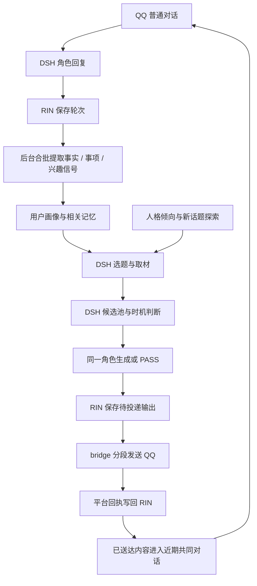

# 铃芽 RIN 继续优化方案

日期：2026-10-28。范围：主动搭话、人格卡自定义与对话示例、用户画像与记忆注入、QQ 图片与消息气泡、模型调用优化。

本文依据本机源码和本轮讨论整理。开发基线为核心 `bd295ea`（`0.1.0.dev9`）、DSH 插件 `51ffef9`（`0.2.8`）；RO04-A 本机交付版本为核心 `0.1.0.dev10`、DSH 插件 `0.2.9`、QQ bridge `1.0.6-neko.6`。第一人称记事、必要背景先于当前消息、图片能力声明与 RO04-A 已交付本机；相关性筛选、人格编辑器与模型联系计划待实施。交付状态只在 [roadmap.md](roadmap.md) 维护。

**推荐分工：DSH 插件负责发现素材、选择话题、判断时机和生成主动消息；RIN 提供人格、用户画像、相关记忆和依据校验，保存输出与投递结果，并处理后续对话的提取、反思和演化。** 复用现有 `rin-memory.service`、`dsh-web.service` 与 QQ bridge，无需新增常驻服务。

## 1. 目标与本批范围

用户应能感受到：角色记得自己的偏好，知道最近关心什么；会带来新的内容，也能探索双方从未聊过的兴趣；自定义的人格段落能按授权成长；这些能力不会让普通聊天每轮多出几次串行模型调用。

本批交付以下能力：

| 项目 | 交付结果 |
|---|---|
| 主动搭话 | DSH 插件持有候选与调度，支持已有兴趣分享、事项续接和零记忆的新话题探索 |
| 人格卡自定义 | 管理台可新增任意语义段落和对话示例，设置演化与冻结，完整经过修订、发布和下一轮采用 |
| 用户画像与注入 | 从有来源的事实、偏好与近期兴趣信号整理画像；会话启动只补必要认识，普通事实按当前话题召回 |
| QQ 表达 | 入站正文不混入图片 CQ 码，出站按语义换行形成独立消息气泡，支持插话与稳定分段回执 |
| 模型调用优化 | 普通提取合批，事实、事项与兴趣信号一次输出；空轮询不调用模型，阶段用量可查看 |

分群长期记忆暂缓；本批保留 `subject` 边界，为后续分群接入留出一致的作用域。自主选项目、执行长期兴趣任务和管理整台服务器属于后续工作。本批提供兴趣探索与分享入口。

现有人格卡经服务编辑与发布延续，不以重建人格卡作为实施步骤。开发、模拟与构建在本机进行，验收后提交固定版本并手动部署服务器。

## 2. 服务职责与完整链路

| 组件 | 负责 | 持有的数据 |
|---|---|---|
| RIN 核心与管理台 | 提取、画像、召回、状态、反思、人格修订、来源有效性、输出与回执 | 原始对话、事实与兴趣信号、画像投影、人格版本、共同经历、输出存档 |
| `dsh-rin-memory` | 取材、选题、候选维护、时机、生成、取消与恢复 | 素材缓存、待聊候选、已用素材、发送冷却、待处理投递 |
| `dsh-qq-bridge` | 校验 QQ 身份、提供绑定、收发消息、分段投递及平台回执 | 桥接绑定与已有投递账本 |
| N.E.K.O 现有实现 | 提供素材采集、规范化与两阶段筛选的参考代码 | 本批不要求启动 N.E.K.O 服务 |



RIN 提供“依据是否仍有效”的校验。开口时间、素材是否值得分享、是否换题等产品策略由插件统一决定。RIN 的画像、规则和记忆是权威数据；插件中的副本带版本和来源，仅用于缓存与恢复。

当前 QQ 主动交流依赖 RIN `/v1/proactive/poll/use/observe/complete/check/release`。改造后，QQ 切换到插件唯一调度入口，改用通用 context、outputs 和 receipts 合同。停止 QQ 对旧候选接口的消费，避免两个调度器重复触发；其他消费者仍可继续使用原接口。切换时按范围处理旧待发候选与输出，已产生的 `output_id` 延续投递或明确取消。

### 2.1 新会话与每轮分别注入什么

新会话需要恢复相处的连续性，注入量由实际需要决定，可以没有事实背景。人格卡、说话风格、对话示例作为已发布人格进入固定系统段；事实与经历留在动态背景。新一轮刚产生的事实通常已经在当前聊天历史中，后台照常提取保存，只有后续确需补充或历史压缩后才再次呈现。

当前 `working_summary._facts_section()` 按重要度和确认时间整理事实，没有当前问题参数。插件会把其中未见过的条目直接渲染为 `[重要事实]`，所以“主人给了我服务器”会在普通图片轮被带入。重要度用于排序，不能单独决定某条事实每次新会话都应该出现。

| 材料 | 新会话 | 后续轮次 |
|---|---|---|
| 已发布人格、表达规则、对话示例 | 固定系统段采用一份 | 同版本保持稳定，新发布在下一轮采用 |
| 最小相处认识 | 仅补人格里尚未包含、当前互动确需的称呼、关系与明确相处约定 | 有有效变更时更新；与人格内容去重 |
| 当前话题相关事实与经历 | 根据本轮原话召回，优先少量直接相关条目 | 新命中或发生更正时补入，已在历史中的内容不重贴 |
| 最近事项与跨端交流 | 仅补当前明确续接、尚未在本会话中出现的进展 | 话题相关、有新结果时补入；不全量复制最近对话 |
| 当前角色状态 | 采用仍有效且会影响当前互动的状态 | 使用时间与来源判断有效性，过期状态不作为此刻情绪 |
| 更正与提及限制 | 保留本范围内有效且会约束当前回复的内容 | 更正和撤回及时生效，不因普通事实限额被丢弃 |

实现时，RIN 保留完整画像和管理摘要，提供经过作用域、有效性与相关性选择的会话材料；插件负责去重、第一人称展示和位置。避免在插件再建一套独立的语义检索。画像、摘要与召回返回的相同条目按稳定引用合并，采用同轮固定快照。

普通事实建议初始最多选择 3 条；只有直接追问旧事时再扩大召回。条数是起始预算，相关性不足允许 0 条。图片轮缺少文字线索时采用最小背景，不为补足配额塞入高重要度事实，也不额外调用一个模型只为决定是否注入。服务器的事实应在讨论部署、资源或服务器相关事项时出现。

维持已实现的“固定人格与已提交历史 → 必要新增背景 → 当前主人原话与图片”顺序。第一人称投影只变换展示视角，来源与引号内原话保持原样，不补写没有依据的感受。

第一人称还需覆盖所有格与句中角色指代：“主人保存有助手的照片”应展示为“主人保存有我的照片”。当前所有格漏转已在本机补齐，引用内原话与明确第三方称谓保留。随着角色和跨端接入增加，使用事实中的主体/参与者绑定识别“主人、我、第三方”，复用已有来源与作用域；若需补参与者字段，随对应提取合同补齐。避免将全局字符串替换当成完整指代消解。

### 2.2 入站图片：正文清理与附件保留

此前 CQ 码残留发生在 QQ bridge 的 `router.ts`：正文取自 `evt.raw_message`，图片又独立从 `evt.message` 的图片段解析。RO04-A 已改为入站统一规范化，并在记忆准备之前完成附件准入；DSH 与 RIN 使用同一份正文和对应媒体状态。

在桥接入站边界做一次规范化，输出真实正文、媒体段引用与读取状态。结构化消息优先按段提取，图片 URL、文件标识、签名参数进入附件下载流程；生成提示与记忆正文只使用规范化结果。访问控制和命令前缀判断继续按既有语义执行。

- 图片成功准入后，DSH 消息包含用户文字和持久 `image` 内容块，正文不再重复图片 CQ 码、文件名与签名 URL。
- 单独一张图片保留图片内容块；需要给记忆索引一个媒体标记时使用简短的 `[图片]`，不把它抽取为用户偏好。文件名也不作为看懂图片的替代品。
- 下载或附件准入失败时，保留用户文字和明确的“本条图片未能读取”状态，按图片段对应位置说明；不把失败的 URL 冒充图片内容，也不删除成功的其他图片。
- 用户在普通文字段里主动输入的 CQ 代码示例保持原样。清理识别出的协议媒体段，不对整段用户文字做无条件正则删除。
- 只有原始 CQ 消息可用时，先解析协议段再进入同一规范化路径。供重试使用的地址保留在传输账本所需字段中，不作为用户发言写进 RIN。

规范化结果必须同时供给 DSH、`qqBridgeEvents.prepare/complete` 和记忆轮次提交，避免界面清理了、事实提取仍读取旧 CQ 正文。文件下载完成后还需覆盖附件准入失败状态；这一阶段只能调整媒体状态，不能再引入另一份用户原话。

## 3. 主动搭话：让角色有东西想告诉用户

### 3.1 两类开口机会

| 类型 | 依据 | 示例行为 |
|---|---|---|
| 延续相处 | 未完事项、明确约定、真实任务结果、近期交流、共同经历 | 适时询问结果，分享相关资料，接续上次未聊完的部分 |
| 带来新东西 | 真实获取的外部素材、人格已有兴趣、一次新的探索选择 | 分享一个细节、表达好奇、提出一个具体感想 |

零记忆允许进入第二类。已有兴趣提高相关性，不作为所有新话题的硬性前置。

例如用户从未聊过天文，角色仍可以从真实素材中注意到一个有趣现象并分享；这次选择记录为探索，不生成“用户喜欢天文”的事实。用户后续明确表达喜欢，或持续主动讨论，再更新对应认识。

人格卡明确写有某个兴趣时，可直接作为取材种子；角色首次选择一个新主题时，记录为本次好奇。持续兴趣的长期演化仍依据真实接触、后续选择与反馈，不按角色自述次数累积。

### 3.2 素材处理与 N.E.K.O 借鉴位置

| 本机参考 | 借鉴内容 |
|---|---|
| `F:\game\projectNEKO\N.E.K.O\main_logic\topic\pipeline.py`、`materials.py` | 主题与关键词、话题池、素材补充、使用历史 |
| `F:\game\projectNEKO\N.E.K.O\config\prompts\prompts_activity.py` 的 `TOPIC_CANDIDATE_PROMPTS` | 从近期交流选择具体、可聊的主题；稳定话题与探索话题采用不同入口 |
| `F:\game\projectNEKO\N.E.K.O\main_logic\proactive_chat\sources.py` | 来源结果规范化、并行采集和成功结果汇集 |
| `F:\game\projectNEKO\N.E.K.O\main_logic\proactive_chat\candidate_selection.py` | 跨来源候选筛选，避免单一来源挤满列表 |
| `F:\game\projectNEKO\N.E.K.O\utils\web_scraper\proactive_candidate.py` | 选中后补充详情，按实际取得的内容构造生成背景 |

参考代码中的平台请求与宿主配置需要整理成 DSH 可用的适配器；RIN 核心不导入 N.E.K.O 的 `app`、`main_logic`、全局配置或插件 SDK。先复用现有后台工作会话和可用来源，固定来源逐步落成专用适配器；需要新增账号或付费依赖时单独决定。

素材选取与现有主动消息使用同一条候选链路。少量列表、记忆续接、明确约定和真实任务结果统一进入插件候选池，共用一次时机裁决、生成和投递。素材采集器只提供候选，不独立调用发送器或启动第二套主动循环。

默认由程序先处理来源有效性、时效、重复和预算，再把少量候选交给当前角色模型。模型在同一轮选择最想聊的一项、决定表达或 PASS，并生成可见话术；选择结果需携带可解析的候选引用，插件保存该引用，选择元数据不发 QQ。需要程序决定时，可由排序器先选定一项，再让同一角色生成；两种选择方式共用后续链路。

采集顺序：少量列表 → 规范化与去重 → 补充必要简介/详情 → 合并候选 → 选择与生成。模型已经有足够内容判断和表达时，选择与话术生成合用一次调用；确实需要进一步读取正文时才由后台补充后继续，避免固定叠加一次选题模型。初期使用少量来源跑通闭环，随后再增加平台。

素材缓存至少包含 `material_id`、规范 URL、来源、标题、简介、发布时间、获取时间、阅读范围、主题标签和内容指纹。阅读范围区分标题、简介、正文、字幕；只读到标题时不生成“看完视频”的表述。外部文本始终作为有来源的材料，不能改变宿主指令或产生用户偏好证据。

### 3.3 插件候选与调度

插件保存的候选至少包含：

```text
candidate_id / character_id / subject / session_binding
kind: followup | interest_share | discovery | task_result
topic / reason / material_refs / memory_refs
profile_version / persona_version / context_basis
created_at / due_at / expires_at / status / output_id
```

`discovery` 可以没有历史兴趣引用，但必须有真实素材引用；单纯表达好奇可以引用人格版本与本次探索选择，不编造读过、做过或体验过的事情。长期兴趣成熟资格继续由 RIN 的成长链路处理，普通新鲜分享不再借用人格演化门槛，也不伪装成任务结果。

候选评分考虑新信息、可聊性、角色倾向、用户相关度、重复情况、时效与提及偏好。已知兴趣优先，同时保留探索机会；冷启动直接从人格倾向和素材本身选择。已发送的话题只在有新内容时形成新机会，不靠改写标题重复分享。

主动开口由模型决定下一次联系的时间、缘由和意图，事件可以让模型提前重新考虑安排。API 模型只在调用期间执行；调用结束后，插件保存它作出的安排，通过一次性计时器在指定时间再次调用。时间设施负责执行模型的计划，联系决策归模型。

| 机会从哪里来 | 何时成为候选 | 何时考虑开口 |
|---|---|---|
| 主人提到后续事件 | 原话形成事项，后续有明确时间或新进展 | 到达约定窗口或确有可跟进内容，避开正在进行的对话 |
| 后台任务或自选探索 | 确有完成结果、失败结果或值得说的新发现 | 结果就绪时进入同一队列，按消息性质决定即时反馈或等待 |
| 关注主题的新素材 | 获取到未分享、内容足够且仍有效的材料 | 与当前相处节奏相容时，由角色决定要不要聊 |
| 从未聊过的新主题 | 人格倾向或一次探索取得真实素材 | 允许零历史兴趣，选择具体有趣的细节，不预设主人喜欢 |

例如“晚上有面试”先留下待关心事项，模型可以安排明晚饭后问结果；在此之前主人已经聊过结果，就取消或改成别的意图。碰到新素材可以提前唤醒并重排。安静满 90 分钟、今天尚未发够次数，都不足以要求模型发言。

时机判断使用程序已知的信息：本会话是否在生成或发送、最后真实入站和最后主动消息时间、作息与安静时段、当前计划、等待回复的主题、明确勿扰要求与来源是否有效。近期活跃由本系统真实收发记录判断；平台没有提供的在线、已读与正在忙状态不做猜测。到模型安排的时间，或出现值得提前考虑的新事件时，由同一角色模型一次完成“现在是否联系 + 选题与正文 + 下一次安排”，也可以 PASS、延后或暂停。

模型可以选择具体联系时间，也可以给一个可接受窗口；插件在窗口内避开正在进行的收发。程序保留绑定、来源、静默与已有频率边界，不用随机时间替代模型的联系安排。详细调度合同见 §3.6。

已有频率参数先保持：普通主动消息每日最多 2 次、间隔至少 90 分钟；作息未知时使用当前用户时区 00:00—09:00 默认静默。有明确作息或勿扰设置时按其设置安排。普通未完事项的 12 小时作为没有明确联系安排时的初始参考；具体模型计划与用户约定按相应语义处理。每日 2 次是上限，不要求发满，也不为新兴趣再增加一套发送配额。

素材刷新建议每 1—3 小时或来源更新时进行。队列恢复检查只读状态；没有到期的模型安排、也没有需处理的新事件时，不调用联系模型。聊天过程中出现新发现时优先融入当前交流，插件撤销相同主题的独立待发候选。

### 3.4 生成、存档与恢复

生成使用当前已发布人格和固定上下文快照；动态画像与素材作为有来源的背景追加。主请求完全省略 `tools` 字段，取材和执行使用后台工作会话。生成输出允许 `[PASS]`，避免反复索取回应，也允许一条简短分享自然结束。

开始新主动轮次前复查绑定、当前对话状态、素材时效、禁提、相关事项状态与 RIN 依据版本。已经开始生成或发送的轮次完整结束后再处理新消息，主人插话不撤回回复；尚未开始的联系计划可结合新消息重排。来源被删除或授权失效继续按既有校验处理。

正文生成后使用 `/v1/outputs` 保存，取得稳定 `output_id`；bridge 发送成功的分段用 `/v1/outputs/deliver` 回报，只有这些分段进入共同对话。部分失败延续同一正文和段索引；重启恢复同一输出，不重新生成已发送部分。未发送且已经过期的内容可以取消，重新生成时使用新的输出标识。

一次主动机会可以生成几条有语义边界的短消息，使用同一批次和稳定分段索引顺序发送；日上限、间隔和同题冷却按本次主动机会计算，长文本分段不另占配额。实现时区分“超过长度自动拆分”和“模型有意分成几条”，统一由已有持久投递队列发送。

普通回复、主动搭话与咒语反馈已采用下一节的同一气泡规则。RO04-A 已把“只取最后一条 assistant 文本”改为按消息 ID 去重、按发生顺序保留完成的对外文字，隐藏咒语与工具协议；先前已发送的文字不再随最终结果重复发送。普通咒语前后的角色回复保持因果顺序，后台 worker 的过程不直接转发到 QQ。执行失败时，由角色依据真实失败结果继续回复。

用户回应按普通 `/v1/turns` 接入，提取时可引用已送达主动消息以消解“这个”“刚才那个”，支持证据仍指向用户实际发言。助手分享不能直接成为“用户喜欢”的证据。

插件重启需恢复候选、冷却与待投递状态，并通过 bridge 的已校验绑定和 DSH 原生会话恢复能力找回投递目标。没有有效绑定时等待真实入站建立身份，不根据昵称或会话前缀猜测身份。重启后无需新发言就恢复已有合法绑定，是本批需要验收的恢复能力；如现有 bridge 接口不足，在 bridge 补齐小范围恢复接口。

### 3.5 QQ 按语义换行发成独立气泡

用户希望短句可以连发。RO04-A 已由 `message-format.ts` 统一自然换行、结构块保护与 Unicode 长度拆分；平台长度默认仍为 4500 码点。短文本换行可以直接形成独立消息，代码、列表、表格和引用块保持整体；大量普通短行合并为至多 6 组，超长片段再按平台长度拆分。

建议人格卡的风格文字为：

> 默认自然中文，像熟悉的少女在 QQ 上日常聊天。短句轻快，有停顿和接话感。按完整意思自然换行，每行作为一条独立 QQ 消息；可以只说一句，也可以接连几句，不为凑条数拆句。需要解释时允许完整段落，代码、清单等内容保持结构。

用户的“想到什么先发什么”表达轻快口吻。首版采用完整可见回复形成后，再按语义分段依次投递，不把每个 token 或思考中的片段直接发出去。每次通常 1—4 个气泡属于风格引导，正文数量按实际内容决定。

- 普通聊天文本的自然换行作为气泡边界，忽略纯空行；长句仍经过平台长度拆分。代码围栏、列表、表格、引用块保持结构，不逐行刷屏；大量短行可合并相邻段落，保留完整正文。
- 模型一次生成多行，程序直接分段，不增加拆句模型调用。优先使用换行约定，主会话继续省略 `tools` 字段。
- 同一会话的气泡顺序发送，间隔初始约 0.8—2 秒，可按长度做轻量调整。普通回复、主动搭话、咒语后续都完整发完本轮内容，再处理队列里的新消息；主人插话不取消任何剩余气泡。主动轮次从生成到首次投递结束都占有会话输出时段，新输入先持久接收、再等待该时段结束，避免先回复新消息、后补旧主动消息的顺序倒置。
- 普通回复、主动消息和咒语后续统一通过同一分段与投递入口。可见 assistant 消息按消息 ID 和顺序处理；只有已经形成的可见正文可投递，推理、后台过程与协议块不进入 QQ。
- 每个气泡拥有稳定索引与独立平台回执，首次发送前持久化分段。中途失败和重启都不得把已发送气泡重发一遍；平台返回状态不明时延续现有 unknown 处理。

RIN 的 `/v1/outputs` 已支持 `part_sizes`。主动消息优先复用这一合同：在正文规范化后确定气泡边界，按 Unicode 码点计算长度，把分隔换行归属相邻片段并参与计数，所有长度之和等于保存的正文长度。bridge 使用 RIN 已固定的分段，不自行再次按另一种长度重拆。普通聊天的分段回执同样按最终分段索引记账，文字、计数和送达范围一致。

验收示例：模型输出三行普通聊天，QQ 得到三条消息；DSH 保留同一轮的完整可见回复，RIN 能追溯三个实际送达片段。第二条失败时重启只继续未发送片段；第一条后主人插话时，第二、第三条仍完整发出，然后才回应新消息，新一轮不会重复旧气泡。主动消息和咒语后续采用相同顺序。

### 3.6 模型决定下一次何时联系

这一部分把“下一条主动消息的时间与意图”交给角色决定。API 调用结束后，模型不会继续在后台执行；DSH 插件作为常驻进程保存安排、设置一次性唤醒，在到期或有新事件时再次调用。每次调用都可发送、继续等、换个时间或暂停，形成持续的自主联系闭环。

```text
普通交流 / 真实新事件 / 上次联系计划到期
  → 当前角色读取最新上下文与原有安排
  → 决定本次要不要说，并决定下次联系时间与意图
  → 插件保存计划，只安排最近一次唤醒
  → 到期重新读取近况，再由角色作决定
```

计划至少保存：

```text
plan_id / revision / character_id / subject / session_binding
mode: at | on_event | paused
next_contact_at / window_end / timezone
intent / reason / topic_refs / material_refs / memory_refs
created_at / expires_at / context_basis / status
```

`at` 选择具体联系时间或窗口；`on_event` 等待真实的新进展、新素材或主人消息，不为保持活跃而频繁调用；`paused` 等待新的授权或交流。意图池可以有多个想聊的事，每个会话只保留一个当前有效的下一次联系计划。模型可以安排几小时后或隔天，时间无需固定。

首次启用时，已有合法绑定但没有计划的会话只初始化一次联系安排；尚无绑定时等待真实主人入站。初始化可以只安排以后联系而不发消息，之后按持久计划恢复，不在每次后台检查时重复初始化。

**典型决策：**

| 场景 | 提供给模型的实际信息 | 模型可以作出的安排 |
|---|---|---|
| 发完消息很久没收到回复 | 最后入站/出站时间、已发内容、待回复主题、明确作息 | 本次暂不说，等晚饭后分享另一件事；或隔天再来，不反复追问同一句 |
| 已到用户常休息的时间 | 明确作息、勿扰设置，以及有来源的活跃时间观察 | 安排在次日通常方便交流的时间；未知作息使用默认静默 |
| 主人说“明天面试” | 原话时间锚点、事项进展、是否已说过结果 | 选择面试之后的合适时段询问；若结果已聊过，取消该意图 |
| 探索得到有意思的新素材 | 实际读到的内容、获取时间、人格倾向、当前交流状态 | 当场分享；或留下具体意图，安排在晚些时候再聊 |
| 主人中途回复 | 最新真实输入与旧计划依据 | 旧唤醒失效，先回应主人，再决定是否还需要主动联系 |

长时间无回复是模型判断时机的输入，不能直接写成“用户不喜欢”“关系变差”或“已经读过”。程序明确提供“尚未收到回复”，不推断平台没有给出的已读状态。观察到的活跃节奏可作为软依据，用户明确的作息与勿扰要求优先。

**保持现有第一人称表达：**普通说话内容沿用当前已发布人格和已经形成的 QQ 口吻，不为联系规划改写风格。主请求继续不声明工具。首版可复用已有中文标签解析方式，让角色在需要调整时附一个简短的隐藏联系安排，例如：

```text
<下次联系>明天20:30｜想问问面试怎么样了</下次联系>
```

这个标签是调度元信息：只落盘，不发 QQ，不回填“终端反馈”，也不启动一次新的角色回复。实现时要在通用咒语执行前单独识别并移除，避免触发当前“念咒语后停下等待反馈”的执行链路。发送正文仍保持原有口吻，联系安排不作为主人发言、用户事实或成长证据。

为便于确定性解析，首版时间写法限定为带用户时区的绝对时间、今天/明天加时分，或明确的“等新进展/暂停”；时间基准由本轮固定快照给出。计划中的自由文本只用于下次生成理解缘由，程序不把它当作可执行条件。不能解析的安排报告调度状态，不静默猜一个时间。

模型安排到期时重新生成最新正文，不提前把隔天要发的台词定死。程序先检查绑定、当前是否正在对话、明确静默、现有频率预算与来源有效性；允许进入时由同一角色调用一次完成“发送或 PASS + 下一次安排”。相同状态下没有更改计划时沿用原安排，无须每轮额外调用规划模型。

**恢复与成本：**计划先保存后设置计时器，重启加载最近有效计划；到期记录以计划 ID 和 revision 幂等领取，旧版本计时器失效。用户新入站在同会话中排队，已开始的生成与投递先完整结束；处理新消息后更新尚未启动的未来联系计划。多个新事件合并处理，同一个计划不会重复调用模型；离线错过的计划只重新评估一次，不补发一串过期问候。

这里重排的是角色自主联系计划。用户明确约定的提醒继续使用已有提醒任务，普通插话不自动取消约定；更改和撤销按实际用户要求处理。

普通回复可在原调用中附安排，不额外增加规划请求；主动唤醒本身使用一次角色调用，包含是否发与下一次时间的决定。素材采集和持久计划恢复仍使用程序，继续受既有并发、重试和调用预算约束。连续 PASS 时允许模型延长间隔或选择 `on_event`，避免短周期自唤醒。

## 4. 人格卡自定义：复用已具备的段落能力

当前后端 `CardSection`、修订接口、发布与演化已经支持自定义 `section_id`、`kind`、`scope`、`editable_by`、`frozen`。演化选段按权限与冻结状态筛选，没有固定五类名称白名单；发布文本也会渲染有效的自定义段落。当前主要限制在管理台 `live.js` 的新增下拉框。

### 4.1 管理台补齐任意段落

本批基础界面提供：预设或自定义段落、段落名、正文、允许演化、冻结和作用范围。基础版使用段落名生成稳定标识，创建后内部 ID 保持不变；同名冲突明确提示。现有段落可继续编辑和调整权限，保持当前修订 CAS、来源记录、发布、回滚及下一轮采用流程。

新增段落可以是“审美与创作”“看世界的方式”“自己的兴趣”“相处时的习惯”等。预设只帮助创建，不限制后端段落种类。用户画像内容通过背景层提供；人格卡保存角色自己的倾向与表达。

独立显示名称、排序和每段演化说明作为同一界面的后续增强，不作为基础自定义能力的前置。采用这些字段时必须同时补齐存储、管理接口、历史/回滚、发布展示与演化模型输入；演化说明单独传给演化器，不自动混进角色对外人设正文。

自动演化继续由现有 off/propose/auto 模式管理。用户选择哪些段落开放，模型依据合格经历提出局部变化；明确教导仍保持单次采用。界面开关需明确说明：关闭演化保留当前内容，冻结约束自动修改，人工保存仍使用现有规则。

### 4.2 对话示例放在人格卡

建议新增“对话示例”预设（`section_id: dialogue_examples`、`kind: examples`），与自定义段落使用同一编辑器和发布流程。它属于表达示范，进入固定人格正文，与当前用户输入和真实聊天历史分别呈现。

每个示例包含一个场景或用户表达，以及角色可能的简短回应。首版沿用段落文本即可，无需单独新增示例数据库。建议保持 3—5 个有差异的短场景，分别示范接梗、关心、分享或明确拒绝等说话方式；不堆放大量同义回复。下面这段用于表示内容格式：

```text
以下是表达示例，情境和台词是示范。
场景：主人分享了一张可爱的图片
主人：你看这个
我：等下
    这个小表情也太得意了
    像偷偷把零食藏起来之后被发现
```

示例段明确标记为表达示范，不能作为用户事实、共同经历或演化支持证据。它示范节奏与表达机制，生成时仍依据当前真实内容回应，不机械复读台词，也不让示例中的场景覆盖眼前图片。

用户精心选定的示例默认 `editable_by.user=true`、`editable_by.evolution=false`、`frozen=true`，用于固定期望的风格。用户可显式勾选允许演化并解除该示例段的冻结；开放后仍需来源与修订记录。明确要求“学这段说话方式”可以走单次教导链路；模型自行生成示例不能反过来增加自己的成长经历计数。

当前界面尚无独立“对话示例”入口。实施 RO01 前，如需立即使用，可在管理台“人格卡 → 编辑人格卡 → 语气（tone）”正文末尾加一个清晰标记的示例小节，再发布到下一轮；RO01 完成后可在同页新增独立段落，原有文字按人工编辑延续，不重建整张卡。

## 5. 用户画像：有来源、能更正的整理视图

### 5.1 内容与数据归属

| 画像部分 | 主要依据 | 更新方式 |
|---|---|---|
| 基本认识 | 用户明确陈述、管理台明确填写 | 事实新增与更正 |
| 相处偏好 | 明确教导、相处要求、表达反馈 | 明确规则与事实来源派生 |
| 稳定兴趣 | 用户明确喜好、有持续依据的兴趣 | 新证据支持、反证修正 |
| 近期关注 | 新的好奇、正在尝试、未完事项 | 兴趣信号、事项进展与热度变化 |
| 提及偏好 | 想接收什么、暂停什么、哪些话题不再提 | 既有提及限制与反馈链路 |

权威记录继续是原话、事实、教导规则、兴趣信号和状态；画像是可重建投影。复用 `working_summary.py` 的来源与作用域过滤方式，首版按结构化分类拼装，避免增加独立的画像生成模型调用。

画像按 `(character_id, subject)` 提供，保留条目所属对象。未来群聊需额外明确发言者与群主体，本批不把主人私聊画像扩散到群或其他用户。

### 5.2 兴趣信号与提取合同

原提取调用从 `facts + state_updates` 扩展为：

```json
{
  "facts": [],
  "state_updates": [],
  "interest_signals": [
    {
      "topic": "胶片摄影",
      "keywords": ["胶片", "摄影"],
      "signal": "curious",
      "evidence_refs": ["本批原话引用"]
    }
  ]
}
```

以上为新增合同示意。信号类型至少区分明确喜欢、近期好奇、明确不喜欢与暂停提及。角色和主体、对象、原始时间、事件键由服务根据引用绑定，模型不能自由指定另一个人的身份。

用户一次明确说喜欢即可用于选材；一次好奇保留为近期关注；短暂追问是话题热度线索，不能直接改写为长期喜好。角色推荐和用户沉默不增加喜好支持。近期关注可到期或随事项结束降权，明确长期偏好不会因近期少提就自动变成错误。

兴趣信号使用来源账本与删除屏障，按来源与主题去重；同一原话的镜像和摘要只算同一份支持。尚未形成事实的新好奇保存在轻量信号记录中，不硬写成稳定事实。反思和人格演化继续按现有证据要求进行。

### 5.3 管理台与接入端

管理台增加用户画像页面：按类别查看、查看来源、明确补充、更正、删除、暂停主动提及。修改写入相应的事实/偏好/限制记录，再重建画像；不直接改一段无来源的摘要。冲突返回当前版本并保留编辑草稿。

新增只读 `GET /v1/profile` 供插件低频获取结构化取材种子，沿用客户端身份和 subject 授权；为管理台补充受管理权限约束的编辑入口。管理台的编辑行为复用已有更正、遗忘和规则更新领域逻辑。

现有 `/v1/context` 增加 `user_profile`，包含版本、简短 block、当前相关条目与来源引用；DSH 和其他宿主按同一合同消费。画像依据的事实、兴趣信号和提及限制变更，需要纳入 context 的依据版本，保证同轮固定快照和删除后的失效校验。

插件按画像版本缓存搜索种子，每次发言前取得或校验当前上下文。冷启动空画像正常返回空条目，插件继续使用探索路径。`profile_version` 反映来源状态变化，不因普通读取更新时间而变化。

画像条目的引用同时纳入插件现有 references 与消费记录，接入清理通知。来源删除后清理对应的画像缓存、搜索种子、衍生候选与未送达输出，离线恢复时先处理清理再继续发送。忘记某条记忆与暂停某个话题分别处理：前者撤销基于旧来源的派生数据，后者还约束独立发现的同题分享。

## 6. 模型调用优化：减少次数，同时保留证据精度

### 6.1 当前调用基线

| 环节 | 当前代码行为 | 本批目标 |
|---|---|---|
| 普通提取 | 轮次异步进入 outbox，通常一个有效轮次一次调用；事实与事项共用调用 | 合批并补兴趣信号，避免另加画像/兴趣模型请求 |
| 反思 | 至少 5 条未吸收事实，单批最多 20 条；默认每维护轮最多一次；同批 no_change 停止重复评估 | 保留证据门槛与去重，补正常综合间隔和用量观测 |
| 演化 | 新合格证据、开放段落、后台冷却 30 分钟；默认每日 8 个演化 run 预算 | 保留当前触发与预算，将实际调用和重试单独统计 |
| 画像与工作摘要 | 工作摘要为程序投影；画像尚未实现 | 画像同样以程序投影提供，不新增生成式调用 |
| 主动队列轮询 | 当前插件轮询核心候选 | 改为插件状态检查，无新机会时不调用生成模型 |

维护检查默认约 60 秒一次，检查频率不等于模型调用频率。反思设置中的 `cooldown_minutes=30` 用于后续资格冷却，并非正常反思综合的固定间隔。演化每日 8 个 run 的预算按运行记录计数，重试与人工触发需另行统计，不能作为全系统每天最多 8 次模型请求的结论。

### 6.2 普通提取合批

初始建议：同一作用域积累 5 个普通轮次，或最后一次用户发言后空闲 2 分钟，满足其一即处理；达到现有输入预算则提前分批。后台轮询会带来约一个维护周期的时间精度。原始轮次立即持久保存，不等待提取完成。

合批键包含角色、主体、客户端、会话和场景，本批不跨会话或跨主体合并。明确教导、事实更正、遗忘与提及限制沿用即时路径。

合批时必须一起完成以下数据约束：

- 每条原话携带独立引用、原始时间和顺序；模型输出引用本批实际来源，服务校验引用存在。
- 每条事实、状态更新和兴趣信号仅绑定支持它的原话；用于指代消解的上下文另外保存，不把整批都算作证据。
- 相对时间按该条事实引用的原话时间解析，不统一套用批首、批尾或处理时间；多个冲突时间依据需拆分或跳过。
- 事项操作按原始事件顺序应用，“新建→进展→结案”在同批内保持顺序；迟到旧更新不能覆盖新终态。
- 批次标识由来源与输入内容稳定生成，完成记录与原 outbox 操作关联；重试、部分落盘和重启恢复不重复计证据。
- 模型返回空结果是正常完成；解析失败保留待处理来源并退避，不能把失败当成“无事实”。

修改 `process_outbox` 时同时适配解析器、逐条来源校验和 `_resolve_event_when` 的时间锚点，不能仅把多轮文本拼到一个 prompt 中。

### 6.3 反思、演化与取材预算

反思建议增加“正常综合最小间隔 30 分钟”，在有新证据且达到现有门槛时触发；重试退避与正常间隔分别记录。不同新证据批次在间隔内合并等待，来源更正、删除与明确教导不等待正常综合间隔。保留 no_change 的同批去重。

演化先保持现有默认冷却、运行预算和成熟规则；本批不通过降低成熟门槛增加人格变化次数。只有新增证据或开放段落等实际依据变化时才评估，普通查询画像和采集新素材不会直接触发改卡。

取材列表优先程序过滤和缓存，紧凑候选可直接进入角色生成，让模型同轮完成选题与表达；需要额外提炼时才增加后台筛选调用。程序排序选题与模型选题是同一链路中的选择策略。新鲜分享资格与长期兴趣成熟资格分开，角色每分享一次不会自动给自己增加一份成长证据。

使用现有模型配置中的 summary 档处理结构化提取和必要筛选，conversation 档负责角色可见表达；具体模型继续沿用已配置的提供方，不因本批引入新的模型服务。

### 6.4 用量观测

按模块记录模型请求次数、阶段、耗时、失败与重试、输入/输出 token（上游返回时）、处理来源数和产生条目数。无上游 token 数据时保留为空，按字符估算的指标另行标注。

管理台增加轻量用量视图，至少分开普通聊天、提取、反思、演化、主动筛选和主动生成。DSH 的调用由插件统计，RIN 的调用由核心统计，按模块展示，不把两个进程的读数混成同一个计数器。默认展示汇总，不记录原始思维链和凭据。

验收使用同一组回放，比较请求数和结果：连续 20 个普通轮次在满足合批条件时形成 4 批提取；插入等待、长文本或即时编辑时按相应规则提前处理，不把“必须恰好四次”写成所有场景的断言。

## 7. 接口与源码落点

| 合同 | 用途 | 本批改动 |
|---|---|---|
| `/v1/turns` | 普通用户与助手轮次 | 保留即时持久提交，后台合批提取 |
| `/v1/context`、`/v1/context/validate` | 人格、召回、规则和依据校验 | 增加画像层与版本；区分最小相处认识与本轮相关材料，普通事实允许 0 条，插件发言前复核 |
| `GET /v1/profile`（新增） | 完整结构化画像与取材种子 | 作用域授权、来源引用、稳定版本；管理编辑另走受限入口 |
| `/v1/persona/revise`、发布/冻结/回滚接口 | 自定义段落与演化控制 | 基础能力复用，界面放开任意段落，增加对话示例预设和权限选择 |
| `/v1/outputs` | 保存真实助手主动输出 | 插件提交正文、cause、来源引用、请求幂等键与作用域；用已有 `part_sizes` 固定语义气泡边界 |
| `/v1/outputs/deliver`、`/invalidate` | 平台接收结果、取消与来源失效 | 保持分段回执、幂等与已送达正文入近期 |
| `/v1/proactive/*` | 现有核心主动候选消费 | QQ 退出消费，其他接入方按既有合同使用 |

核心主要落点：

- `src/rin_memory/domain/extraction.py`：合批、联合提取合同、逐条来源与时间。
- `domain/working_summary.py` 及新增画像投影/兴趣信号模块：来源整理、版本、过滤与重建；完整管理摘要继续可读，当前轮注入材料按相关性选择。
- `domain/reflection.py`、`domain/maintenance.py`：正常综合间隔、合批调度和用量。
- `domain/persona_card.py`、`domain/evolution.py`：复用已有任意段落支持，按增强字段实际范围补齐。
- `service/protocol.py`、`service/management.py`、`service/server.py`：画像读取/管理、上下文字段与依据校验。
- `webui/designs/tidebell/live.js`、`index-watercolor.html`：任意自定义段落、对话示例预设、演化权限、用户画像与用量视图；沿用现有水彩样式。
- `domain/outputs.py`、`persistence/outputs.py`：复用分段和实际送达入近期的合同，与插件的 Unicode 长度、分隔符与稳定索引一致。

DSH 插件主要落点：

- `F:\game\projectNEKO\dsh-rin-memory\proactive.js`：事件候选、模型联系计划、一次性唤醒、选择与生成、投递与恢复；到期由模型重新决定发送、延后或暂停。
- 新增取材适配模块，例如 `discovery.js`：素材刷新、详情、去重和实际阅读范围。
- `memory-client.js`、`session-store.js`：画像获取、候选/缓存持久状态、通用 outputs 调用。
- `index.js`：精简的新会话材料与本轮相关记忆、第一人称背景渲染、输入抢占、当前人格与固定快照接线。
- `schema.js`、`config.js`：仅增加本批实际需要的刷新/调用参数，沿用已有主开关。
- `package.json` 的 `files`：将新增取材模块纳入 tgz 白名单，安装产物验收覆盖实际运行入口。

QQ bridge 位于 `E:\dsh\plugins\dsh-qq-bridge`：`router.ts` 规范化入站正文和媒体段，`onebot/images.ts` 与 `plugin.ts:buildDshUserContent()` 处理图片结果和附件准入；`handlers/agent.ts` 统一语义气泡分段、顺序、抢占与回执，`handlers/dsh-executor.ts` 处理实际可见 assistant 消息的顺序与去重。复用 `bridge-events.ts` 和 `delivery-store.ts`，为绑定恢复或通用投递缺口补小范围接口，不复制候选策略或画像存储。

## 8. 分批实施与验收

| 批次 | 交付 | 关键验收 |
|---|---|---|
| RO04-A QQ 收发表达（本机完成） | 入站 CQ 清理、图片保留、语义气泡、助手可见消息边界与分段回执 | DSH 与 RIN 正文没有协议污染；图片成功与失败状态正确；三行三条、本轮说完再接新消息、重启不重复；真实 SDK/API 验收通过 |
| RO01 人格卡自定义 | 编辑器新增任意段落、对话示例预设、权限、冻结和作用范围；发布渲染 | 自定义段落保存/重启/发布后存在；示例可采用且不进事实；开放段可进入演化；冻结、冲突与回滚继续生效 |
| RO02 调用合批与观测 | 普通提取合批、逐条证据与时间、反思正常间隔、分阶段请求统计 | 请求减少且事实/事项含义保持；跨作用域不合批；重试不重复支持；即时教导与遗忘不等待 |
| RO03 用户画像与注入 | 联合提取兴趣信号、可重建画像、管理台、context 接入与本轮材料选择 | 一次好奇与稳定喜好区分；手动更正/删除传播；空画像和 0 条相关事实可用；无关重要事实不进入图片轮；同轮版本固定 |
| RO04-B DSH 主动搭话 | 素材池、事件候选、模型决定下一次联系、一次性唤醒、零记忆探索、通用输出闭环 | 时间与意图由模型安排；久未回复与作息可改变安排；到期可 PASS/延后/暂停；标签不发 QQ；无重复调度 |

推荐顺序为 RO04-A → RO01 → RO02 → RO03 → RO04-B。RO04-A 先处理当前 QQ 体验，可独立于画像交付；RO01 同样可以独立实施。RO02 的联合提取结构需要为 RO03 预留兴趣信号及来源引用。RO04-B 消费 RO03 的画像，使用 RO04-A 的统一气泡投递。

每批围绕独立行为风险新增定向检查，优先复用现有测试文件和 fake model；不新增测试框架。自动验证重点：

1. RO04-A：协议媒体段与字面 CQ 文字区分、真实图片内容块、语义气泡与实际送达片段、插话和恢复。
2. RO01：自定义与示例段落全生命周期、演化权限/冻结、版本冲突与回滚、示例不进入事实。
3. RO02：合批调用次数与范围、逐条时间/证据、失败恢复与即时操作。
4. RO03：信号语义与支持来源、画像更正/删除重建、权限与 context 固定快照；新会话与图片轮材料相关性。
5. RO04-B：冷启动素材链路、模型计划的时间解析与时区、原安排因新输入失效、到期重新决策、部分投递与重启幂等。

联合模拟至少覆盖以下场景：

- 用户从未谈过某主题，插件取得真实素材并主动分享；画像没有被自动写成用户喜好。
- 用户说“最近想试胶片”，进入近期关注；明确说“我一直喜欢胶片摄影”，形成稳定偏好。
- 用户让某话题暂停，已排队候选撤销；无回复只影响冷却，不增加亲近或宣告事项完成。
- 跨日合批中两条相对时间分别按各自原话解析，“新建→结案”的事项不会被旧更新复活。
- 用户更正或删除画像来源，下一轮 context 与在途候选依据同时失效。
- 自定义段落在下一次生成采用；关闭自动演化与冻结不会清空当前内容。
- 自定义“对话示例”保存并发布后进入人格，示例中的虚构情境不会成为共同经历或成长证据。
- 新会话仅发“在吗”或一张普通图片时，不注入服务器事实；问到服务器部署时可召回这条事实。
- 图片成功时真实请求包含图片块，DSH 与 RIN 正文均无 CQ 下载码；图片失败仍保留原话和失败状态，字面的 CQ 代码示例不被误删。
- 普通聊天三行对应三个气泡；代码与清单保持结构；咒语前后可见回复按顺序发送，后台过程不会穿透。
- 两段 QQ 输出第一段成功、第二段失败，重启后只补第二段；只有已送达内容进入近期。
- 没有到期模型计划和新事件时，推进检查时钟或产生每日配额空缺不调用联系模型；模型已有安排到期时可以唤醒并决定发送或 PASS。
- 模型安排隔天联系后主人提前回复，旧定时器失效；安静时段、不同时间写法和跨日基准均按用户时区处理。
- 联系计划标签从 QQ 正文与事实提取中剥离，不触发终端反馈循环；重启只恢复最新 revision，离线错过多次时不连发补问候。

真实模型验收使用已授权、已配置的 DSH 模型凭据，通过真实 SDK 检查主请求不存在 `tools` 字段、人格与示例和素材来源正确、图片内容块保留、动态背景位于本轮输入之前、无关事实与 CQ 协议文本没有混入；密钥、签名 URL 和原始思维链不进入日志或仓库。QQ 发送先用模拟适配器验证气泡顺序、回执与抢占，再进行真实链路验收。

## 9. 发布与接手约定

RO04-A 已完成本机代码、定向检查与真实 SDK/API 模拟投递验收，服务器尚未同步；其余批次按本方案继续。每批先在本机完成代码、定向验证与构建，再通过 Git 记录源码，服务器安装对应固定提交的 wheel/tgz。推送不自动部署。

RO04 切换前核对：QQ 只有一个主动调度器、旧待发输出已有归属、绑定可恢复、主请求零工具、输出回执正常、画像空库与来源删除可处理。先模拟完整链路，再用日常反馈调整话题质量；初始发送频率保持现有值。

可复制的开发交接指令：

> 按 `docs/rin-next-optimization-plan.md` 实施，状态只维护 `docs/roadmap.md`。所有代码修改、模拟与构建在本机 `rin-memory`、`dsh-rin-memory` 及必要的 QQ bridge 源码完成；不重建人格卡。先完成 RO04-A（CQ 清理、图片保留与语义气泡），再进行 RO01（任意段落与对话示例）、RO02（提取合批与用量）、RO03（画像、兴趣信号与精简注入）、RO04-B（模型安排下次联系、一次性唤醒与事件重排的插件主动搭话）。取材、候选、计划、时机与生成由 DSH 插件负责，RIN 提供画像、人格、记忆、依据校验及输出/投递存档。允许零记忆探索，模型在联系时决定下一次时间与意图，到期读取最新情况再作决定，保持主请求完全省略 tools。每批验证来源、作用域、时间、删除和恢复后再交付；本机验收后按固定 Git 提交手动部署服务器。
