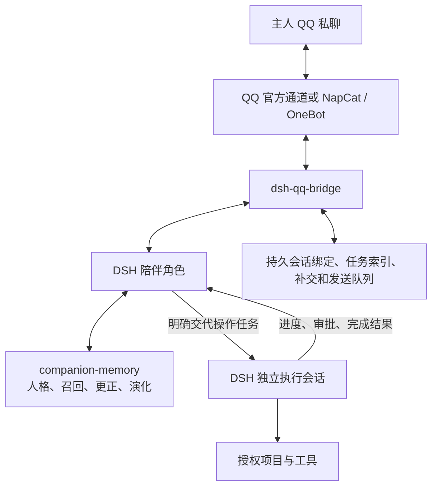

# 服务器 QQ 接入计划：DSH 陪伴角色、独立记忆与后台执行

2026-10-25 最新本机执行规格见 [dsh-companion-memory/PLAN.md §9](../../dsh-companion-memory/PLAN.md#qq-main-session-plan)：先精简 QQ 主会话、按追加历史优化前缀缓存，并落实统一任务入口所需的最小独立执行闭环。进度维护在 roadmap §2.5；本文继续定义完整任务调度与后续服务器交付。

更新：2026-10-25。本文替换原 AstrBot 接入方案，供开发 agent 直接实施。当前优先 Windows 本机开发与桌面版接入，完成后再部署 Linux。批次状态只在 [roadmap](roadmap.md) 维护。

当前执行入口为 [DSH 记忆插件计划 §9](../../dsh-companion-memory/PLAN.md#qq-main-session-plan)。用户已确定统一人格、记忆、保存、更正删除和恢复全部在该插件实现，与现有 QQ bridge 共存；本机已更新 rc.3。基础闭环沿用 DM01—DM06 已有修复与剩余验收，本批按 QP01—QP08 精简主会话、优化缓存，并接通最小独立执行；完整后台调度与 Linux 继续按后续工作包推进。专项状态见 roadmap §2.4/§2.5；下文 rc.1 是前期基线。

**1. 已确定的路线与交付目标**

采用 **QQ → 现成 QQ bridge → DSH 陪伴角色 → 按需委派独立执行会话**。companion-memory 为人格和长期记忆的唯一权威服务。先在 Windows 本机 `E:\dsh\desktop` 开发，目标 DSH `0.2.1-rc.3`；记忆插件独立目录为 `F:\game\projectNEKO\dsh-companion-memory`，bridge 开发副本为 `E:\dsh\plugins\dsh-qq-bridge`，本机流程完成后部署 Linux。模型通过远程 API 调用，首版只开放绑定主人的私聊文字交互。

日常对话也由 DSH 内的陪伴角色生成。它使用服务发布的人格与记忆；当前记忆专项保留 DSH 已配置工具与权限，后续可接可调用的视频/音乐工具。项目操作的独立执行角色和后台委派在 Q03 完成；届时长任务后台运行时，QQ 仍能继续聊天、查询、补充和取消。

现有记忆服务、WebUI、人格演化和已交付的文字接入成果作为底座直接复用。本计划独立于 N.E.K.O 宿主工作包，开发与验收不以语音、实时、游戏或旧入口退役为前置。



本批先交付 DSH 记忆插件、桌面版 bridge 适配与本机流程，再推进陪伴/执行角色分工和 Linux 部署。AstrBot 和独立 Python 任务调度服务从本计划的部署依赖及工作包中移除。

**2. QQ bridge 基座与版本选择**

基于 [TomoyoNatsume/dsh-qq-bridge](https://github.com/TomoyoNatsume/dsh-qq-bridge) 的本地副本做必要扩展。原包 `@yachangchang/dsh-qq-bridge@1.0.6` 的 0.1 系列 peer 及设置/preset 接口需要适配当前桌面版；本机适配包标记为 `1.0.6-neko.1`，使用 desktop profile。项目已有官方 QQ / OneBot 通道与回复转发，Linux 安装向导不作为本机桌面配置入口。[项目说明](https://github.com/TomoyoNatsume/dsh-qq-bridge/blob/main/README.md)

优先完成官方 QQ Bot 私聊通道；如果用户选择普通 QQ 好友账号，则使用 NapCat / OneBot。首轮固定并验收其中一条通道，另一条不作为首版交付条件。账号绑定、官方身份配对或 NapCat 扫码在部署时由用户完成。

Q01 必须锁定实际可用的 DSH 与 bridge commit/tag、Node/Python 版本及协议接口，验证建会话、回复转发、会话恢复、委派和必要审批。保持 bridge 的当前工作方式，仅对本计划涉及的边界补代码。现有 memo、角色文本等功能在接入后分别归属：通用人格与长期记忆统一走 companion-memory，任务备忘和运行状态仍可留在 bridge。

**3. 各部分职责与最小改动位置**

| 部分 | 复用内容 | 本批需要开发或配置 |
|---|---|---|
| companion-memory | 权威核心、HTTP 合同、管理台、发布、更正/删除、演化 | 必要的 QQ 消费/传输回执适配，Linux 启动配套 |
| QQ bridge | QQ 收发、身份校验、会话映射、控制指令与已有通知 | 稳定请求号、最终可见回复关联、持久发送和任务映射、接入状态 |
| DSH 记忆插件 | 标准插件生命周期、按 Agent 作用域扩展提示词 | 生成前固定上下文、整轮提交、补交、清理与范围隔离 |
| 陪伴角色 | DSH 模型调用、持久会话、已配置工具与后续委派 | 服务人格接入；工具权限沿用实际配置，Q03 再落实执行角色分工 |
| 执行角色 | DSH 原生执行、权限、会话和任务结果 | 固定授权项目与工具、进度/取消/继续关联 |
| 运行状态 | DSH 的会话日志、插件持久存储能力 | 补齐任务索引与 outbox，记录平台确认和未决状态 |

优先把记忆接入做成独立 DSH 插件，QQ 特有逻辑留在 bridge。任务索引、补交和发送队列复用选定版本的插件持久存储，不额外创建一个调度守护进程。只有现有存储无法满足已确定的原子更新或恢复需求时，才补最小存储实现。

**4. 日常聊天：生成、保存与采用**

1. bridge 收到消息，校验主人身份，以平台实例与消息 ID 去重，登记稳定的 request/turn 标识后再投给 DSH。
2. 记忆插件只处理标记为 QQ 陪伴角色的主会话，向服务获取本轮发布人格、必需更正、相关召回和近期对话，生成前完成上下文登记。
3. 本轮上下文绑定到 DSH turn。该轮内部的多次模型请求和工具步骤共享同一份人格快照；新发布的人格从下一轮使用。
4. 静态平台规则和工具协议保留在角色配置中，语义人格来自服务；记忆内容使用临时上下文，避免每轮重复累积。
5. Agent 结束后，按 bridge 实际准备发出的最终文字组装整轮提交。原始工具流、思考文本、内部完成通知分别记录，不作为用户发言上传。
6. 用稳定 ID 提交到 `/v1/turns`，先持久保存补交状态。bridge 发送文字后，保存成功分段、平台消息 ID 和待重试分段。
7. 服务按原管线提炼并演化。已提交生成记录 used，QQ 传输确认采用独立状态。

用户抢占、模型失败或取消时记录 interrupted/failed，生成、补交与发送状态分别保存。后台任务结果进入主会话时应保留其外部事件身份，与用户输入按主会话顺序处理，避免覆盖正在生成的用户回复。

接入使用 [现有客户端合同](webui-console.md#23-非宿主客户端合同) 的 context/reserve/validate/turns/requests/receipts/events/cleanup。普通陪伴轮次由 DSH 生成，核心继续负责记忆与人格。

DSH 支持按 Agent 作用域贡献提示词与动态上下文，记忆插件应通过标准扩展接入，只作用于指定 QQ 角色。[DSH 提示词扩展](https://github.com/deepseek-ai/deepseek-harness/blob/master/packages/core/system-prompt/README.md)

聊天先沿用 `deepseek-v4.1-flash`；执行角色与核心提炼/摘要模型独立配置。模型名、服务地址和凭据属于部署配置，角色演化只修改语义人格。

**5. 陪伴角色怎样委派执行**

用户说“帮我检查 demo 项目为什么启动失败，能修就修”时：

1. 陪伴角色提取目标、项目和授权范围，调用仅绑定允许执行角色的委派入口。
2. 先登记任务、来源消息和幂等键，再发起 DSH 子会话；拿到 child/session 标识立即关联落盘，QQ 返回任务号。
3. 委派立即返回，执行会话在后台运行。QQ 主会话继续响应用户，禁止等待整个执行过程结束才释放聊天入口。
4. 执行角色读取文件、操作项目并做必要检查。关键进度合并推送，原始终端输出留在执行记录。
5. 完成通知携带原任务号、执行结果和证据，由陪伴角色按当前发布人格整理后发回原 QQ 会话。
6. 用户查询、补充、取消或继续任务时，根据主人、QQ 会话、任务号和项目范围解析目标。

复用 DSH 原生后台委派、完成通知及可用的会话恢复能力。具体子会话控制接口以 Q01 锁定版本为准；需要保留继续/补充能力时，优先使用支持消息与恢复的本地受管子会话。[DSH 委派能力](https://github.com/deepseek-ai/deepseek-harness/blob/master/packages/subagent/tool-subagent/README.md)

执行角色只收到任务要求和必要项目记忆；陪伴角色保留个人相处上下文。Q03 按角色配置工具：陪伴侧提供任务提交/查询/取消/继续及已授权的日常查询或媒体工具，项目文件与命令操作放在执行侧。当前记忆专项不提前变更用户工具设置。

bridge 的新建会话、切换目录、模型和权限等控制操作统一经过角色绑定校验。重建后的 QQ 主会话仍使用陪伴配置，切换执行项目只调整对应任务的工作目录与授权，不能绕过工具集合和主人身份限制。

“查任务”“停止任务 T…”保留直接指令入口。一个任务匹配时可以自然指代；多个任务匹配时列出供选择。取消发出后等待执行器确认，任务状态展示已发生的改动，继续从原会话追加要求。

**6. 任务索引与持久恢复**

每个任务至少保存：任务号、主人身份、QQ 会话、来源消息与幂等键、项目与工作目录、目标、父/子会话标识、状态、结果引用、通知状态和时间。保存最少必要元数据，执行正文与工具日志优先引用 DSH 原始记录。

状态建议为 `queued → starting → running → succeeded / failed / cancelled`，审批时为 `waiting_approval`，执行状态失联时为 `interrupted`。

- 重复消息、模型重复调用和提交响应丢失，都返回原任务；涉及同一 QQ 消息的不同明确任务使用不同子任务键。
- 同一项目首版只运行一个写任务，其余排队。队列、容量和拒绝提示需要落到实现中。
- 任务受理只表示登记成功；执行器结束且结果记录完成后才通知成功。
- 上下文过期或删除/更正导致失效时重新取得依据，原已派发任务保持同一 ID；重新生成聊天回复不会再次启动任务。
- 任务登记先于执行，派发与记录标识之间的断点必须核对。重启先恢复映射并检查原 DSH 会话/日志，状态不明保留 interrupted。
- 完成事件、整理结果、QQ 发送各自幂等；通知重试只处理原结果。
- bridge 或 DSH 断线时保留有界入站队列、记忆补交和出站队列；超出容量明确提示，不能静默丢最旧消息。
- 多次完成通知归并成同一任务结果；查询与取消校验完整所有权。

**7. 记忆范围、历史清理与演化**

客户端采用独立 `client_id`、令牌和 plugin 绑定，按角色、主体、QQ 会话和来源范围访问。身份使用平台稳定标识并附带机器人实例命名空间，昵称只用于展示。首版仅主人私聊，新用户或群聊需要独立授权和主体边界。

用户偏好和相处经历按现有证据规则进入记忆及演化。项目知识沿用 plugin/run/applies_to 范围，项目号保存在任务索引；执行输出、代码样本与模型自述按工具来源记录，不增加通用人格的用户偏好支持。

后台完成通知按 `companion_output` 或有来源的外部事件处理，保存任务来源、人格版本和发送状态，不虚构用户发言。复用 H03 已有的分类与放弃语义；因 bridge 发送和主会话生命周期不同而需要的适配，在 Q04 验收。

删除/更正必须同时覆盖：临时记忆、待补交轮次、待发通知、DSH 中已经保留的相关历史及压缩摘要。

- 先处理服务下发的清理任务，再恢复补交和发送；已被删除/更正依据失效的正文停止重放。
- DSH 支持受影响内容的原生清理时使用它；否则退役受影响的聊天会话，清除可召回副本，从服务过滤后的近期对话建立新会话，并持久阻止恢复旧会话。
- 旧 DSH 日志、工具生成的副本与附件按本次删除范围处理；清理回执逐项列出完成/失败，失败继续保留待办。
- 单条事实删除保留合同允许保留的原始对话；按来源/整段经历删除才移除相应对话副本，沿用服务已有删除范围。

服务器实例是本 QQ 链路的记忆权威。以后 N.E.K.O 共用记忆时通过受控隧道或私网连接同一实例，保持单核心写入。

**8. QQ 送达与人格消费状态**

现有 used 只对应已提交生成，delivered 对应真实显示/播放。QQ 平台接收成功单独记录为传输确认，不能把接口成功当作用户已读。

优先复用 bridge 的发送封装并补持久 outbox，普通回复和后台通知共用它。长文本按分段记录 ID、字符范围和确认状态，只重试失败部分；回执丢失时先查询平台可用记录，无法核对的发送保留状态不明，避免自动循环刷屏。

如将传输确认汇入核心管理台，新增明确的 `platform_accepted` 等回执类型并补齐校验、持久恢复和界面文案；当前 HTTP 合同只接受 used/delivered/interrupted/failed，这属于本批待开发扩展。QQ 消费者单独显示，例如 `qq_chat`；读取上下文不计采用，执行子会话不冒用 QQ 用户对话的消费记录。

后台通知的生成、正文持久化、实际发送和放弃状态应分别落盘。只有计划发出的内容才进入发送流程，被过滤或取消的候选按 companion_output 放弃语义处理。

**9. Linux 部署结构**

本节是本机验收之后的部署目标；当前开发使用上述 Windows 目录与 desktop profile，账号由用户自行配置，不自动修改桌面 UI。

采用同机 systemd 服务：companion-memory、DSH Web runtime（加载 bridge 和记忆插件），选用 NapCat 时增加其运行组件。记忆服务继续绑定 `127.0.0.1:48931`，DSH 管理页绑定回环或受控私网，管理访问走 SSH 隧道或已有私网。

建议目录：

```text
/opt/qq-companion/                 # 固定版本核心、DSH 与插件
/etc/qq-companion/                 # 配置和权限受控的凭据
/srv/qq-companion/memory/          # 核心持久数据
/srv/qq-companion/state/           # 核心本机状态
/srv/qq-companion/dsh-home/        # DSH profile、会话、插件持久状态
/srv/qq-companion/bridge-state/    # 桥接补交/发送/任务索引需要的状态
/srv/qq-companion/napcat/          # 个人号通道选用时的账号状态
/srv/qq-companion/workspaces/      # 授权项目
/srv/qq-companion/tmp/             # 临时文件
```

记忆服务使用独立系统用户。DSH 使用受限账户，执行角色的工具与路径权限明确配置；记忆客户端令牌只由宿主插件持有，不放入提示词、执行会话材料或模型可调用命令的环境。敏感配置和核心数据目录纳入工具访问限制，必要的进程隔离按执行工具实际能力落实。

权限检查在工具边界执行。主人可授权的目录、工具和服务操作由配置表达；遇到审批按选定版本的已有能力复用，将具体操作、任务号、主人身份和有效期关联后再执行。补充文本不会自动扩大既有权限。

当前记忆服务限定回环监听并检查 Host/Origin，同机部署沿用该约束。容器化如需独立网络，先实现相应监听与访问策略；首版交付 systemd 路线。

**10. 启停、配置与故障行为**

- 使用新 Linux 运行根与 `host.enabled=false` 的核心配置，保持现有 Windows 实例。角色先通过管理台创建/导入并发布，历史整库迁移单独安排。
- 核心从 wheel 安装，DSH 与插件锁定版本。systemd 管理前台进程，处理 SIGTERM、退出、根锁释放与就绪检查。
- 记忆服务就绪后启动 DSH 与 QQ 通道。记忆必需上下文不可用时保留消息并提示连接异常；可选召回按核心现有规则降级。
- 执行角色或工具不可用时，陪伴聊天继续，任务入口返回具体失败；DSH 整体停止时 QQ 消息保留到重连后处理。
- 关闭时停止接收新任务，持久保存队列与映射，再有序中断执行和退出。启动先核对任务、处理清理，再补交或发送。
- 备份与恢复覆盖核心一致性快照、DSH home、会话映射、任务索引、outbox、QQ 账号状态和项目目录。
- 语音回复、麦克风、屏幕观察与主动消息来源可按需要开关；任务进度和完成通知保留。日志与配置样例不包含凭据值。

**11. 工作包、代码落点与实施顺序**

当前先按 DM01—DM06 完成 Q02 及 Q04 的聊天保存、恢复和历史清理；后台任务部分再按 Q03、Q04 推进，随后交付 Q05 与整体 Q06。状态统一回填 roadmap，本表只定义交付。

| 工作包 | 主要改动 | 完成条件 |
|---|---|---|
| Q01 基座与版本验证 | Windows 桌面版接口适配；锁定 DSH/bridge；验证 QQ 通道、主/子会话、恢复与发送 | 本机 desktop profile 正确加载，形成可复现版本清单，确认真实 QQ 接入所需账号条件 |
| Q02 DSH 记忆插件 | 身份/来源映射，固定上下文与 reserve，最终对话提交，生成版本与补交状态 | 中文多轮可召回；发布下一轮生效、在途版本不变；工具步骤不重复注入或入库 |
| Q03 陪伴与执行分工 | 主/执行角色工具配置、原生后台委派、持久任务索引、查/停/补充/继续 | 实际任务在授权项目执行；运行时 QQ 继续聊天；结果回到原会话，控制操作校验所有者 |
| Q04 可靠性与清理回执 | 入站幂等、任务调度断点核对、补交/通知 outbox、QQ 确认、历史及缓存清理 | 重复/重启不重复调度，通知重试不重做操作，删除后原会话与补交不能带回内容 |
| Q05 Linux 交付配套 | 核心 wheel、固定插件包、配置样例、systemd、权限和健康状态、恢复操作 | 新根可安装启停；缺项可定位；正常退出释放资源，恢复后任务与队列可核对 |
| Q06 真实端到端验收 | 用选定 QQ 通道与真实模型完成下方场景，修正暴露的问题 | 形成可日常使用的 QQ 聊天→记忆→任务→通知→重启链路，并更新唯一台账 |

建议代码落点：

- 本仓库仅放必要的核心回执与 Linux 启动改动，继续保持宿主无关。
- 工作区根 `F:\game\projectNEKO\dsh-companion-memory\` 放独立记忆插件及其隔离测试，配置样例与角色 preset 同包维护。
- QQ 特有补强放选定 bridge 的独立开发副本；实施前确认实际路径和 Git 来源，保留上游归属，不覆盖其他已有插件。
- 部署脚本靠近实际部署项目维护。执行工具、QQ SDK 和 DSH 依赖留在插件/桥接侧。

接手先读工作区与目标仓库 AGENTS，再读现行 HTTP 合同和相关测试。每批只补独立风险的行为测试，遵循默认最多 3 个新增测试的约定，运行定向检查；真实 QQ 和 DSH 执行另做受控验收。

**12. 最终验收与交接指令**

1. 默认 QQ 私聊使用服务人格与记忆；普通闲聊不会创建执行任务或调用文件/Shell 工具。
2. 主人交代项目任务，获得任务号，执行会话完成真实文件操作和必要检查，QQ 收到基于执行证据的结果。
3. 后台运行时继续聊天、查进度、补充、取消和继续；同时两个项目不会混用任务和结果。
4. 发布、冻结、更正和自动演化遵循现有规则；每轮可追踪实际采用版本，任务日志不推动通用人格改变。
5. QQ 重投、工具重试、记忆提交响应丢失、bridge/DSH 重启：幂等生效，未知执行状态可核对，重发结果不会重新执行任务。
6. QQ 分段发送失败或限流：成功部分保留确认，失败部分可重试，任务结果可查询；界面区分平台接收与用户已读。
7. 删除/更正后，旧 DSH 历史、压缩摘要、缓存、补交和待发通知按范围处理；重启或尝试恢复旧会话后内容不复活。
8. 未绑定身份、跨用户任务、未授权目录与越权工具在边界拒绝；审批只授权指定主人确认的具体操作。
9. Linux 新根按固定版本安装成功，可有序启停与恢复。

可转交任务：

> 先按 F:\game\projectNEKO\dsh-companion-memory\PLAN.md 的 DM01—DM06 实施本机记忆专项，目标为用户升级后的 Windows DSH 0.2.1-rc.3，与 E:\dsh\plugins\dsh-qq-bridge 共存。复用当前记忆服务、管理台和客户端合同，完成统一人格、召回、保存、更正删除、历史清理和恢复。之后再推进本文 Q03/Q04 后台任务、Q05 Linux 与整体 Q06。账号和桌面操作由用户完成；记忆数据可清空重来，人格卡不重建；状态只回填 roadmap。
